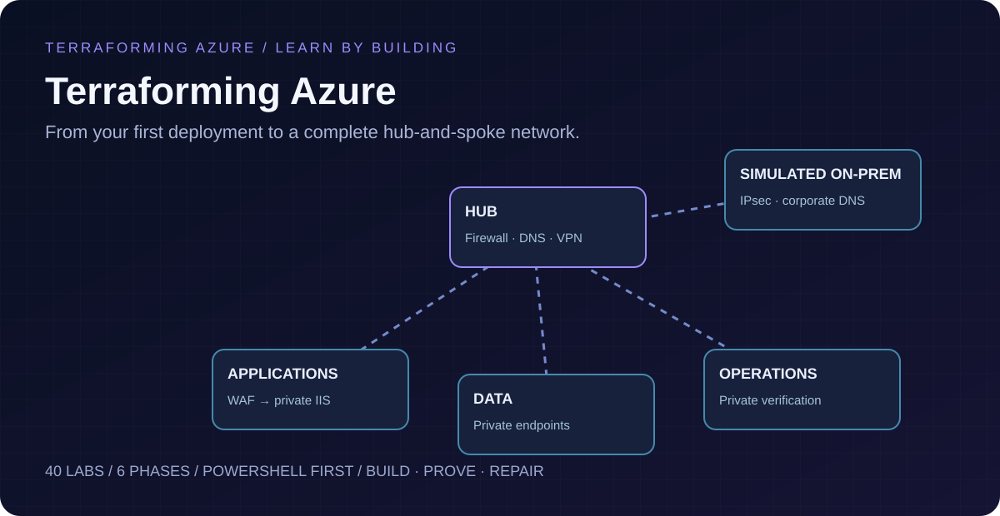

# Terraforming Azure

[](https://github.com/Jamonygr/Terraforming-Azure/actions/workflows/quality.yml)
[](https://github.com/Jamonygr/Terraforming-Azure/blob/main/LICENSE)



**From your first deployment to a complete hub-and-spoke network.**

An original Windows-first course: **40 labs, six learning phases, 200 explained
questions**, and a final staged Azure architecture. Learn Terraform and Azure
together, then prove that your network, DNS, security, application, and hybrid
paths behave as designed.

**[Open the learning website](https://jamonygr.github.io/Terraforming-Azure/)** ·
[Start TFA-001](labs/TFA-001/README.md) · [Final architecture](docs/architecture.md) ·
[Cost and cleanup](docs/cost-and-cleanup.md) · [Validation status](docs/validation.md)

## Start here

```powershell
git clone https://github.com/Jamonygr/Terraforming-Azure.git
Set-Location Terraforming-Azure
code .
./scripts/Test-AzureReadiness.ps1 -LocalOnly
```

Open **TFA-001**, then complete the workstation checks in **TFA-002**. Early
labs use readable resources directly; modules come after you understand those
resources. Most labs are independently disposable. The final lab keeps one
remote state and advances through **foundation → secure → applications → hybrid**.

Before a cloud lab, verify your subscription explicitly:

```powershell
az login
az account list --output table
az account set --subscription '<your-subscription-id>'
$env:TF_VAR_subscription_id = az account show --query id --output tsv
./scripts/Test-AzureReadiness.ps1 -SubscriptionId $env:TF_VAR_subscription_id
```

Follow the selected lesson's commands, review a saved plan before applying, and
destroy when finished. Terraform state, plans, passwords and certificate files
belong outside Git. Budget notifications do not stop Azure spending.

## The learning journey

| Phase | Labs | Graduation checkpoint |
|---|---|---|
| 1 · Foundations | 001–006 | Explain a plan and make a deliberate change. |
| 2 · Azure networks | 007–013 | Trace a packet and find its enforcement points. |
| 3 · Terraform engineering | 014–021 | Reuse tested modules and keep state ownership clear. |
| 4 · Private platforms | 022–028 | Prove secure application and private service paths. |
| 5 · Hybrid operations | 029–034 | Restore a broken hybrid service using evidence. |
| 6 · Delivery and capstone | 035–040 | Review, deploy, investigate, recover and destroy. |

## Curriculum

<!-- curriculum:start -->
| Lab | Lesson | Phase | Cost tier | Run mode |
|---|---|---|---|---|
| [TFA-001](labs/TFA-001/README.md) | Azure, infrastructure as code, and Terraform | 1 | None | local |
| [TFA-002](labs/TFA-002/README.md) | Prepare your workstation and subscription | 1 | None | read-only |
| [TFA-003](labs/TFA-003/README.md) | Your first Azure deployment | 1 | Low | azure |
| [TFA-004](labs/TFA-004/README.md) | Variables, types, and validation | 1 | None | local |
| [TFA-005](labs/TFA-005/README.md) | References, locals, data sources, and outputs | 1 | Low | azure |
| [TFA-006](labs/TFA-006/README.md) | Collections and resource identity | 1 | Low | azure |
| [TFA-007](labs/TFA-007/README.md) | IP addressing, CIDR, VNets, and subnets | 2 | Low | azure |
| [TFA-008](labs/TFA-008/README.md) | NSGs and application security groups | 2 | Low | azure |
| [TFA-009](labs/TFA-009/README.md) | Explicit outbound connectivity | 2 | Moderate | azure |
| [TFA-010](labs/TFA-010/README.md) | Private Windows VM and IIS | 2 | Moderate | azure |
| [TFA-011](labs/TFA-011/README.md) | Private administration with Bastion | 2 | High | azure |
| [TFA-012](labs/TFA-012/README.md) | VNet peering and its limits | 2 | Low | azure |
| [TFA-013](labs/TFA-013/README.md) | Routes, next hops, and Network Watcher | 2 | Low | azure |
| [TFA-014](labs/TFA-014/README.md) | State, addressing, and locking | 3 | None | local |
| [TFA-015](labs/TFA-015/README.md) | Drift, import, and refactoring | 3 | Low | azure |
| [TFA-016](labs/TFA-016/README.md) | Azure remote-state bootstrap | 3 | Low | azure |
| [TFA-017](labs/TFA-017/README.md) | Your first reusable module | 3 | Low | azure |
| [TFA-018](labs/TFA-018/README.md) | Module contracts and safe changes | 3 | Low | azure |
| [TFA-019](labs/TFA-019/README.md) | Environment and state separation | 3 | None | local |
| [TFA-020](labs/TFA-020/README.md) | Compose a network from structured inputs | 3 | Low | azure |
| [TFA-021](labs/TFA-021/README.md) | Test Terraform behavior | 3 | None | mock |
| [TFA-022](labs/TFA-022/README.md) | Azure DNS and private DNS | 4 | Low | azure |
| [TFA-023](labs/TFA-023/README.md) | Storage private endpoints | 4 | Moderate | azure |
| [TFA-024](labs/TFA-024/README.md) | Managed identity and Key Vault | 4 | Moderate | azure |
| [TFA-025](labs/TFA-025/README.md) | Azure Firewall and Firewall Policy | 4 | High | azure |
| [TFA-026](labs/TFA-026/README.md) | Inspected hub-and-spoke routing | 4 | High | azure |
| [TFA-027](labs/TFA-027/README.md) | Application Gateway WAF and private IIS | 4 | High | azure |
| [TFA-028](labs/TFA-028/README.md) | Monitoring and diagnostic evidence | 4 | Moderate | azure |
| [TFA-029](labs/TFA-029/README.md) | VPN and hybrid routing foundations | 5 | None | local |
| [TFA-030](labs/TFA-030/README.md) | Simulated on-premises connectivity | 5 | High | azure |
| [TFA-031](labs/TFA-031/README.md) | Hybrid DNS with Private Resolver | 5 | High | azure |
| [TFA-032](labs/TFA-032/README.md) | RBAC, policy, budgets, and locks | 5 | Low | azure |
| [TFA-033](labs/TFA-033/README.md) | Provider aliases and subscription boundaries | 5 | Low | azure |
| [TFA-034](labs/TFA-034/README.md) | Network incident investigation | 5 | Moderate | azure |
| [TFA-035](labs/TFA-035/README.md) | Git collaboration and pull-request checks | 6 | None | local |
| [TFA-036](labs/TFA-036/README.md) | GitHub Actions authentication with OIDC | 6 | Low | azure |
| [TFA-037](labs/TFA-037/README.md) | Reviewed plan, apply, and destroy workflows | 6 | None | local |
| [TFA-038](labs/TFA-038/README.md) | Recovery and controlled upgrades | 6 | None | local |
| [TFA-039](labs/TFA-039/README.md) | Capstone architecture workshop | 6 | None | local |
| [TFA-040](labs/TFA-040/README.md) | Build Terraforming Azure | 6 | High | azure |
<!-- curriculum:end -->

## Build, prove, repair

Each lesson includes a scenario, teaching diagram, code walkthrough, prediction,
PowerShell commands, expected results, a controlled failure, cleanup verification,
production differences and five quiz questions. Target learning time is 60–80
hours including exercises; deployment waiting time varies by Azure service.

The final environment has one classic hub, application/data/operations spokes,
Firewall Standard, Bastion, private DNS, private endpoints, private Windows/IIS,
Application Gateway WAF_v2, monitoring, and VPN-connected simulated on-premises.
The Azure-hosted remote site models hybrid connectivity; it does not validate a
physical VPN appliance or real WAN conditions.

## Check the course locally

```powershell
./scripts/Test-Course.ps1
py -3.12 -m pip install -r requirements-site.txt
py -3.12 tools/build_site.py
py -3.12 -m mkdocs build --strict
```

The quality workflow runs without Azure credentials. Live Azure workflows are
explicitly invoked and use OIDC. The website stores progress locally and never
runs Terraform. See [contributing](CONTRIBUTING.md), [troubleshooting](docs/troubleshooting.md),
[delivery](docs/delivery.md), and [backend setup](bootstrap/README.md).

Website tooling requires Python 3.12+. Terraform checks default to serial provider
initialization to avoid cold-cache races; use `-Jobs 2` only with a prewarmed
provider cache. `Test-Course.ps1 -Python <python-path>` selects a specific runtime.

## License and authorship

Original course content, code, assessments, and SVG illustrations by Chris
Panagiotidis, under the MIT license. Inspired by the teaching format of
[Azure From Zero To Hero](https://github.com/Jamonygr/Azure-From-Zero-To-Hero).
