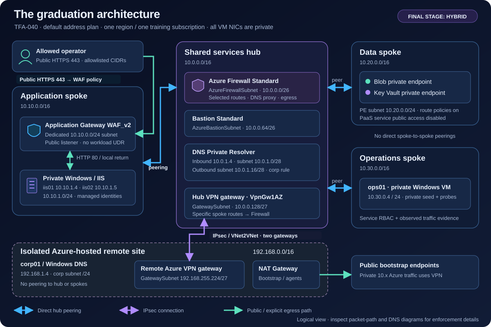
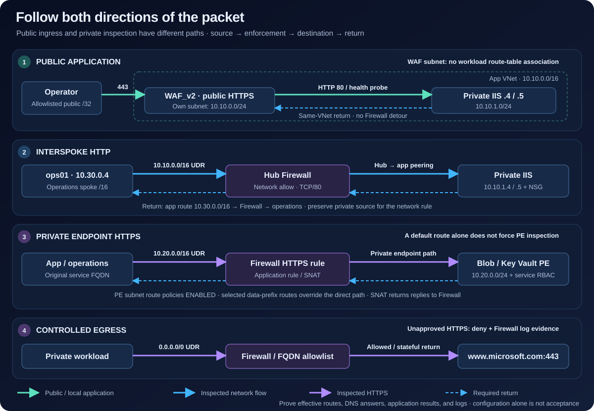
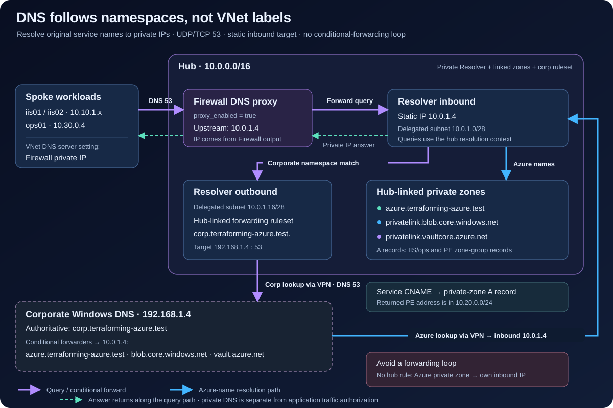
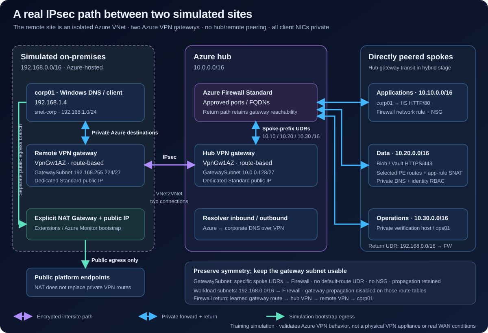

# The final architecture

TFA-040 integrates one classic regional hub, three peered spokes and an isolated
Azure-hosted simulated on-premises network. This is a training reference, not a
complete enterprise landing zone. The full hybrid stage is the graduation target.

## Network inventory

| Network | Prefix | Contents |
|---|---|---|
| Hub | `10.0.0.0/16` | Firewall Standard, Bastion Standard, VPN, DNS Private Resolver |
| Applications | `10.10.0.0/16` | Dedicated Application Gateway WAF_v2 subnet and private IIS VMs |
| Data | `10.20.0.0/16` | Storage and Key Vault private endpoints |
| Operations | `10.30.0.0/16` | Private verification/administration Windows VM |
| Simulated on-premises | `192.168.0.0/16` | Windows DNS/client, second VPN gateway, explicit outbound NAT |

The last network is not peered to Azure. Its private Azure traffic crosses the
IPsec connection. Its small NAT Gateway exists for simulation bootstrap/agent
downloads, not as a substitute for hybrid routes. All VM NICs remain private.

## Traffic contract

For every successful test, record the source, destination, protocol, expected
forward and return routes, enforcement point, command, and observed result.

| Source → destination | Protocol / name | Forward and return path | Expected enforcement |
|---|---|---|---|
| Allowed operator → application | HTTPS / `app.terraforming-azure.test` | Public WAF → private IIS; IIS returns within the same app VNet | Operator allowlist, WAF; normal page 200, test rule 403 |
| Bastion → Windows | RDP / private IP | Hub to directly peered spoke and back | Bastion plus workload NSG; no public RDP |
| App → approved internet host | HTTPS / allowed FQDN | UDR → Firewall → internet; stateful return | Firewall application allow rule |
| App → unapproved internet host | HTTPS | Same next hop, denied before destination | Firewall deny evidence |
| Operations → application | HTTP / private IIS IP | Explicit app-prefix route → Firewall → app; reciprocal route back | Firewall network rule plus destination NSG |
| App/operations → Blob or Key Vault | HTTPS / original service FQDN | Specific data-prefix UDR → Firewall → private endpoint | PE route policies, Firewall HTTPS application rule/SNAT, service RBAC |
| Simulated on-premises → Azure | Approved application/service ports | VPN → hub gateway spoke-prefix UDR → Firewall → spoke; reverse Firewall → gateway | Firewall, NSG, service authorization |
| Azure → corporate DNS | DNS / `corp.terraforming-azure.test` | Proxy → resolver outbound → VPN → Windows DNS; reverse tunnel | DNS forwarding rules and permitted DNS flow |
| On-premises → Azure private names | DNS / Azure service namespaces | Corporate conditional forwarder → VPN → resolver inbound | Correct authoritative zones; private addresses returned |

## Routing decisions

Peering is not transitive. Workload subnets use explicit destination prefixes
for other spokes and simulated on-premises, plus a default route to Firewall.
Disable gateway propagation on those workload route tables. GatewaySubnet uses
specific spoke routes toward Firewall; it has neither a default-route UDR nor an
NSG. Preserve gateway routes on the Firewall path.

Application Gateway has its own subnet treatment. The ordinary workload default
route is not attached there. WAF handles public HTTP/S inspection; Firewall
handles the specified egress, interspoke, private endpoint, and hybrid flows.
This distinction prevents asymmetric ingress returns. See [Microsoft's v2
routing constraints](https://learn.microsoft.com/en-us/azure/application-gateway/configuration-infrastructure).

Private endpoint traffic is an explicit checkpoint: enable PE route policies,
use destination-specific routes, and use HTTPS application rules for SNAT/return
symmetry. A default route alone does not override a more-specific private path.
See [Microsoft's inspection scenarios](https://learn.microsoft.com/en-us/azure/private-link/inspect-traffic-with-azure-firewall).

## DNS path

Spokes use Firewall DNS proxy. Firewall forwards to the static resolver inbound
IP. Azure private zones are linked to the resolver's hub. The hybrid stage adds
an outbound endpoint and a hub-linked ruleset for the corporate namespace.
Corporate Windows DNS conditionally forwards the Azure lab zone and original
service namespaces (`blob.core.windows.net`, `vault.azure.net`) to the inbound IP.
Do not create a hub-linked rule that forwards an Azure private zone back to its
own inbound endpoint; that makes a loop. See [Private Resolver rules](https://learn.microsoft.com/en-us/azure/dns/private-resolver-endpoints-rulesets).

## Stages and ownership

`foundation` creates network layout, zones and shared observability. `secure`
adds Firewall, Bastion and resolver inbound before Windows guests exist.
`applications` adds private guests, WAF, identity and private services. `hybrid`
adds VPN gateways, the corporate guest and resolver outbound forwarding.

One root owns the capstone under `capstone.terraform.tfstate`; stage inputs
expand it cumulatively. Keep module keys stable. Use whole-root plans and resume
a failed apply by reviewing a fresh plan against the same configuration/state.
The separate bootstrap root owns its own backend and is destroyed last.

## Deliberate limits

One region, one subscription, synthetic data, a self-signed training certificate,
and an Azure-hosted remote site. Real WAN failure modes, multi-region DR,
ExpressRoute, Virtual WAN, AD forests, Kubernetes, TLS interception and production
certificate lifecycle are outside this first release. See TFA-039 for the
readiness gate and TFA-040 for exact deployed names and verification commands.
