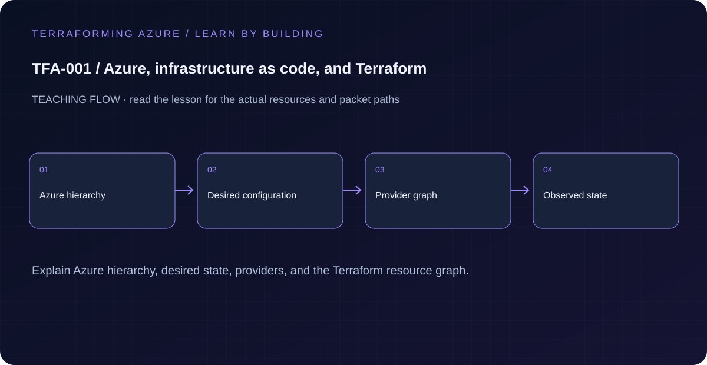

# TFA-001 — Azure, infrastructure as code, and Terraform

<!-- lab-metadata:start -->
**Phase 1:** Foundations

**Learning target:** 75 minutes · **Cost tier:** None · **Run mode:** `local`

**Prerequisites:** None — start here.
<!-- lab-metadata:end -->

<!-- lab-diagram:start -->

<!-- lab-diagram:end -->

## Goal

Explain what Azure manages, what Terraform records, and how a reviewable desired state differs from a sequence of portal clicks.

## Prerequisites

No tools or Azure credentials are needed to read this introduction and make the predictions below. The executable preview requires the workstation setup in [TFA-002](../TFA-002/README.md#install-the-windows-workstation). If Terraform is not installed yet, read through this lesson, complete that setup section, then return to run the preview. You do not need an Azure subscription for this preview.

## Predict the mechanism

Configuration expresses desired state; a provider translates its graph into API operations. State records object bindings and is not a second source of desired configuration. A tenant contains identities, while a subscription owns resource billing and access boundaries.

Before running commands, write the expected result: **The plan changes the recorded input; no Azure resource is created.** Then explain what would change in this controlled failure: Change an input and explain an update versus deleting state. Record your prediction before inspecting the outcome.

## Understand the design

A tenant is the identity boundary; a subscription connects access, billing, policy, and quotas. A resource group groups related resource lifecycles. A region is a deployment location, not an identity boundary. These concepts answer different questions and should not be treated as interchangeable folders.

Terraform compares configuration, recorded state, and provider observations to propose a change. This first configuration uses the built-in terraform_data resource to store a harmless local model. There is no AzureRM provider, cloud API, or cloud resource. You can learn plan review and repeatability before obtaining an Azure subscription.

## Architecture and resources

PowerShell → Terraform built-in provider → local terraform.tfstate. The output is a model of an Azure resource group, not a real resource group.

See the catalog cost tier above and the [cost and cleanup guide](../../docs/cost-and-cleanup.md). Destroy the lesson when finished and verify its actual resource names.

## Inputs and working directory

Use PowerShell 7 from the repository root, then enter this lesson folder. Copy the example once and edit only the untracked terraform.tfvars. location defaults to westeurope; name_prefix isolates this lesson; tags contains non-secret ownership metadata. This local example does not need a subscription_id input or Azure authentication.

```powershell
Set-Location labs/TFA-001
```

## Build and inspect

Read main.tf before running the commands. Review the proposed actions and
subscription before approving an apply. An existing tfvars file should be edited,
not overwritten; skip Copy-Item when you already have one.

```powershell
Copy-Item terraform.tfvars.example terraform.tfvars
terraform init -backend=false -input=false
terraform fmt -check
terraform validate
terraform plan -out=tfplan
terraform show tfplan
terraform apply tfplan
```

Never commit terraform.tfvars, backend runtime files, saved plans, state, crash
logs, or secret-bearing command output. Keep dependency lockfiles in source control.

## Validate and collect evidence

```powershell
terraform output -json desired_infrastructure
terraform state list
terraform plan -detailed-exitcode
```

**Expected:** The output includes tenant/subscription/resource-group concepts, your region label, and learning tags. State contains only terraform_data.intent. A second plan returns exit code 0 and no changes.

For a deployable lesson, finish with terraform plan -detailed-exitcode: 0 means
no changes, 2 means a change exists, and 1 means an error. A mock test checks
configuration behavior; it is not a network connectivity test.

## Exercises

1. Predict the resource_group_name, change name_prefix to tfa001demo, and inspect a plan before applying. The local model changes; no Azure resource appears.
2. Use terraform console to evaluate local.azure_model["subscription"]. Explain why changing a subscription differs from changing a region.
3. Explain the diagram and your validation evidence to another learner. Include
   what the evidence does and does not prove, then answer [five review questions](quiz.json).

## Break and repair

Change location to northeurope in terraform.tfvars and plan. The model changes because it records that string. Restore westeurope and plan again; explain why neither plan proves an Azure service is available there.

## Troubleshooting

| Symptom | Investigation |
|---|---|
| Initialization or schema validation fails | Check the working directory, Terraform version, module source paths, and tracked provider lockfile. Run init before validate. |
| Azure returns authorization, quota, or region errors | Verify the explicit subscription and tenant, role scope, registered provider, regional SKU availability, and quota from TFA-002. |
| Results differ from the expected evidence | Compare the actual resource IDs and effective state with this lesson's architecture. Read the service-specific explanation above before changing permissions or network policy. |

## Cleanup and proof

```powershell
terraform destroy
if ($LASTEXITCODE -ne 0) { throw 'Destroy failed: keep state and investigate before continuing.' }
$remaining = @(terraform state list)
if ($LASTEXITCODE -ne 0 -or $remaining.Count) { throw 'Cleanup left managed objects or state could not be read.' }
Remove-Item tfplan -ErrorAction SilentlyContinue
```

No Azure resource exists in this workflow. Managed local resources, when present, must be absent from state after cleanup.

## Production differences

Real infrastructure requires a provider, an explicit subscription, identity permissions, quota, and observed cloud evidence. Local model success does not establish any of those prerequisites.

## Navigation

[Course start](../../README.md) · [Curriculum](../../README.md) · [Next: TFA-002](../TFA-002/README.md)

## Evidence contract

Inspect the local terraform_data output and explain which hierarchy fields are labels, then change one input and read its plan. The plan changes the recorded input; no Azure resource is created.

See the [40-lab evidence map](../../docs/curriculum-evidence.md) for source paths, validation level and cleanup dependencies. Authored Azure commands are learner exercises; passing local checks does not establish a live deployment.
