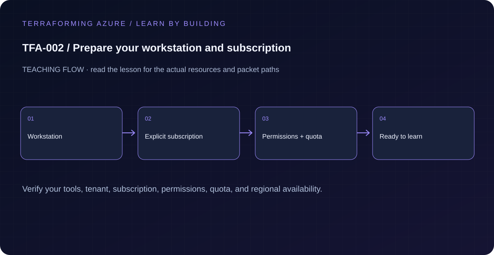

# TFA-002 — Prepare your workstation and subscription

<!-- lab-metadata:start -->
**Phase 1:** Foundations

**Learning target:** 75 minutes · **Cost tier:** None · **Run mode:** `read-only`

**Prerequisites:** [TFA-001 — Azure, infrastructure as code, and Terraform](../TFA-001/README.md)
<!-- lab-metadata:end -->

<!-- lab-diagram:start -->

<!-- lab-diagram:end -->

## Goal

Collect tool, identity, subscription, provider, quota, and cost evidence before the first billable deployment.

## Prerequisites

Complete [TFA-001](../TFA-001/README.md). Earlier cloud labs should already be destroyed; this root deploys independently.

## Install the Windows workstation

Start here before running the optional preview in TFA-001. Use a supported Windows 10/11 installation with permission to install software. These are manual workstation setup commands; the course checks never install tools automatically. If your organization manages software, ask its administrator to provide the same tools and approved versions.

1. Open **Windows Terminal → PowerShell**. The built-in Windows PowerShell 5.1 is sufficient only for starting installation. Run `winget --version`; if it is missing, install/update Microsoft's **App Installer** from the Microsoft Store, then open a new terminal.
2. Install the command-line tools and editor from their explicit package IDs. Review each installer prompt.

```powershell
winget install --exact --id Microsoft.PowerShell --source winget
winget install --exact --id Git.Git --source winget
winget install --exact --id Microsoft.AzureCLI --source winget
winget install --exact --id Microsoft.VisualStudioCode --source winget
```

Close the terminal and open a **new PowerShell 7** tab (`pwsh`). This refreshes PATH. `$PSVersionTable.PSVersion` must report 7.4 or newer; the published compatibility record lists the exact tested release. The keyed-address examples depend on modern native-argument handling. Do not run the remaining commands in Windows PowerShell 5.1.

Install the course's pinned Terraform **1.15.8** from HashiCorp and verify its archive checksum before extracting. This installation uses your LocalAppData applications directory and does not require a machine-wide PATH change.

```powershell
$tfVersion = '1.15.8'
$tfDirectory = Join-Path $env:LOCALAPPDATA "Programs\Terraform\$tfVersion"
$downloadDirectory = Join-Path ([IO.Path]::GetTempPath()) ('terraform-setup-' + [guid]::NewGuid().ToString('N'))
New-Item -ItemType Directory -Path $downloadDirectory, $tfDirectory -Force | Out-Null
$archiveName = "terraform_${tfVersion}_windows_amd64.zip"
$baseUrl = "https://releases.hashicorp.com/terraform/$tfVersion"
Invoke-WebRequest "$baseUrl/$archiveName" -OutFile (Join-Path $downloadDirectory $archiveName)
$checksums = (Invoke-WebRequest "$baseUrl/terraform_${tfVersion}_SHA256SUMS").Content
$expectedHash = (($checksums -split "`n" | Where-Object { $_.Trim().EndsWith($archiveName) }) -split '\s+')[0]
$actualHash = (Get-FileHash (Join-Path $downloadDirectory $archiveName) -Algorithm SHA256).Hash
if (-not $expectedHash -or $actualHash -ine $expectedHash) { throw 'Terraform archive checksum mismatch. Stop installation.' }
Expand-Archive (Join-Path $downloadDirectory $archiveName) -DestinationPath $tfDirectory -Force
$userPath = [Environment]::GetEnvironmentVariable('Path','User')
if (($userPath -split ';') -notcontains $tfDirectory) {
    [Environment]::SetEnvironmentVariable('Path', ($tfDirectory + ';' + $userPath), 'User')
}
$env:Path = $tfDirectory + ';' + $env:Path
terraform version
```

The example archive is for x64 Windows. On ARM64 Windows, use the supported x64 compatibility installation or follow HashiCorp's current platform downloads; do not silently substitute a different toolchain. Verify `Get-Command terraform -All` if another installation takes precedence after opening a new terminal. Retain only the verified executable, license and your intended PATH entry; the uniquely named temporary download folder can be removed after successful installation.

Install the VS Code extensions, then clone your own course working copy into a folder you control. Skip cloning if you already have a checkout; do not create a nested clone inside a lesson.

```powershell
code --install-extension HashiCorp.terraform
code --install-extension ms-vscode.PowerShell
Set-Location (Join-Path $env:USERPROFILE 'Documents')
git clone https://github.com/Jamonygr/Terraforming-Azure.git
Set-Location Terraforming-Azure
code .
./scripts/Test-AzureReadiness.ps1 -Mode Local
```

The repository root contains `README.md`, `labs`, and `scripts`. `Set-Location labs/TFA-001` enters a root; `Set-Location ../..` returns to the repository. Run Terraform in the selected lesson, not in the repository root. Complete the local TFA-001 preview, then return here for subscription preparation. Python, Node.js and MkDocs are contributor/site tools; they are not required to run these Terraform lessons.

Official installation references: [PowerShell](https://learn.microsoft.com/en-us/powershell/scripting/install/installing-powershell-on-windows), [Azure CLI](https://learn.microsoft.com/en-us/cli/azure/install-azure-cli-windows), [Terraform](https://developer.hashicorp.com/terraform/install), [VS Code](https://code.visualstudio.com/docs/setup/windows), [Git](https://git-scm.com/downloads/win).

## Select a subscription deliberately

Local readiness does not require Azure sign-in. For a later cloud exercise, run `az login`, inspect `az account list --output table`, and select its GUID with `az account set --subscription '<GUID>'`. Record tenant, subscription, permitted region and cleanup owner. Azure subscription access, resource creation, role assignment and backend blob access are separate permissions. Leave cloud readiness unresolved until you have evidence for that exact subscription. If a provider is unregistered, follow your administrator's registration procedure for the chosen services; this setup does not register every provider automatically.

## Predict the mechanism

PATH determines which executable runs. Authentication, subscription selection, provider registration, regional service availability and quota are separate readiness questions. A local version check can establish only the workstation part.

Before running commands, write the expected result: **Local checks identify exact supported tools; cloud permission/quota checks remain unresolved.** Then explain what would change in this controlled failure: Use a fixture with a missing tool or a mismatched version; repair the installed path. Record your prediction before inspecting the outcome.

## Understand the design

Authentication answers who you are; authorization answers what you may do. A successful az login does not prove you can create a VM or assign a role. Subscription selection is equally important: display names can be duplicated, so record and pass the GUID.

The Terraform example is a local checklist. Its default output lists every incomplete check. Setting a boolean records your own evidence; it does not make an Azure API call or verify a permission. Keep the distinction visible when sharing screenshots or progress records.

## Architecture and resources

Read-only Azure CLI checks supply human-reviewed evidence. Terraform evaluates a local readiness object; no resource or backend is created.

See the catalog cost tier above and the [cost and cleanup guide](../../docs/cost-and-cleanup.md). Destroy the lesson when finished and verify its actual resource names.

## Inputs and working directory

Use PowerShell 7 from the repository root, then enter this lesson folder. Copy the example once and edit only the untracked terraform.tfvars. Use only the lesson-specific inputs shown in main.tf and the example file. This local model does not require Azure authentication.

```powershell
Set-Location labs/TFA-002
```

## Build and inspect

Read main.tf before running the commands. Review the proposed actions and
subscription before approving an apply. An existing tfvars file should be edited,
not overwritten; skip Copy-Item when you already have one.

```powershell
Copy-Item terraform.tfvars.example terraform.tfvars
terraform init -backend=false -input=false
terraform fmt -check
terraform validate
terraform plan -out=tfplan
terraform show tfplan
terraform apply tfplan
```

Never commit terraform.tfvars, backend runtime files, saved plans, state, crash
logs, or secret-bearing command output. Keep dependency lockfiles in source control.

## Validate and collect evidence

```powershell
pwsh --version
terraform version
az version
git --version
az account show --query "{tenant:tenantId,subscription:id,user:user.name}" -o table
az provider show --namespace Microsoft.Network --query registrationState -o tsv
az provider show --namespace Microsoft.Compute --query registrationState -o tsv
az provider show --namespace Microsoft.Storage --query registrationState -o tsv
az vm list-usage --location westeurope -o table
terraform output -json readiness
```

**Expected:** Record the exact subscription and tenant. Network, Compute, and Storage must be Registered before the relevant deployment. Review regional vCPU/SKU quotas and the subscription budget in Azure Cost Management. Default checklist output is ready=false; it becomes true only after you record all six completed checks and apply the local output state.

For a deployable lesson, finish with terraform plan -detailed-exitcode: 0 means
no changes, 2 means a change exists, and 1 means an error. A mock test checks
configuration behavior; it is not a network connectivity test.

## Exercises

1. Run az account list --output table, select your intended account with az account set --subscription <GUID>, and compare az account show. The GUID must match your intended subscription.
2. Add checks = { tools=true, identity=true, subscription=true, providers=true, quota=true, budget=true } to your untracked tfvars only after collecting evidence. The local plan changes ready from false to true.
3. Explain the diagram and your validation evidence to another learner. Include
   what the evidence does and does not prove, then answer [five review questions](quiz.json).

## Break and repair

Set checks.providers=false and inspect the plan. Readiness must become false and incomplete must contain providers. Repair the actual Azure prerequisite separately, then record the check as true. A subscription administrator may need to register a provider; this lesson does not register providers automatically.

## Troubleshooting

| Symptom | Investigation |
|---|---|
| Initialization or schema validation fails | Check the working directory, Terraform version, module source paths, and tracked provider lockfile. Run init before validate. |
| Azure returns authorization, quota, or region errors | Verify the explicit subscription and tenant, role scope, registered provider, regional SKU availability, and quota from TFA-002. |
| Results differ from the expected evidence | Compare the actual resource IDs and effective state with this lesson's architecture. Read the service-specific explanation above before changing permissions or network policy. |

## Cleanup and proof

```powershell
terraform destroy
if ($LASTEXITCODE -ne 0) { throw 'Destroy failed: keep state and investigate before continuing.' }
$remaining = @(terraform state list)
if ($LASTEXITCODE -ne 0 -or $remaining.Count) { throw 'Cleanup left managed objects or state could not be read.' }
Remove-Item tfplan -ErrorAction SilentlyContinue
```

No Azure resource exists in this workflow. Managed local resources, when present, must be absent from state after cleanup.

## Production differences

Team readiness also includes least-privilege access, deployment identity ownership, approved regions/SKUs, policy constraints, support ownership, and cost alerts. Use organization-specific gates before production.

## Navigation

[Previous: TFA-001](../TFA-001/README.md) · [Curriculum](../../README.md) · [Next: TFA-003](../TFA-003/README.md)

## Evidence contract

./scripts/Test-AzureReadiness.ps1 -Mode Local; inspect Get-Command terraform -All and each version. Local checks identify exact supported tools; cloud permission/quota checks remain unresolved.

See the [40-lab evidence map](../../docs/curriculum-evidence.md) for source paths, validation level and cleanup dependencies. Authored Azure commands are learner exercises; passing local checks does not establish a live deployment.
