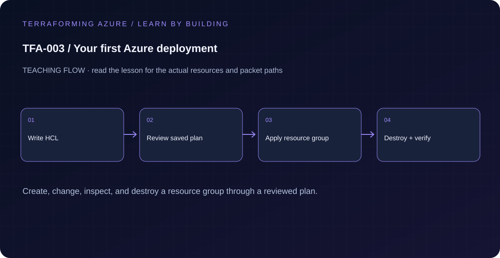

# TFA-003 — Your first Azure deployment

<!-- lab-metadata:start -->
**Phase 1:** Foundations

**Learning target:** 75 minutes · **Cost tier:** Low · **Run mode:** `azure`

**Prerequisites:** [TFA-002 — Prepare your workstation and subscription](../TFA-002/README.md)
<!-- lab-metadata:end -->

<!-- lab-diagram:start -->

<!-- lab-diagram:end -->

## Goal

Create and remove one Azure resource group while learning init, fmt, validate, plan, apply, refresh, and destroy.

## Workspace and isolation

Earlier cloud labs should already be destroyed; this root deploys independently. Concept prerequisites are listed in the generated catalog block.

## Predict the mechanism

A resource group has its own lifecycle even when empty. init installs the declared provider, validate checks configuration structure, and a saved plan records the intended action. apply creates the real binding in state, while destroy removes that managed group.

Before running commands, write the expected result: **One resource group address is tracked after apply; repeat plan is empty.** Then explain what would change in this controlled failure: Change a mutable tag, compare the plan, then restore it. Record your prediction before inspecting the outcome.

## Understand the design

Configuration describes the desired resource group. Terraform state associates its address azurerm_resource_group.lab with an Azure resource ID. The AzureRM provider translates the configuration into Azure API calls. These three layers have different responsibilities.

An apply can create billable resources in later lessons; a saved plan is therefore a review artifact. Inspect both the target subscription and every proposed action before applying it. Never reuse an old plan after changing configuration, variables, identity, or state.

## Architecture and resources

One isolated resource group, tagged with its course, lab, and learning purpose. No VNet, storage account, or VM is created.

See the catalog cost tier above and the [cost and cleanup guide](../../docs/cost-and-cleanup.md). Destroy the lesson when finished and verify its actual resource names.

## Inputs and working directory

Use PowerShell 7 from the repository root, then enter this lesson folder. Copy the example once and edit only the untracked terraform.tfvars. location defaults to westeurope; name_prefix isolates this lesson; tags contains non-secret ownership metadata. subscription_id is required through TF_VAR_subscription_id. Provider auto-registration is disabled: complete TFA-002 readiness checks first.

```powershell
Set-Location labs/TFA-003
```

## Build and inspect

Read main.tf before running the commands. Review the proposed actions and
subscription before approving an apply. An existing tfvars file should be edited,
not overwritten; skip Copy-Item when you already have one.

```powershell
az login
az account list --output table
az account set --subscription '<your-subscription-guid>'
$env:TF_VAR_subscription_id = az account show --query id --output tsv
az account show --query '{tenant:tenantId,subscription:id,user:user.name}' --output table
Copy-Item terraform.tfvars.example terraform.tfvars
terraform init -backend=false -input=false -lockfile=readonly
terraform fmt -check
terraform validate
terraform plan -out=tfplan
terraform show tfplan
terraform apply tfplan
```

Never commit terraform.tfvars, backend runtime files, saved plans, state, crash
logs, or secret-bearing command output. Keep dependency lockfiles in source control.

## Validate and collect evidence

```powershell
$rg = terraform output -raw resource_group_name
az group show --name $rg --subscription $env:TF_VAR_subscription_id --query "{name:name,location:location,tags:tags}" -o json
terraform state show azurerm_resource_group.lab
terraform plan -detailed-exitcode
```

**Expected:** Azure reports the expected group name, region, and TFA-003 tag. State records the same resource ID. The second plan has no changes and exits 0.

For a deployable lesson, finish with terraform plan -detailed-exitcode: 0 means
no changes, 2 means a change exists, and 1 means an error. A mock test checks
configuration behavior; it is not a network connectivity test.

## Exercises

1. Add cost_center = "training" to tags, predict one in-place update, and inspect the plan. Apply it and verify the tag with Azure CLI.
2. Plan a name_prefix change and identify the replacement marker. Do not apply it; restore your prefix and confirm no changes.
3. Explain the diagram and your validation evidence to another learner. Include
   what the evidence does and does not prove, then answer [five review questions](quiz.json).

## Break and repair

Temporarily set the location variable to an unsupported region name and run terraform validate, then terraform plan. Explain why syntax validation may pass while a provider or Azure request rejects the region. Restore westeurope before any apply.

## Troubleshooting

| Symptom | Investigation |
|---|---|
| Initialization or schema validation fails | Check the working directory, Terraform version, module source paths, and tracked provider lockfile. Run init before validate. |
| Azure returns authorization, quota, or region errors | Verify the explicit subscription and tenant, role scope, registered provider, regional SKU availability, and quota from TFA-002. |
| Results differ from the expected evidence | Compare the actual resource IDs and effective state with this lesson's architecture. Read the service-specific explanation above before changing permissions or network policy. |

## Cleanup and proof

```powershell
$rg = terraform output -raw resource_group_name
if ($LASTEXITCODE -ne 0 -or -not $rg) { throw 'Capture the exact owned group before destruction.' }
terraform destroy
if ($LASTEXITCODE -ne 0) { throw 'Destroy failed: keep state and investigate before continuing.' }
$remaining = @(terraform state list)
if ($LASTEXITCODE -ne 0 -or $remaining.Count) { throw 'Cleanup left managed objects or state could not be read.' }
$groupExists = az group exists --name $rg --subscription $env:TF_VAR_subscription_id
if ($LASTEXITCODE -ne 0 -or $groupExists -ne 'false') { throw 'The owned group is not confirmed deleted. Keep state and investigate.' }
Remove-Item tfplan -ErrorAction SilentlyContinue
```

State should contain no managed resources. Azure CLI should return false for the deleted group (or an empty list for the multi-group lesson).

## Production differences

Shared environments require reviewed changes, protected remote state, an appropriate deployment identity, policy checks, and recovery planning. A resource group is a lifecycle boundary; deleting it also deletes its contents.

## Navigation

[Previous: TFA-002](../TFA-002/README.md) · [Curriculum](../../README.md) · [Next: TFA-004](../TFA-004/README.md)

## Evidence contract

terraform plan -out=lab.tfplan; terraform show lab.tfplan; terraform state list. One resource group address is tracked after apply; repeat plan is empty.

See the [40-lab evidence map](../../docs/curriculum-evidence.md) for source paths, validation level and cleanup dependencies. Authored Azure commands are learner exercises; passing local checks does not establish a live deployment.
