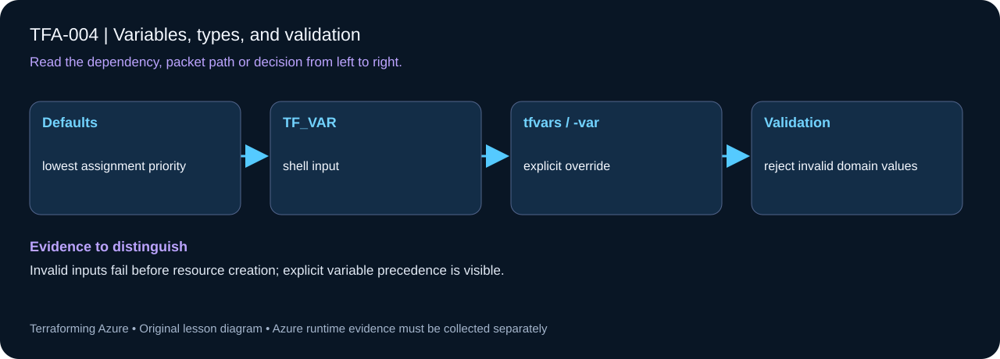

# TFA-004 — Variables, types, and validation



## Goal

Design a small typed configuration interface and reject invalid inputs before any infrastructure exists.

## Prerequisites

Complete [TFA-003](../TFA-003/README.md). Earlier cloud labs should already be destroyed; this root deploys independently.

## Understand the design

Types tell callers what shape to supply: string, number, bool, collection, and object are different contracts. Validation narrows values further. A number type accepts 1.5, so an integer capacity rule must explicitly reject fractions.

This lesson evaluates a configuration_preview output with an environment, a replica count, and a structured workload object. It creates no resources. Learning types locally makes failure messages easier to understand without cloud permissions or costs.

## Architecture and resources

Typed variables → validation → a local preview output saved in local state.

**Cost:** None Destroy the lesson when finished. A stopped VM may still have billable disks; deleting all lab resources is the cleanup target.

## Inputs and working directory

Use PowerShell 7 from the repository root, then enter this lesson folder. Copy the example once and edit only the untracked terraform.tfvars. location defaults to westeurope; name_prefix isolates this lesson; tags contains non-secret ownership metadata. This local example does not need a subscription_id input or Azure authentication.

```powershell
Set-Location labs/TFA-004
```

## Build and inspect

Read main.tf before running the commands. Review the proposed actions and
subscription before approving an apply. An existing tfvars file should be edited,
not overwritten; skip Copy-Item when you already have one.

```powershell
Copy-Item terraform.tfvars.example terraform.tfvars
terraform init -backend=false -input=false
terraform fmt -check
terraform validate
terraform plan -out=tfplan
terraform show tfplan
terraform apply tfplan
```

Never commit terraform.tfvars, backend runtime files, saved plans, state, crash
logs, or secret-bearing command output. Keep dependency lockfiles in source control.

## Validate and collect evidence

```powershell
terraform output -json configuration_preview
terraform plan -var="environment=test" -var="instance_count=2"
terraform console
```

**Expected:** Default preview has tfa004-dev, replicas=1, and an enabled web workload with port 443. A test/count=2 plan changes only the proposed output. No cloud provider is required.

For a deployable lesson, finish with terraform plan -detailed-exitcode: 0 means
no changes, 2 means a change exists, and 1 means an error. A mock test checks
configuration behavior; it is not a network connectivity test.

## Exercises

1. Set workload = { name="api", enabled=true, ports=[443,8443] } in your tfvars and inspect its type in terraform console. Port ordering is not an identity contract because ports is a set.
2. Compare -var="instance_count=2" with the value in terraform.tfvars. The command-line value takes precedence for that invocation.
3. Explain the diagram and your validation evidence to another learner. Include
   what the evidence does and does not prove, then answer [five review questions](quiz.json).

## Break and repair

Run terraform plan -var="instance_count=1.5" and terraform plan -var="environment=production". Both must fail with the intended validation messages. Repair using a whole number from 1 to 3 and one of dev/test/prod.

## Troubleshooting

| Symptom | Investigation |
|---|---|
| Initialization or schema validation fails | Check the working directory, Terraform version, module source paths, and tracked provider lockfile. Run init before validate. |
| Azure returns authorization, quota, or region errors | Verify the explicit subscription and tenant, role scope, registered provider, regional SKU availability, and quota from TFA-002. |
| Results differ from the expected evidence | Compare the actual resource IDs and effective state with this lesson's architecture. Read the service-specific explanation above before changing permissions or network policy. |

## Cleanup and proof

```powershell
terraform destroy
terraform state list
Remove-Item tfplan -ErrorAction SilentlyContinue
```

No Azure resource exists in this workflow. Managed local resources, when present, must be absent from state after cleanup.

## Production differences

Public module inputs need concise descriptions and constraints that encode known requirements. Avoid validation that pretends to prove dynamic Azure capacity or connectivity.

## Navigation

[Previous: TFA-003](../TFA-003/README.md) · [Curriculum](../../README.md) · [Next: TFA-005](../TFA-005/README.md)
