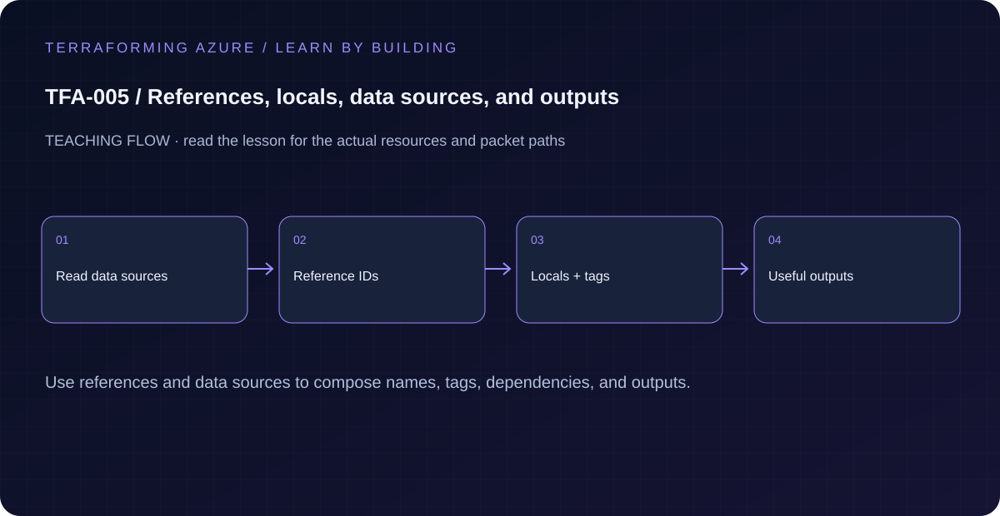

# TFA-005 — References, locals, data sources, and outputs



## Goal

Build dependency edges through references and distinguish a managed resource from a read-only data source.

## Prerequisites

Complete [TFA-004](../TFA-004/README.md). Earlier cloud labs should already be destroyed; this root deploys independently.

## Understand the design

A resource block manages an object lifecycle. A data source observes an object or context. Here, Terraform creates one resource group and reads it back through a data source whose name references the managed resource. That reference establishes the ordering dependency without a manual depends_on.

Locals name reusable expressions inside a module; they are not caller inputs. Outputs publish the supported interface to callers and operators. The observed resource group remains managed by the resource block, so reading it through a data source does not transfer ownership.

## Architecture and resources

Current Azure identity → one managed group → a dependent read of that group → a context output. The client-config data source also exposes the current tenant and subscription identifiers.

**Cost:** Low: one resource group and control-plane reads. Destroy the lesson when finished. A stopped VM may still have billable disks; deleting all lab resources is the cleanup target.

## Inputs and working directory

Use PowerShell 7 from the repository root, then enter this lesson folder. Copy the example once and edit only the untracked terraform.tfvars. location defaults to westeurope; name_prefix isolates this lesson; tags contains non-secret ownership metadata. subscription_id is required through TF_VAR_subscription_id. Provider auto-registration is disabled: complete TFA-002 readiness checks first.

```powershell
Set-Location labs/TFA-005
```

## Build and inspect

Read main.tf before running the commands. Review the proposed actions and
subscription before approving an apply. An existing tfvars file should be edited,
not overwritten; skip Copy-Item when you already have one.

```powershell
az login
az account list --output table
az account set --subscription '<your-subscription-guid>'
$env:TF_VAR_subscription_id = az account show --query id --output tsv
az account show --query '{tenant:tenantId,subscription:id,user:user.name}' --output table
Copy-Item terraform.tfvars.example terraform.tfvars
terraform init -backend=false -input=false -lockfile=readonly
terraform fmt -check
terraform validate
terraform plan -out=tfplan
terraform show tfplan
terraform apply tfplan
```

Never commit terraform.tfvars, backend runtime files, saved plans, state, crash
logs, or secret-bearing command output. Keep dependency lockfiles in source control.

## Validate and collect evidence

```powershell
terraform output -json context
terraform graph
terraform state list
terraform plan -detailed-exitcode
```

**Expected:** The output subscription matches the explicitly selected subscription. The graph contains a reference from the group data source to its managed resource. State contains both managed and data addresses, but destroy only deletes the managed resource.

For a deployable lesson, finish with terraform plan -detailed-exitcode: 0 means
no changes, 2 means a change exists, and 1 means an error. A mock test checks
configuration behavior; it is not a network connectivity test.

## Exercises

1. Find every reference to azurerm_resource_group.lab.name. Explain why Terraform can discover the dependency even if file order changes.
2. Add an output for data.azurerm_resource_group.observed.location. A plan should add an output without proposing a second resource group.
3. Explain the diagram and your validation evidence to another learner. Include
   what the evidence does and does not prove, then answer [five review questions](quiz.json).

## Break and repair

Change the data-source name to "group-that-does-not-exist-tfa005" and run a plan. The read must fail; adding a data source never creates the missing group. Restore the resource reference and confirm the plan succeeds.

## Troubleshooting

| Symptom | Investigation |
|---|---|
| Initialization or schema validation fails | Check the working directory, Terraform version, module source paths, and tracked provider lockfile. Run init before validate. |
| Azure returns authorization, quota, or region errors | Verify the explicit subscription and tenant, role scope, registered provider, regional SKU availability, and quota from TFA-002. |
| Results differ from the expected evidence | Compare the actual resource IDs and effective state with this lesson's architecture. Read the service-specific explanation above before changing permissions or network policy. |

## Cleanup and proof

```powershell
$rg = terraform output -raw resource_group_name
terraform destroy
terraform state list
az group exists --name $rg --subscription $env:TF_VAR_subscription_id
Remove-Item tfplan -ErrorAction SilentlyContinue
```

State should contain no managed resources. Azure CLI should return false for the deleted group (or an empty list for the multi-group lesson).

## Production differences

Outputs should expose stable contracts rather than every internal object. Treat access to state and outputs as privileged because sensitive infrastructure values may be present.

## Navigation

[Previous: TFA-004](../TFA-004/README.md) · [Curriculum](../../README.md) · [Next: TFA-006](../TFA-006/README.md)
