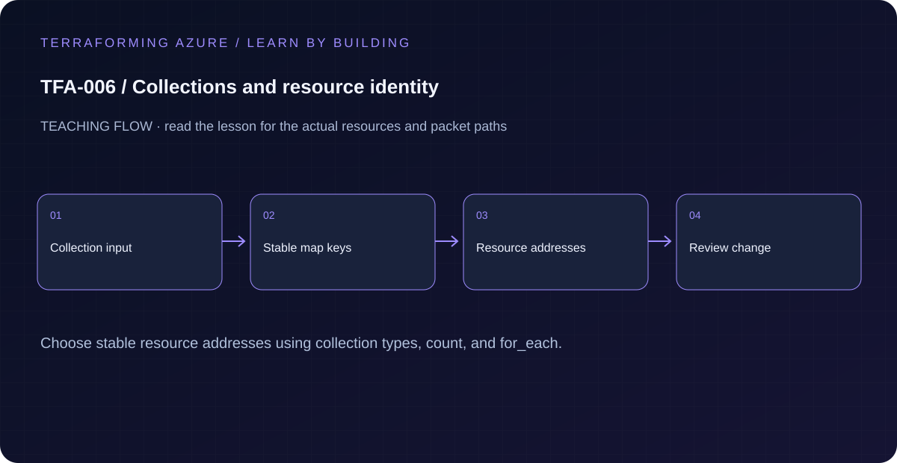

# TFA-006 — Collections and resource identity

<!-- lab-metadata:start -->
**Phase 1:** Foundations

**Learning target:** 75 minutes · **Cost tier:** Low · **Run mode:** `azure`

**Prerequisites:** [TFA-005 — References, locals, data sources, and outputs](../TFA-005/README.md)
<!-- lab-metadata:end -->

<!-- lab-diagram:start -->

<!-- lab-diagram:end -->

## Goal

Compare count indexes with for_each keys and predict which identities survive collection changes.

## Workspace and isolation

Earlier cloud labs should already be destroyed; this root deploys independently. Concept prerequisites are listed in the generated catalog block.

## Predict the mechanism

count uses numeric positions as resource addresses; for_each uses stable keys. Removing the first element of an indexed list can shift later identities, while removing one map key should affect only that instance. Reordering display values is different from renaming an address key.

Before running commands, write the expected result: **The keyed instance addresses preserve unaffected identities.** Then explain what would change in this controlled failure: Rename a key and predict destroy/create before introducing moved blocks later. Record your prediction before inspecting the outcome.

## Understand the design

Terraform resource addresses are part of the state contract. count identifies instances by position, such as indexed[0]. for_each identifies instances by stable keys, such as keyed["web"]. A human-readable name inside an object does not replace the state address.

The example deliberately creates two indexed and two keyed empty resource groups. This makes the address difference visible without multiplying VM costs. A later network module will preserve subnet keys for the same reason.

## Architecture and resources

Two count-indexed groups and a map of keyed groups share one region and lab tags. They are independent lifecycle objects, not nested groups.

See the catalog cost tier above and the [cost and cleanup guide](../../docs/cost-and-cleanup.md). Destroy the lesson when finished and verify its actual resource names.

## Inputs and working directory

Use PowerShell 7 from the repository root, then enter this lesson folder. Copy the example once and edit only the untracked terraform.tfvars. location defaults to westeurope; name_prefix isolates this lesson; tags contains non-secret ownership metadata. subscription_id is required through TF_VAR_subscription_id. Provider auto-registration is disabled: complete TFA-002 readiness checks first.

```powershell
Set-Location labs/TFA-006
```

## Build and inspect

Read main.tf before running the commands. Review the proposed actions and
subscription before approving an apply. An existing tfvars file should be edited,
not overwritten; skip Copy-Item when you already have one.

```powershell
az login
az account list --output table
az account set --subscription '<your-subscription-guid>'
$env:TF_VAR_subscription_id = az account show --query id --output tsv
az account show --query '{tenant:tenantId,subscription:id,user:user.name}' --output table
Copy-Item terraform.tfvars.example terraform.tfvars
terraform init -backend=false -input=false -lockfile=readonly
terraform fmt -check
terraform validate
terraform plan -out=tfplan
terraform show tfplan
terraform apply tfplan
```

Never commit terraform.tfvars, backend runtime files, saved plans, state, crash
logs, or secret-bearing command output. Keep dependency lockfiles in source control.

## Validate and collect evidence

```powershell
terraform state list
terraform output -json addresses
az group list --subscription $env:TF_VAR_subscription_id --tag lab=TFA-006 --query "[].name" -o table
```

**Expected:** State contains indexed[0], indexed[1], keyed["api"], and keyed["web"]. Azure lists four groups with your prefix.

For a deployable lesson, finish with terraform plan -detailed-exitcode: 0 means
no changes, 2 means a change exists, and 1 means an error. A mock test checks
configuration behavior; it is not a network connectivity test.

## Exercises

1. Add worker = "Background service" to workloads. The plan should create one keyed group and retain api/web identities.
2. Rename the web key to frontend in an untracked tfvars file and plan. Explain why the old key is removed and the new key is created even if you intended a cosmetic label change. Restore the keys without applying.
3. Explain the diagram and your validation evidence to another learner. Include
   what the evidence does and does not prove, then answer [five review questions](quiz.json).

## Break and repair

Try changing workloads from a map to a list in terraform.tfvars. Terraform must reject the input type. Repair it as a map and use stable logical keys; learn moved blocks in TFA-015 before renaming deployed addresses.

## Troubleshooting

| Symptom | Investigation |
|---|---|
| Initialization or schema validation fails | Check the working directory, Terraform version, module source paths, and tracked provider lockfile. Run init before validate. |
| Azure returns authorization, quota, or region errors | Verify the explicit subscription and tenant, role scope, registered provider, regional SKU availability, and quota from TFA-002. |
| Results differ from the expected evidence | Compare the actual resource IDs and effective state with this lesson's architecture. Read the service-specific explanation above before changing permissions or network policy. |

## Cleanup and proof

```powershell
$cleanupGroups = @(terraform output -json cleanup_group_names | ConvertFrom-Json)
if ($LASTEXITCODE -ne 0 -or -not $cleanupGroups.Count) { throw 'Capture the exact owned groups before destruction.' }
terraform destroy
if ($LASTEXITCODE -ne 0) { throw 'Destroy failed: keep state and investigate before continuing.' }
$remaining = @(terraform state list)
if ($LASTEXITCODE -ne 0 -or $remaining.Count) { throw 'Cleanup left managed objects or state could not be read.' }
foreach ($groupName in $cleanupGroups) {
    $groupExists = az group exists --name $groupName --subscription $env:TF_VAR_subscription_id
    if ($LASTEXITCODE -ne 0 -or $groupExists -ne 'false') { throw "Owned group $groupName is not confirmed deleted." }
}
Remove-Item tfplan -ErrorAction SilentlyContinue
```

State should contain no managed resources. Azure CLI should return false for the deleted group (or an empty list for the multi-group lesson).

## Production differences

Use stable business or topology keys. Avoid keys derived from mutable descriptions, secrets, or unknown resource-generated IDs. Replacements must be reviewed even when the resulting display names look familiar.

## Navigation

[Previous: TFA-005](../TFA-005/README.md) · [Curriculum](../../README.md) · [Next: TFA-007](../TFA-007/README.md)

## Evidence contract

Compare plans after removing a list member and a map key; inspect terraform state list. The keyed instance addresses preserve unaffected identities.

See the [40-lab evidence map](../../docs/curriculum-evidence.md) for source paths, validation level and cleanup dependencies. Authored Azure commands are learner exercises; passing local checks does not establish a live deployment.
