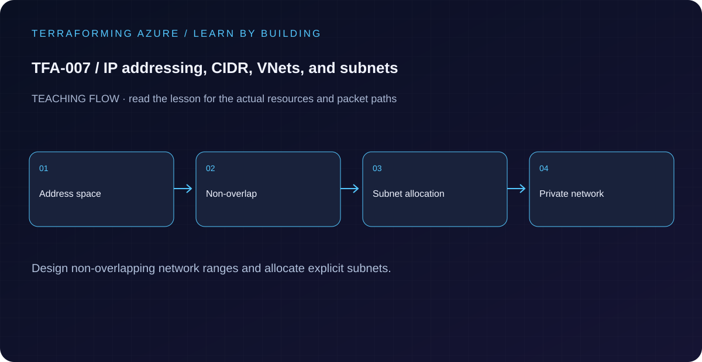

# TFA-007 — IP addressing, CIDR, VNets, and subnets

<!-- lab-metadata:start -->
**Phase 2:** Azure networks

**Learning target:** 75 minutes · **Cost tier:** Low · **Run mode:** `azure`

**Prerequisites:** [TFA-006 — Collections and resource identity](../TFA-006/README.md)
<!-- lab-metadata:end -->

<!-- lab-diagram:start -->

<!-- lab-diagram:end -->

## Goal

Calculate an address plan and deploy three non-overlapping workload subnets directly before introducing a module.

## Workspace and isolation

Earlier cloud labs should already be destroyed; this root deploys independently. Concept prerequisites are listed in the generated catalog block.

## Predict the mechanism

A VNet prefix contains subnet prefixes; subnets in the same VNet cannot overlap. Azure reserves the first four and last address in each subnet. A /24 contains 256 addresses but 251 usable addresses, and the gateway address cannot be assigned to a VM.

Before running commands, write the expected result: **The segmented subnets fit the VNet without overlap.** Then explain what would change in this controlled failure: Propose overlapping prefixes, explain the rejection, then restore disjoint ranges. Record your prediction before inspecting the outcome.

## Understand the design

A CIDR prefix combines a network address with the number of network bits. Increasing a /16 by eight bits creates /24 blocks. cidrsubnet("10.7.0.0/16", 8, 1) therefore produces 10.7.1.0/24. Azure reserves addresses in each subnet, so its usable host count is smaller than the mathematical total.

The VNet defines an address space; subnets divide it into workload boundaries. A subnet name does not itself filter traffic. This example explicitly disables default outbound access so future workloads require a deliberate egress design.

## Architecture and resources

VNet 10.7.0.0/16 contains web 10.7.1.0/24, app 10.7.2.0/24, and data 10.7.3.0/24. There is no peering, route table, VM, NSG, or gateway.

See the catalog cost tier above and the [cost and cleanup guide](../../docs/cost-and-cleanup.md). Destroy the lesson when finished and verify its actual resource names.

## Inputs and working directory

Use PowerShell 7 from the repository root, then enter this lesson folder. Copy the example once and edit only the untracked terraform.tfvars. location defaults to westeurope; name_prefix isolates this lesson; tags contains non-secret ownership metadata. subscription_id is required through TF_VAR_subscription_id. Provider auto-registration is disabled: complete TFA-002 readiness checks first.

```powershell
Set-Location labs/TFA-007
```

## Build and inspect

Read main.tf before running the commands. Review the proposed actions and
subscription before approving an apply. An existing tfvars file should be edited,
not overwritten; skip Copy-Item when you already have one.

```powershell
az login
az account list --output table
az account set --subscription '<your-subscription-guid>'
$env:TF_VAR_subscription_id = az account show --query id --output tsv
az account show --query '{tenant:tenantId,subscription:id,user:user.name}' --output table
Copy-Item terraform.tfvars.example terraform.tfvars
terraform init -backend=false -input=false -lockfile=readonly
terraform fmt -check
terraform validate
terraform plan -out=tfplan
terraform show tfplan
terraform apply tfplan
```

Never commit terraform.tfvars, backend runtime files, saved plans, state, crash
logs, or secret-bearing command output. Keep dependency lockfiles in source control.

## Validate and collect evidence

```powershell
$rg = terraform output -raw resource_group_name
$vnet = terraform output -raw vnet_name
az network vnet subnet list -g $rg --vnet-name $vnet --query "[].{name:name,prefix:addressPrefix,defaultOutbound:defaultOutboundAccess}" -o table
terraform output -json address_plan
```

**Expected:** Exactly three named /24 subnets appear with the calculated prefixes. No implicit public egress resource exists. A second plan is empty.

For a deployable lesson, finish with terraform plan -detailed-exitcode: 0 means
no changes, 2 means a change exists, and 1 means an error. A mock test checks
configuration behavior; it is not a network connectivity test.

## Exercises

1. Evaluate cidrsubnet(var.address_space, 8, 4) in terraform console before adding a management subnet keyed mgmt. Expect 10.7.4.0/24 and one subnet creation.
2. Create a paper address plan for a hub and two spokes with no overlaps. Reserve service subnets before assigning application ranges.
3. Explain the diagram and your validation evidence to another learner. Include
   what the evidence does and does not prove, then answer [five review questions](quiz.json).

## Break and repair

Temporarily give app and web the same netnum in main.tf and plan. Local validation cannot always prove Azure overlap rules; Azure rejects the conflicting deployment. Do not apply the broken plan. Restore distinct netnums and verify the calculated prefixes.

## Troubleshooting

| Symptom | Investigation |
|---|---|
| Initialization or schema validation fails | Check the working directory, Terraform version, module source paths, and tracked provider lockfile. Run init before validate. |
| Azure returns authorization, quota, or region errors | Verify the explicit subscription and tenant, role scope, registered provider, regional SKU availability, and quota from TFA-002. |
| Results differ from the expected evidence | Compare the actual resource IDs and effective state with this lesson's architecture. Read the service-specific explanation above before changing permissions or network policy. |

## Cleanup and proof

```powershell
$rg = terraform output -raw resource_group_name
if ($LASTEXITCODE -ne 0 -or -not $rg) { throw 'Capture the exact owned group before destruction.' }
terraform destroy
if ($LASTEXITCODE -ne 0) { throw 'Destroy failed: keep state and investigate before continuing.' }
$remaining = @(terraform state list)
if ($LASTEXITCODE -ne 0 -or $remaining.Count) { throw 'Cleanup left managed objects or state could not be read.' }
$groupExists = az group exists --name $rg --subscription $env:TF_VAR_subscription_id
if ($LASTEXITCODE -ne 0 -or $groupExists -ne 'false') { throw 'The owned group is not confirmed deleted. Keep state and investigate.' }
Remove-Item tfplan -ErrorAction SilentlyContinue
```

State should contain no managed resources. Azure CLI should return false for the deleted group (or an empty list for the multi-group lesson).

## Production differences

Allocate address spaces across regions, subscriptions, hybrid networks, and future growth using a coordinated IPAM plan. A working isolated VNet can still conflict with the network it later needs to join.

## Navigation

[Previous: TFA-006](../TFA-006/README.md) · [Curriculum](../../README.md) · [Next: TFA-008](../TFA-008/README.md)

## Evidence contract

Compare network/subnet prefixes and calculate containment and usable counts before planning. The segmented subnets fit the VNet without overlap.

See the [40-lab evidence map](../../docs/curriculum-evidence.md) for source paths, validation level and cleanup dependencies. Authored Azure commands are learner exercises; passing local checks does not establish a live deployment.

Run `terraform test` after initialization for the four mocked allocation contracts: distinct contained /24s, malformed CIDR, wrong /16 size and noncanonical host bits. The generated subnet design avoids overlap; arbitrary user-supplied overlapping subnet maps are not part of this root.
