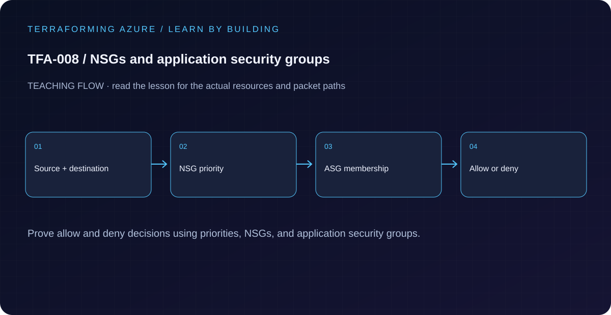

# TFA-008 — NSGs and application security groups



## Goal

Read NSG priorities and service tags, distinguish ASG membership from filtering, and attach the NSG to the intended subnet.

## Prerequisites

Complete [TFA-007](../TFA-007/README.md). Earlier cloud labs should already be destroyed; this root deploys independently.

## Understand the design

An NSG applies ordered allow/deny rules to traffic at a subnet or NIC. Lower priority numbers are evaluated first. Default rules still exist below custom rules, including an allow within VirtualNetwork. This example adds a targeted HTTPS allow followed by a deny for other VNet-originated inbound traffic.

An ASG groups NIC IP configurations for rule targeting; it does not attach to an entire subnet and it does not enforce a rule by itself. The web ASG is empty in this control-plane lesson, so the configuration demonstrates policy shape without claiming a successful packet test.

## Architecture and resources

One VNet/workload subnet → one associated NSG. Priority 100 allows TCP/443 from VirtualNetwork to web-ASG members; priority 200 denies other VNet inbound traffic. The ASG has no NIC members yet.

**Cost:** Low: network objects only; no VMs are created. Destroy the lesson when finished. A stopped VM may still have billable disks; deleting all lab resources is the cleanup target.

## Inputs and working directory

Use PowerShell 7 from the repository root, then enter this lesson folder. Copy the example once and edit only the untracked terraform.tfvars. location defaults to westeurope; name_prefix isolates this lesson; tags contains non-secret ownership metadata. subscription_id is required through TF_VAR_subscription_id. Provider auto-registration is disabled: complete TFA-002 readiness checks first.

```powershell
Set-Location labs/TFA-008
```

## Build and inspect

Read main.tf before running the commands. Review the proposed actions and
subscription before approving an apply. An existing tfvars file should be edited,
not overwritten; skip Copy-Item when you already have one.

```powershell
az login
az account list --output table
az account set --subscription '<your-subscription-guid>'
$env:TF_VAR_subscription_id = az account show --query id --output tsv
az account show --query '{tenant:tenantId,subscription:id,user:user.name}' --output table
Copy-Item terraform.tfvars.example terraform.tfvars
terraform init -backend=false -input=false -lockfile=readonly
terraform fmt -check
terraform validate
terraform plan -out=tfplan
terraform show tfplan
terraform apply tfplan
```

Never commit terraform.tfvars, backend runtime files, saved plans, state, crash
logs, or secret-bearing command output. Keep dependency lockfiles in source control.

## Validate and collect evidence

```powershell
$rg = terraform output -raw resource_group_name
$nsg = terraform output -raw nsg_name
az network nsg rule list -g $rg --nsg-name $nsg --query "[].{name:name,priority:priority,access:access,destination:destinationPortRange}" -o table
az network vnet subnet show --ids (terraform output -raw subnet_id) --query networkSecurityGroup.id -o tsv
```

**Expected:** The allow rule has priority 100, the deny rule has priority 200, and the subnet references the created NSG. These checks verify configuration, not end-to-end connectivity.

For a deployable lesson, finish with terraform plan -detailed-exitcode: 0 means
no changes, 2 means a change exists, and 1 means an error. A mock test checks
configuration behavior; it is not a network connectivity test.

## Exercises

1. Explain which custom rule handles TCP/443 to an ASG member and which handles TCP/3389 from another VNet host.
2. Plan an HTTPS source change from VirtualNetwork to 10.8.2.0/24. Expect a rule update and explain why service tags and explicit prefixes have different scopes. Restore it afterward.
3. Explain the diagram and your validation evidence to another learner. Include
   what the evidence does and does not prove, then answer [five review questions](quiz.json).

## Break and repair

Temporarily change the allow priority to 200, matching the deny. Review the conflict and restore unique priorities before apply. Then explain why an unattached NSG or empty ASG can invalidate an otherwise plausible security claim.

## Troubleshooting

| Symptom | Investigation |
|---|---|
| Initialization or schema validation fails | Check the working directory, Terraform version, module source paths, and tracked provider lockfile. Run init before validate. |
| Azure returns authorization, quota, or region errors | Verify the explicit subscription and tenant, role scope, registered provider, regional SKU availability, and quota from TFA-002. |
| Results differ from the expected evidence | Compare the actual resource IDs and effective state with this lesson's architecture. Read the service-specific explanation above before changing permissions or network policy. |

## Cleanup and proof

```powershell
$rg = terraform output -raw resource_group_name
terraform destroy
terraform state list
az group exists --name $rg --subscription $env:TF_VAR_subscription_id
Remove-Item tfplan -ErrorAction SilentlyContinue
```

State should contain no managed resources. Azure CLI should return false for the deleted group (or an empty list for the multi-group lesson).

## Production differences

Validate real application traffic using representative endpoints and effective security rules. Consider both subnet and NIC NSGs, platform traffic, stateful behavior, and the intended default-deny policy.

## Navigation

[Previous: TFA-007](../TFA-007/README.md) · [Curriculum](../../README.md) · [Next: TFA-009](../TFA-009/README.md)
