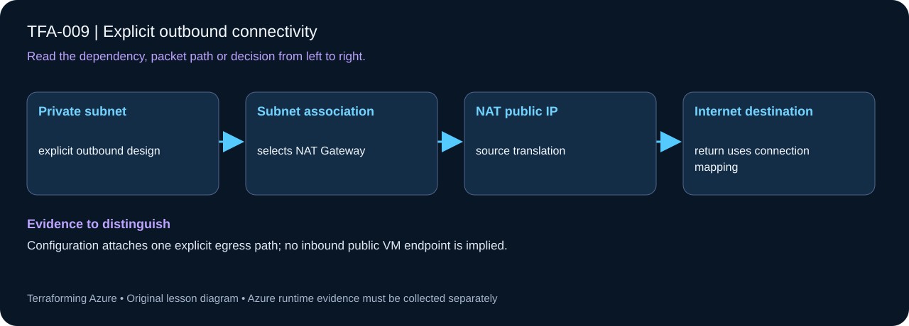

# TFA-009 — Explicit outbound connectivity

<!-- lab-metadata:start -->
**Phase 2:** Azure networks

**Learning target:** 75 minutes · **Cost tier:** Moderate · **Run mode:** `azure`

**Prerequisites:** [TFA-008 — NSGs and application security groups](../TFA-008/README.md)
<!-- lab-metadata:end -->

<!-- lab-diagram:start -->

<!-- lab-diagram:end -->

## Goal

Connect a private subnet to an explicit NAT Gateway and distinguish outbound SNAT from inbound publication.

## Workspace and isolation

Earlier cloud labs should already be destroyed; this root deploys independently. Concept prerequisites are listed in the generated catalog block.

## Predict the mechanism

NAT Gateway translates outbound connections from its associated subnet to a selected public source address. The NAT public IP is not a public IP on the VM and creates no inbound listener. A subnet can exist with NAT configured before any workload proves outbound behavior.

Before running commands, write the expected result: **Configuration attaches one explicit egress path; no inbound public VM endpoint is implied.** Then explain what would change in this controlled failure: Remove the NAT subnet association in a reviewed plan and identify the missing egress dependency. Record your prediction before inspecting the outcome.

## Understand the design

A private IP has no direct Internet return path. NAT Gateway translates outbound flows to a stable public source address and tracks their return traffic. It does not create an inbound listener or permit unsolicited inbound connections.

The subnet disables default outbound access and explicitly associates a Standard NAT Gateway and Standard static public IP. There is no VM here; the goal is to inspect a complete egress path before depending on it during the Windows bootstrap in TFA-010.

## Architecture and resources

Private workload subnet → NAT Gateway → Standard static public IPv4 → Internet destination. Replies return through the NAT mapping; no public IP is attached to a workload NIC.

See the catalog cost tier above and the [cost and cleanup guide](../../docs/cost-and-cleanup.md). Destroy the lesson when finished and verify its actual resource names.

## Inputs and working directory

Use PowerShell 7 from the repository root, then enter this lesson folder. Copy the example once and edit only the untracked terraform.tfvars. location defaults to westeurope; name_prefix isolates this lesson; tags contains non-secret ownership metadata. subscription_id is required through TF_VAR_subscription_id. Provider auto-registration is disabled: complete TFA-002 readiness checks first.

```powershell
Set-Location labs/TFA-009
```

## Build and inspect

Read main.tf before running the commands. Review the proposed actions and
subscription before approving an apply. An existing tfvars file should be edited,
not overwritten; skip Copy-Item when you already have one.

```powershell
az login
az account list --output table
az account set --subscription '<your-subscription-guid>'
$env:TF_VAR_subscription_id = az account show --query id --output tsv
az account show --query '{tenant:tenantId,subscription:id,user:user.name}' --output table
Copy-Item terraform.tfvars.example terraform.tfvars
terraform init -backend=false -input=false -lockfile=readonly
terraform fmt -check
terraform validate
terraform plan -out=tfplan
terraform show tfplan
terraform apply tfplan
```

Never commit terraform.tfvars, backend runtime files, saved plans, state, crash
logs, or secret-bearing command output. Keep dependency lockfiles in source control.

## Validate and collect evidence

```powershell
$rg = terraform output -raw resource_group_name
az network nat gateway list -g $rg --query "[].{name:name,state:provisioningState,ips:publicIpAddresses[].id}" -o json
az network vnet subnet show --ids (terraform output -raw subnet_id) --query "{nat:natGateway.id,defaultOutbound:defaultOutboundAccess}" -o json
terraform output -raw outbound_public_ip
```

**Expected:** The NAT Gateway is Succeeded with a public IP association. The workload subnet points to that gateway and defaultOutboundAccess is false. No traffic test is claimed until a workload exists.

For a deployable lesson, finish with terraform plan -detailed-exitcode: 0 means
no changes, 2 means a change exists, and 1 means an error. A mock test checks
configuration behavior; it is not a network connectivity test.

## Exercises

1. Draw the source and destination addresses before and after outbound SNAT, then describe why that public IP cannot be used for an inbound RDP connection.
2. Inspect dependencies in terraform graph. Explain why a subnet association and public IP association must both exist before a VM bootstrap depends on working outbound access.
3. Explain the diagram and your validation evidence to another learner. Include
   what the evidence does and does not prove, then answer [five review questions](quiz.json).

## Break and repair

Comment out the subnet association and plan. Expect removal of the egress attachment while the NAT resource remains. Do not apply the broken design; restore it and confirm no change. In TFA-010 use a workload test to prove the actual source address.

## Troubleshooting

| Symptom | Investigation |
|---|---|
| Initialization or schema validation fails | Check the working directory, Terraform version, module source paths, and tracked provider lockfile. Run init before validate. |
| Azure returns authorization, quota, or region errors | Verify the explicit subscription and tenant, role scope, registered provider, regional SKU availability, and quota from TFA-002. |
| Results differ from the expected evidence | Compare the actual resource IDs and effective state with this lesson's architecture. Read the service-specific explanation above before changing permissions or network policy. |

## Cleanup and proof

```powershell
$rg = terraform output -raw resource_group_name
if ($LASTEXITCODE -ne 0 -or -not $rg) { throw 'Capture the exact owned group before destruction.' }
terraform destroy
if ($LASTEXITCODE -ne 0) { throw 'Destroy failed: keep state and investigate before continuing.' }
$remaining = @(terraform state list)
if ($LASTEXITCODE -ne 0 -or $remaining.Count) { throw 'Cleanup left managed objects or state could not be read.' }
$groupExists = az group exists --name $rg --subscription $env:TF_VAR_subscription_id
if ($LASTEXITCODE -ne 0 -or $groupExists -ne 'false') { throw 'The owned group is not confirmed deleted. Keep state and investigate.' }
Remove-Item tfplan -ErrorAction SilentlyContinue
```

State should contain no managed resources. Azure CLI should return false for the deleted group (or an empty list for the multi-group lesson).

## Production differences

Choose egress deliberately for policy, routing, resilience, scale, and cost. NAT alone provides translation; it does not enforce the application filtering later introduced by Azure Firewall.

## Navigation

[Previous: TFA-008](../TFA-008/README.md) · [Curriculum](../../README.md) · [Next: TFA-010](../TFA-010/README.md)

## Evidence contract

Inspect subnet/NAT/public-IP associations; use the later private Windows workload to observe actual egress. Configuration attaches one explicit egress path; no inbound public VM endpoint is implied.

See the [40-lab evidence map](../../docs/curriculum-evidence.md) for source paths, validation level and cleanup dependencies. Authored Azure commands are learner exercises; passing local checks does not establish a live deployment.
