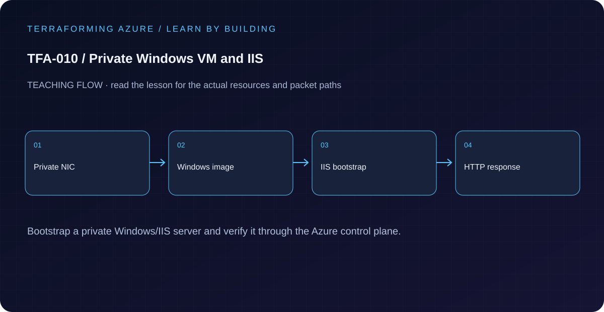

# TFA-010 — Private Windows VM and IIS



## Goal

Provision a private Windows VM, bootstrap IIS after explicit egress exists, and validate the application without publishing an inbound endpoint.

## Prerequisites

Complete [TFA-009](../TFA-009/README.md). Earlier cloud labs should already be destroyed; this root deploys independently. Confirm regional Windows VM SKU/vCPU quota. Use a unique password and protect local state.

## Understand the design

A VM depends on a NIC and subnet. Its agent and extension add another lifecycle: Azure may finish creating the VM before application installation has completed. The IIS extension therefore waits for both NAT associations, and validation checks the application after extension provisioning.

The administrator password is a required sensitive input supplied through a process environment variable. Sensitive suppresses ordinary display; it does not remove the password from Terraform state or saved plans. Protect local state and never commit runtime artifacts.

## Architecture and resources

One private Windows Server 2022 VM in 10.10.1.0/24, no NIC public IP, NAT egress, and a Custom Script extension installing IIS. Azure Run Command provides an evidence path through the VM agent.

**Cost:** Moderate: Windows VM, disk, NAT Gateway, and public NAT IPv4 are billed. Destroy the lesson when finished. A stopped VM may still have billable disks; deleting all lab resources is the cleanup target.

## Inputs and working directory

Use PowerShell 7 from the repository root, then enter this lesson folder. Copy the example once and edit only the untracked terraform.tfvars. location defaults to westeurope; name_prefix isolates this lesson; tags contains non-secret ownership metadata. subscription_id is required through TF_VAR_subscription_id. Provider auto-registration is disabled: complete TFA-002 readiness checks first.

```powershell
Set-Location labs/TFA-010
```

## Build and inspect

Read main.tf before running the commands. Review the proposed actions and
subscription before approving an apply. An existing tfvars file should be edited,
not overwritten; skip Copy-Item when you already have one.

```powershell
az login
az account list --output table
az account set --subscription '<your-subscription-guid>'
$env:TF_VAR_subscription_id = az account show --query id --output tsv
az account show --query '{tenant:tenantId,subscription:id,user:user.name}' --output table
Copy-Item terraform.tfvars.example terraform.tfvars
$securePassword = Read-Host 'Unique Windows administrator password' -AsSecureString
$env:TF_VAR_admin_password = [System.Net.NetworkCredential]::new('', $securePassword).Password
terraform init -backend=false -input=false -lockfile=readonly
terraform fmt -check
terraform validate
terraform plan -out=tfplan
terraform show tfplan
terraform apply tfplan
```

Never commit terraform.tfvars, backend runtime files, saved plans, state, crash
logs, or secret-bearing command output. Keep dependency lockfiles in source control.

## Validate and collect evidence

```powershell
$rg = terraform output -raw resource_group_name
$vm = terraform output -raw vm_name
az vm extension list -g $rg --vm-name $vm --query "[].{name:name,state:provisioningState}" -o table
az vm run-command invoke -g $rg -n $vm --command-id RunPowerShellScript --scripts "(Invoke-WebRequest http://localhost -UseBasicParsing).StatusCode; Get-Content C:/inetpub/wwwroot/Default.htm" --query "value[].message" -o tsv
az network nic show -g $rg -n (terraform output -raw nic_name) --query "ipConfigurations[].publicIPAddress" -o json
```

**Expected:** The IIS extension reports Succeeded. Run Command returns HTTP 200 and Terraforming Azure TFA-010. The NIC public-IP result contains no assigned public IP. Inspecting a public NAT IP does not mean the web server is publicly reachable.

For a deployable lesson, finish with terraform plan -detailed-exitcode: 0 means
no changes, 2 means a change exists, and 1 means an error. A mock test checks
configuration behavior; it is not a network connectivity test.

## Exercises

1. Use Run Command with (Invoke-RestMethod https://api.ipify.org) and compare its result with outbound_public_ip. An external lookup is optional and depends on that service availability.
2. Run Get-WindowsFeature Web-Server through Run Command, then inspect the extension state separately. Distinguish OS capability, extension success, and HTTP behavior.
3. Explain the diagram and your validation evidence to another learner. Include
   what the evidence does and does not prove, then answer [five review questions](quiz.json).

## Break and repair

Use Run Command to stop W3SVC, repeat the localhost HTTP test, and record the failure. Repair with Start-Service W3SVC and prove HTTP 200 again. Terraform plan may remain empty because it does not model guest service runtime.

## Troubleshooting

| Symptom | Investigation |
|---|---|
| Initialization or schema validation fails | Check the working directory, Terraform version, module source paths, and tracked provider lockfile. Run init before validate. |
| Azure returns authorization, quota, or region errors | Verify the explicit subscription and tenant, role scope, registered provider, regional SKU availability, and quota from TFA-002. |
| Results differ from the expected evidence | Compare the actual resource IDs and effective state with this lesson's architecture. Read the service-specific explanation above before changing permissions or network policy. |

## Cleanup and proof

```powershell
$rg = terraform output -raw resource_group_name
terraform destroy
terraform state list
az group exists --name $rg --subscription $env:TF_VAR_subscription_id
Remove-Item tfplan -ErrorAction SilentlyContinue
Remove-Item Env:TF_VAR_admin_password -ErrorAction SilentlyContinue
Remove-Variable securePassword -ErrorAction SilentlyContinue
```

State should contain no managed resources. Azure CLI should return false for the deleted group (or an empty list for the multi-group lesson).

## Production differences

Use managed images, configuration management, patching, monitoring, backup, identity, and protected secret/state handling. Re-running a Terraform plan does not establish guest application health.

## Navigation

[Previous: TFA-009](../TFA-009/README.md) · [Curriculum](../../README.md) · [Next: TFA-011](../TFA-011/README.md)
