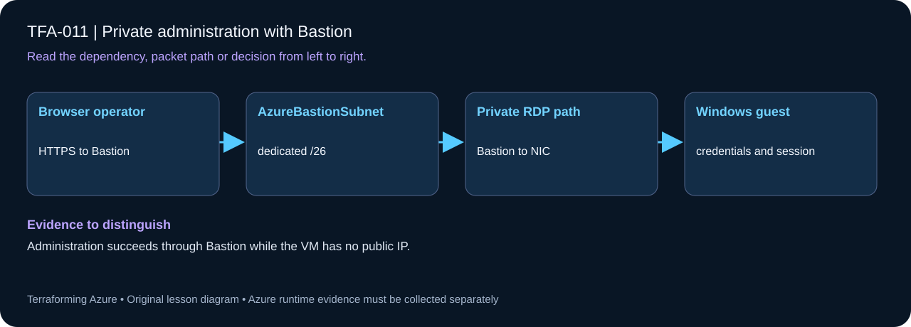

# TFA-011 — Private administration with Bastion

<!-- lab-metadata:start -->
**Phase 2:** Azure networks

**Learning target:** 120 minutes · **Cost tier:** High · **Run mode:** `azure`

**Prerequisites:** [TFA-010 — Private Windows VM and IIS](../TFA-010/README.md)
<!-- lab-metadata:end -->

<!-- lab-diagram:start -->

<!-- lab-diagram:end -->

## Goal

Administer a VM over its private IP through Azure Bastion while restricting RDP to the Bastion subnet.

## Workspace and isolation

Earlier cloud labs should already be destroyed; this root deploys independently. Concept prerequisites are listed in the generated catalog block. Confirm regional Windows VM SKU/vCPU quota. Use a unique password and protect local state.

## Predict the mechanism

Bastion terminates the administrative session in its dedicated subnet and reaches the VM privately. The VM therefore does not need a public IP or public RDP allowance. Bastion service health alone does not prove that the guest accepts credentials and an RDP connection.

Before running commands, write the expected result: **Administration succeeds through Bastion while the VM has no public IP.** Then explain what would change in this controlled failure: Inspect an intentionally missing guest or NSG allowance; restore only the required path. Record your prediction before inspecting the outcome.

## Understand the design

Azure Bastion terminates the browser administration session and reaches the VM over the VNet. Its public endpoint belongs to the managed Bastion service; the VM NIC remains private. Basic SKU supports this browser exercise; native-client tunnelling requires a different supported SKU and configuration.

The VM subnet NSG explicitly allows TCP/3389 from AzureBastionSubnet and then denies other RDP sources. Broad default VirtualNetwork rules otherwise make it easy to accidentally allow lateral administration. This lab preserves Bastion-required service connectivity by leaving its dedicated subnet free of a custom NSG.

## Architecture and resources

Browser HTTPS → Basic Bastion in AzureBastionSubnet (10.11.0.0/26) → private Windows VM. A separate NAT path supplies VM outbound connectivity.

See the catalog cost tier above and the [cost and cleanup guide](../../docs/cost-and-cleanup.md). Destroy the lesson when finished and verify its actual resource names.

## Inputs and working directory

Use PowerShell 7 from the repository root, then enter this lesson folder. Copy the example once and edit only the untracked terraform.tfvars. location defaults to westeurope; name_prefix isolates this lesson; tags contains non-secret ownership metadata. subscription_id is required through TF_VAR_subscription_id. Provider auto-registration is disabled: complete TFA-002 readiness checks first.

```powershell
Set-Location labs/TFA-011
```

## Build and inspect

Read main.tf before running the commands. Review the proposed actions and
subscription before approving an apply. An existing tfvars file should be edited,
not overwritten; skip Copy-Item when you already have one.

```powershell
az login
az account list --output table
az account set --subscription '<your-subscription-guid>'
$env:TF_VAR_subscription_id = az account show --query id --output tsv
az account show --query '{tenant:tenantId,subscription:id,user:user.name}' --output table
Copy-Item terraform.tfvars.example terraform.tfvars
$securePassword = Read-Host 'Unique Windows administrator password' -AsSecureString
$env:TF_VAR_admin_password = [System.Net.NetworkCredential]::new('', $securePassword).Password
terraform init -backend=false -input=false -lockfile=readonly
terraform fmt -check
terraform validate
terraform plan -out=tfplan
terraform show tfplan
terraform apply tfplan
```

Never commit terraform.tfvars, backend runtime files, saved plans, state, crash
logs, or secret-bearing command output. Keep dependency lockfiles in source control.

## Validate and collect evidence

```powershell
$rg = terraform output -raw resource_group_name
az network bastion show -g $rg -n (terraform output -raw bastion_name) --query "{state:provisioningState,sku:sku.name}" -o json
az network nic list-effective-nsg -g $rg -n (terraform output -raw nic_name) -o json
az network nic show -g $rg -n (terraform output -raw nic_name) --query "ipConfigurations[].privateIPAddress" -o tsv
```

**Expected:** Bastion is Succeeded with Basic SKU. Effective NSG evidence includes allow-bastion-rdp at priority 100 and deny-other-rdp at 110. In the portal, select the lab VM → Connect → Bastion, authenticate as tfalearner, and verify the hostname in the RDP session.

For a deployable lesson, finish with terraform plan -detailed-exitcode: 0 means
no changes, 2 means a change exists, and 1 means an error. A mock test checks
configuration behavior; it is not a network connectivity test.

## Exercises

1. Capture the private VM IP, Bastion subnet prefix, and effective RDP rule sources. Explain every hop from your browser to the VM.
2. Plan a change allowing RDP from VirtualNetwork and explain its wider lateral scope. Restore the restricted rule without applying it.
3. Explain the diagram and your validation evidence to another learner. Include
   what the evidence does and does not prove, then answer [five review questions](quiz.json).

## Break and repair

After a successful session, temporarily change allow-bastion-rdp destination port to 3390, apply the reviewed change, and start a new session. It should fail because deny-other-rdp still blocks 3389. Restore 3389, apply, and prove a new session succeeds.

## Troubleshooting

| Symptom | Investigation |
|---|---|
| Initialization or schema validation fails | Check the working directory, Terraform version, module source paths, and tracked provider lockfile. Run init before validate. |
| Azure returns authorization, quota, or region errors | Verify the explicit subscription and tenant, role scope, registered provider, regional SKU availability, and quota from TFA-002. |
| Results differ from the expected evidence | Compare the actual resource IDs and effective state with this lesson's architecture. Read the service-specific explanation above before changing permissions or network policy. |

## Cleanup and proof

```powershell
$rg = terraform output -raw resource_group_name
if ($LASTEXITCODE -ne 0 -or -not $rg) { throw 'Capture the exact owned group before destruction.' }
terraform destroy
if ($LASTEXITCODE -ne 0) { throw 'Destroy failed: keep state and investigate before continuing.' }
$remaining = @(terraform state list)
if ($LASTEXITCODE -ne 0 -or $remaining.Count) { throw 'Cleanup left managed objects or state could not be read.' }
$groupExists = az group exists --name $rg --subscription $env:TF_VAR_subscription_id
if ($LASTEXITCODE -ne 0 -or $groupExists -ne 'false') { throw 'The owned group is not confirmed deleted. Keep state and investigate.' }
Remove-Item tfplan -ErrorAction SilentlyContinue
Remove-Item Env:TF_VAR_admin_password -ErrorAction SilentlyContinue
Remove-Variable securePassword -ErrorAction SilentlyContinue
```

State should contain no managed resources. Azure CLI should return false for the deleted group (or an empty list for the multi-group lesson).

## Production differences

Select supported zones, capacity/SKU, session controls, audit, identity, and approved management paths. Review Bastion-specific networking requirements before placing an NSG on its dedicated subnet.

## Navigation

[Previous: TFA-010](../TFA-010/README.md) · [Curriculum](../../README.md) · [Next: TFA-012](../TFA-012/README.md)

## Evidence contract

Use the authored Bastion browser connection to the private Windows VM and inspect its NIC. Administration succeeds through Bastion while the VM has no public IP.

See the [40-lab evidence map](../../docs/curriculum-evidence.md) for source paths, validation level and cleanup dependencies. Authored Azure commands are learner exercises; passing local checks does not establish a live deployment.
