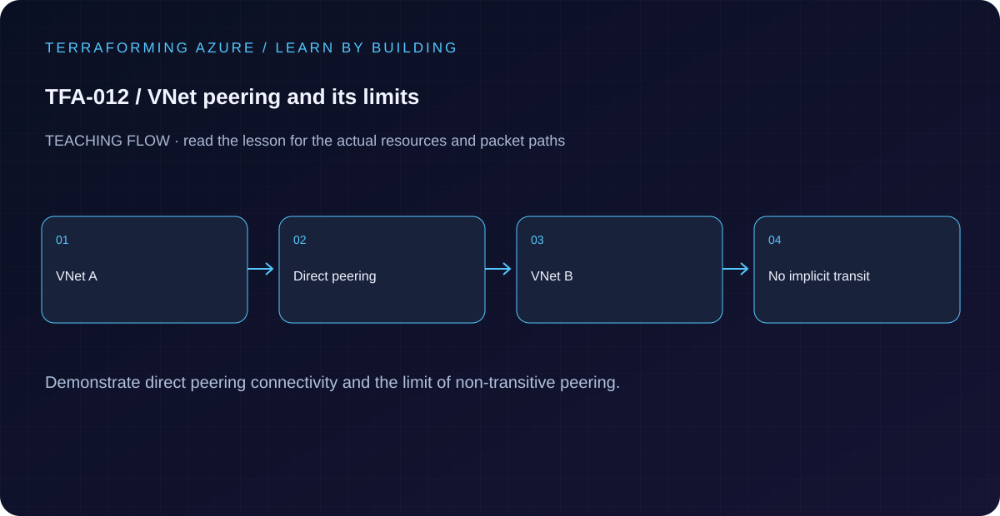

# TFA-012 — VNet peering and its limits



## Goal

Create both directions of a direct VNet peering and explain why peering is not automatically transitive.

## Prerequisites

Complete [TFA-011](../TFA-011/README.md). Earlier cloud labs should already be destroyed; this root deploys independently.

## Understand the design

A peering is configured on each participating VNet. A direct pair connects the hub and spoke; one declaration is not a bidirectional Terraform object. Address spaces must not overlap. Peering connection state proves the control-plane relationship, not that every application path is permitted.

The third VNet starts isolated. Adding a second pair between hub and isolated still does not create a routed spoke-to-isolated path through the hub. The hub needs an actual forwarding design, appropriate UDRs, and forwarded-traffic settings for that topology. Setting allow_forwarded_traffic does not turn a VNet into a router.

## Architecture and resources

Hub 10.12.0.0/16 ↔ spoke 10.13.0.0/16. Isolated VNet 10.14.0.0/16 has no initial peer. No gateway, firewall, forwarding VM, or workload is present.

**Cost:** Low for empty networks; peering data transfer is billed when traffic flows. Destroy the lesson when finished. A stopped VM may still have billable disks; deleting all lab resources is the cleanup target.

## Inputs and working directory

Use PowerShell 7 from the repository root, then enter this lesson folder. Copy the example once and edit only the untracked terraform.tfvars. location defaults to westeurope; name_prefix isolates this lesson; tags contains non-secret ownership metadata. subscription_id is required through TF_VAR_subscription_id. Provider auto-registration is disabled: complete TFA-002 readiness checks first.

```powershell
Set-Location labs/TFA-012
```

## Build and inspect

Read main.tf before running the commands. Review the proposed actions and
subscription before approving an apply. An existing tfvars file should be edited,
not overwritten; skip Copy-Item when you already have one.

```powershell
az login
az account list --output table
az account set --subscription '<your-subscription-guid>'
$env:TF_VAR_subscription_id = az account show --query id --output tsv
az account show --query '{tenant:tenantId,subscription:id,user:user.name}' --output table
Copy-Item terraform.tfvars.example terraform.tfvars
terraform init -backend=false -input=false -lockfile=readonly
terraform fmt -check
terraform validate
terraform plan -out=tfplan
terraform show tfplan
terraform apply tfplan
```

Never commit terraform.tfvars, backend runtime files, saved plans, state, crash
logs, or secret-bearing command output. Keep dependency lockfiles in source control.

## Validate and collect evidence

```powershell
$nets = terraform output -json vnet_names | ConvertFrom-Json
$rg = terraform output -raw resource_group_name
az network vnet peering list -g $rg --vnet-name $nets.hub --query "[].{name:name,state:peeringState,sync:peeringSyncLevel}" -o table
az network vnet peering list -g $rg --vnet-name $nets.spoke --query "[].{name:name,state:peeringState}" -o table
az network vnet peering list -g $rg --vnet-name $nets.isolated -o json
```

**Expected:** Hub and spoke each show one Connected peering. Isolated returns an empty peering list. There is no dataplane evidence because the lesson has no test hosts.

For a deployable lesson, finish with terraform plan -detailed-exitcode: 0 means
no changes, 2 means a change exists, and 1 means an error. A mock test checks
configuration behavior; it is not a network connectivity test.

## Exercises

1. Add hub_to_isolated and isolated_to_hub entries to local.peers and inspect the plan. Expect two additional peering resources; explain why transitive connectivity is still absent.
2. Compare allow_gateway_transit and use_remote_gateways with allow_forwarded_traffic. Identify which require an actual gateway or forwarding appliance.
3. Explain the diagram and your validation evidence to another learner. Include
   what the evidence does and does not prove, then answer [five review questions](quiz.json).

## Break and repair

Change the spoke CIDR to overlap the hub and inspect the plan. Terraform can describe the resources, but Azure cannot establish that peering. Restore nonoverlapping ranges before applying. Do not treat plan success as a network-design validator.

## Troubleshooting

| Symptom | Investigation |
|---|---|
| Initialization or schema validation fails | Check the working directory, Terraform version, module source paths, and tracked provider lockfile. Run init before validate. |
| Azure returns authorization, quota, or region errors | Verify the explicit subscription and tenant, role scope, registered provider, regional SKU availability, and quota from TFA-002. |
| Results differ from the expected evidence | Compare the actual resource IDs and effective state with this lesson's architecture. Read the service-specific explanation above before changing permissions or network policy. |

## Cleanup and proof

```powershell
$rg = terraform output -raw resource_group_name
terraform destroy
terraform state list
az group exists --name $rg --subscription $env:TF_VAR_subscription_id
Remove-Item tfplan -ErrorAction SilentlyContinue
```

State should contain no managed resources. Azure CLI should return false for the deleted group (or an empty list for the multi-group lesson).

## Production differences

Document address ownership, cross-subscription permissions, gateway sharing, forwarded paths, DNS, security policy, and connectivity tests. Peering only supplies one part of the complete path.

## Navigation

[Previous: TFA-011](../TFA-011/README.md) · [Curriculum](../../README.md) · [Next: TFA-013](../TFA-013/README.md)
