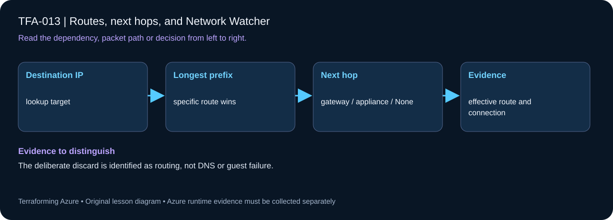

# TFA-013 — Routes, next hops, and Network Watcher

<!-- lab-metadata:start -->
**Phase 2:** Azure networks

**Learning target:** 75 minutes · **Cost tier:** Low · **Run mode:** `azure`

**Prerequisites:** [TFA-012 — VNet peering and its limits](../TFA-012/README.md)
<!-- lab-metadata:end -->

<!-- lab-diagram:start -->

<!-- lab-diagram:end -->

## Goal

Inspect effective NIC routes and diagnose an intentional discard route before introducing a firewall next hop.

## Workspace and isolation

Earlier cloud labs should already be destroyed; this root deploys independently. Concept prerequisites are listed in the generated catalog block. Network Watcher must already be enabled in the selected region for the optional next-hop command; effective-route inspection does not require taking ownership of it. Confirm regional Windows VM SKU/vCPU quota. Use a unique password and protect local state.

## Predict the mechanism

Azure selects the longest matching destination prefix before considering equal-prefix route precedence. A default route cannot override a more-specific private path. A route with next hop None deliberately discards matching traffic and differs from a blocked NSG or a stopped service.

Before running commands, write the expected result: **The deliberate discard is identified as routing, not DNS or guest failure.** Then explain what would change in this controlled failure: Restore the wrong next hop and compare the exact same source/destination. Record your prediction before inspecting the outcome.

## Understand the design

Azure combines system routes, user-defined routes, and propagated routes. Prefix specificity is fundamental: a more specific match wins before comparing route-source preference for equal prefixes. Inspect effective routes on the actual NIC instead of assuming the route-table definition is the whole routing picture.

This lab uses a real discard next hop, None, for 10.60.0.0/16. It does not invent a non-existent virtual appliance IP. The VM has no general Internet egress or IIS bootstrap; platform VM provisioning and control-plane evidence are sufficient for the route lesson.

## Architecture and resources

Private VM in 10.15.1.0/24 → subnet-associated route table → 10.60.0.0/16 next hop None. This route intentionally blackholes that destination range.

See the catalog cost tier above and the [cost and cleanup guide](../../docs/cost-and-cleanup.md). Destroy the lesson when finished and verify its actual resource names.

## Inputs and working directory

Use PowerShell 7 from the repository root, then enter this lesson folder. Copy the example once and edit only the untracked terraform.tfvars. location defaults to westeurope; name_prefix isolates this lesson; tags contains non-secret ownership metadata. subscription_id is required through TF_VAR_subscription_id. Provider auto-registration is disabled: complete TFA-002 readiness checks first.

```powershell
Set-Location labs/TFA-013
```

## Build and inspect

Read main.tf before running the commands. Review the proposed actions and
subscription before approving an apply. An existing tfvars file should be edited,
not overwritten; skip Copy-Item when you already have one.

```powershell
az login
az account list --output table
az account set --subscription '<your-subscription-guid>'
$env:TF_VAR_subscription_id = az account show --query id --output tsv
az account show --query '{tenant:tenantId,subscription:id,user:user.name}' --output table
Copy-Item terraform.tfvars.example terraform.tfvars
$securePassword = Read-Host 'Unique Windows administrator password' -AsSecureString
$env:TF_VAR_admin_password = [System.Net.NetworkCredential]::new('', $securePassword).Password
terraform init -backend=false -input=false -lockfile=readonly
terraform fmt -check
terraform validate
terraform plan -out=tfplan
terraform show tfplan
terraform apply tfplan
```

Never commit terraform.tfvars, backend runtime files, saved plans, state, crash
logs, or secret-bearing command output. Keep dependency lockfiles in source control.

## Validate and collect evidence

```powershell
$rg = terraform output -raw resource_group_name
$nic = terraform output -raw nic_name
az network nic show-effective-route-table -g $rg -n $nic --query "value[].{prefix:addressPrefix,nextHop:nextHopType,source:source,state:state}" -o table
az network route-table route list -g $rg --route-table-name (terraform output -raw route_table_name) -o table
# Optional: requires Network Watcher already enabled in the region.
az network watcher show-next-hop -g $rg --vm (terraform output -raw vm_name) --source-ip (terraform output -raw private_ip_address) --dest-ip 10.60.0.4 -o json
```

**Expected:** The effective route set contains the user route for 10.60.0.0/16 with next hop None. Network Watcher, when enabled, reports None for 10.60.0.4. The route-table association is necessary for that result.

For a deployable lesson, finish with terraform plan -detailed-exitcode: 0 means
no changes, 2 means a change exists, and 1 means an error. A mock test checks
configuration behavior; it is not a network connectivity test.

## Exercises

1. Add a more specific 10.60.1.0/24 route with next hop None and compare effective routes. Explain longest-prefix matching even when both routes discard.
2. Inspect the VirtualNetwork system route and explain why it remains present alongside the deliberate discard route.
3. Explain the diagram and your validation evidence to another learner. Include
   what the evidence does and does not prove, then answer [five review questions](quiz.json).

## Break and repair

Temporarily remove only the route-table association and plan. The table and route can still exist while no longer affecting the VM subnet. Restore the association; after applying an intentional association test, verify effective routes again rather than relying on resource existence.

## Troubleshooting

| Symptom | Investigation |
|---|---|
| Initialization or schema validation fails | Check the working directory, Terraform version, module source paths, and tracked provider lockfile. Run init before validate. |
| Azure returns authorization, quota, or region errors | Verify the explicit subscription and tenant, role scope, registered provider, regional SKU availability, and quota from TFA-002. |
| Results differ from the expected evidence | Compare the actual resource IDs and effective state with this lesson's architecture. Read the service-specific explanation above before changing permissions or network policy. |

## Cleanup and proof

```powershell
$rg = terraform output -raw resource_group_name
if ($LASTEXITCODE -ne 0 -or -not $rg) { throw 'Capture the exact owned group before destruction.' }
terraform destroy
if ($LASTEXITCODE -ne 0) { throw 'Destroy failed: keep state and investigate before continuing.' }
$remaining = @(terraform state list)
if ($LASTEXITCODE -ne 0 -or $remaining.Count) { throw 'Cleanup left managed objects or state could not be read.' }
$groupExists = az group exists --name $rg --subscription $env:TF_VAR_subscription_id
if ($LASTEXITCODE -ne 0 -or $groupExists -ne 'false') { throw 'The owned group is not confirmed deleted. Keep state and investigate.' }
Remove-Item tfplan -ErrorAction SilentlyContinue
Remove-Item Env:TF_VAR_admin_password -ErrorAction SilentlyContinue
Remove-Variable securePassword -ErrorAction SilentlyContinue
```

State should contain no managed resources. Azure CLI should return false for the deleted group (or an empty list for the multi-group lesson).

## Production differences

Network Watcher is a regional shared capability; verify it is enabled before its optional diagnostic command and do not import or destroy a shared watcher as part of this lab. Real appliances also require healthy forwarding, policy, return paths, and effective-route evidence.

## Navigation

[Previous: TFA-012](../TFA-012/README.md) · [Curriculum](../../README.md) · [Next: TFA-014](../TFA-014/README.md)

## Evidence contract

Read the effective route/next-hop evidence in the exercise and compare the selected destination prefix. The deliberate discard is identified as routing, not DNS or guest failure.

See the [40-lab evidence map](../../docs/curriculum-evidence.md) for source paths, validation level and cleanup dependencies. Authored Azure commands are learner exercises; passing local checks does not establish a live deployment.

## Interpret saved route evidence locally

[Test-RouteEvidence.ps1](Test-RouteEvidence.ps1) accepts an effective-route JSON response and a next-hop response for an explicitly supplied destination. It ignores inactive routes, selects the longest matching IPv4 prefix, applies user/BGP/default precedence for equal prefixes, and requires the selected next hop to agree with both the Network Watcher response and your expected result. `None` is reported as a discard; a successful API response is not treated as successful connectivity.

```powershell
# From the repository root; synthetic saved responses only.
./labs/TFA-013/Test-RouteEvidence.ps1 -EffectiveRoutesPath ./tests/fixtures/lesson-evidence/effective-routes.json -NextHopPath ./tests/fixtures/lesson-evidence/next-hop-discard.json -Destination 10.60.0.4 -ExpectedNextHop None
./labs/TFA-013/Test-RouteEvidence.ps1 -EffectiveRoutesPath ./tests/fixtures/lesson-evidence/effective-routes.json -NextHopPath ./tests/fixtures/lesson-evidence/next-hop-local.json -Destination 10.13.1.10 -ExpectedNextHop VnetLocal
```

The first selects 10.60.0.0/16 and reports a discard. The second selects 10.13.0.0/16 despite the broader RFC1918 discard and an inactive /32 entry. The regression also rejects conflicting next-hop evidence. To analyze an intentional later Azure exercise, save the **unprojected** `show-effective-route-table -o json` response so its `value`, `addressPrefix`, `state`, `source` and `nextHopType` fields remain available. These fixtures verify interpretation, not actual route programming or packet delivery.
