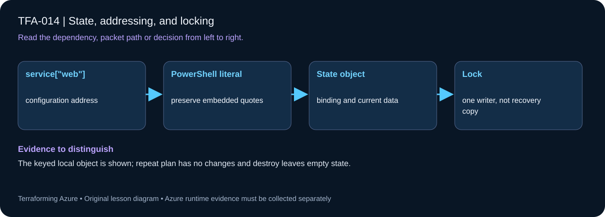

# TFA-014 — State, addressing, and locking



## Goal

Read resource identities in local state and demonstrate lock contention safely with two terminals.

## Prerequisites

Complete [TFA-013](../TFA-013/README.md). Earlier cloud labs should already be destroyed; this root deploys independently.

## Understand the design

State maps Terraform addresses to managed object identities and stores attributes required for planning. Editing state JSON by hand risks breaking those mappings. Backups and state-aware commands are safer tools. A state file is operational data, not a configuration file to commit.

Locking protects a state snapshot from concurrent writers when the backend supports it. This lesson uses built-in resources and the local backend. A second command must respect the first command’s lock; using -lock=false would remove that protection rather than repair the contention.

## Architecture and resources

Two keyed terraform_data resources share one local state file and its local lock. No cloud credentials or AzureRM provider are needed.

**Cost:** None Destroy the lesson when finished. A stopped VM may still have billable disks; deleting all lab resources is the cleanup target.

## Inputs and working directory

Use PowerShell 7 from the repository root, then enter this lesson folder. Copy the example once and edit only the untracked terraform.tfvars. Use only the lesson-specific inputs shown in main.tf and the example file. This local model does not require Azure authentication.

```powershell
Set-Location labs/TFA-014
```

## Build and inspect

Read main.tf before running the commands. Review the proposed actions and
subscription before approving an apply. An existing tfvars file should be edited,
not overwritten; skip Copy-Item when you already have one.

```powershell
Copy-Item terraform.tfvars.example terraform.tfvars
terraform init -backend=false -input=false
terraform fmt -check
terraform validate
terraform plan -out=tfplan
terraform show tfplan
terraform apply tfplan
```

Never commit terraform.tfvars, backend runtime files, saved plans, state, crash
logs, or secret-bearing command output. Keep dependency lockfiles in source control.

## Validate and collect evidence

```powershell
terraform state list
terraform state show terraform_data.service["web"]
terraform state pull | ConvertFrom-Json | Select-Object lineage,serial
terraform output -json service_ids
```

**Expected:** State lists api and web keyed addresses and contains one lineage plus an increasing serial as changes are saved. Each built-in resource has a persisted ID.

For a deployable lesson, finish with terraform plan -detailed-exitcode: 0 means
no changes, 2 means a change exists, and 1 means an error. A mock test checks
configuration behavior; it is not a network connectivity test.

## Exercises

1. In terminal A run terraform apply -var="revision=2" and leave the approval prompt open. In terminal B, from the same folder, run terraform plan -lock-timeout=5s. Expect an acquisition failure while terminal A holds the lock.
2. Cancel terminal A with Ctrl+C. Repeat the plan in terminal B and confirm it succeeds. Do not delete lock files or force-unlock an active operation.
3. Explain the diagram and your validation evidence to another learner. Include
   what the evidence does and does not prove, then answer [five review questions](quiz.json).

## Break and repair

If the second terminal fails to acquire the lock, identify the first process and stop or let it finish. Retry normally after it releases the lock. A genuine lock conflict is repaired by coordinating writers; -lock=false creates a race.

## Troubleshooting

| Symptom | Investigation |
|---|---|
| Initialization or schema validation fails | Check the working directory, Terraform version, module source paths, and tracked provider lockfile. Run init before validate. |
| Azure returns authorization, quota, or region errors | Verify the explicit subscription and tenant, role scope, registered provider, regional SKU availability, and quota from TFA-002. |
| Results differ from the expected evidence | Compare the actual resource IDs and effective state with this lesson's architecture. Read the service-specific explanation above before changing permissions or network policy. |

## Cleanup and proof

```powershell
terraform destroy
terraform state list
Remove-Item tfplan -ErrorAction SilentlyContinue
```

No Azure resource exists in this workflow. Managed local resources, when present, must be absent from state after cleanup.

## Production differences

Use a supported remote backend, controlled access, encryption, versioning, recovery exercises, and a single writer per state. A remote backend does not merge competing plans or make a broad state boundary safe.

## Navigation

[Previous: TFA-013](../TFA-013/README.md) · [Curriculum](../../README.md) · [Next: TFA-015](../TFA-015/README.md)
