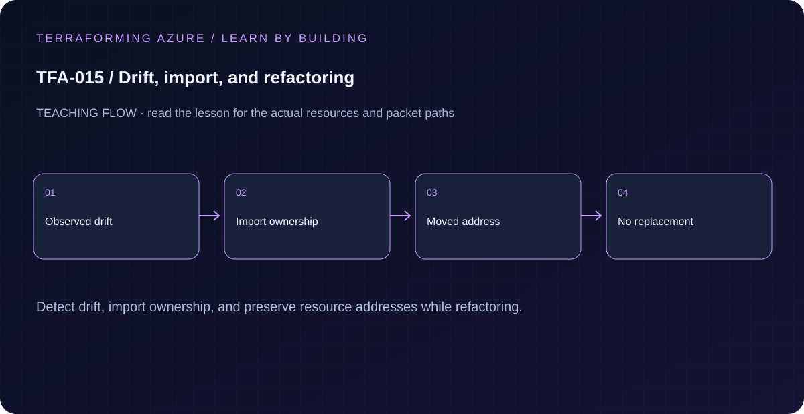

# TFA-015 — Drift, import, and refactoring

<!-- lab-metadata:start -->
**Phase 3:** Terraform engineering

**Learning target:** 75 minutes · **Cost tier:** Low · **Run mode:** `azure`

**Prerequisites:** [TFA-014 — State, addressing, and locking](../TFA-014/README.md)
<!-- lab-metadata:end -->

<!-- lab-diagram:start -->

<!-- lab-diagram:end -->

## Goal

Detect an out-of-band tag change, import an existing lab group, and move an address without replacing its Azure object.

## Workspace and isolation

Earlier cloud labs should already be destroyed; this root deploys independently. Concept prerequisites are listed in the generated catalog block.

## Predict the mechanism

Drift is a difference observed during refresh; Terraform configuration still determines the intended target. Import binds an existing object to an address but does not invent a well-matched configuration. A moved block preserves an existing binding during a declared address refactor.

Before running commands, write the expected result: **The intended existing object is bound once and moves address without replacement.** Then explain what would change in this controlled failure: Remove or mismatch the moved declaration, compare the destructive plan, then restore. Record your prediction before inspecting the outcome.

## Understand the design

Drift is a difference between the declared configuration and the observed object. Terraform refreshes provider observations during a normal plan, but you still decide whether to restore configuration or adopt the external change. A refresh-only apply records observations; it does not automatically change your source code.

Import establishes ownership of an existing object at a Terraform address. A moved block records an address refactor for an object Terraform already owns. Neither operation is a general permission bypass, and two states must never manage the same resource.

## Architecture and resources

One managed group at azurerm_resource_group.current. A moved block supports the former legacy address. An optional import.tf.example adds a second deliberately created empty group.

See the catalog cost tier above and the [cost and cleanup guide](../../docs/cost-and-cleanup.md). Destroy the lesson when finished and verify its actual resource names.

## Inputs and working directory

Use PowerShell 7 from the repository root, then enter this lesson folder. Copy the example once and edit only the untracked terraform.tfvars. location defaults to westeurope; name_prefix isolates this lesson; tags contains non-secret ownership metadata. subscription_id is required through TF_VAR_subscription_id. Provider auto-registration is disabled: complete TFA-002 readiness checks first.

```powershell
Set-Location labs/TFA-015
```

## Build and inspect

Read main.tf before running the commands. Review the proposed actions and
subscription before approving an apply. An existing tfvars file should be edited,
not overwritten; skip Copy-Item when you already have one.

```powershell
az login
az account list --output table
az account set --subscription '<your-subscription-guid>'
$env:TF_VAR_subscription_id = az account show --query id --output tsv
az account show --query '{tenant:tenantId,subscription:id,user:user.name}' --output table
Copy-Item terraform.tfvars.example terraform.tfvars
terraform init -backend=false -input=false -lockfile=readonly
terraform fmt -check
terraform validate
terraform plan -out=tfplan
terraform show tfplan
terraform apply tfplan
```

Never commit terraform.tfvars, backend runtime files, saved plans, state, crash
logs, or secret-bearing command output. Keep dependency lockfiles in source control.

## Validate and collect evidence

```powershell
$rg = terraform output -raw resource_group_name
az group update -n $rg --set tags.external_change=demo --subscription $env:TF_VAR_subscription_id -o none
terraform plan
terraform state list
terraform plan -detailed-exitcode
```

**Expected:** The first drift plan proposes removing the unmanaged external_change tag. Apply the reviewed correction and confirm no changes. The state address is current, not legacy; the resource ID remains the same through an address-only refactor.

For a deployable lesson, finish with terraform plan -detailed-exitcode: 0 means
no changes, 2 means a change exists, and 1 means an error. A mock test checks
configuration behavior; it is not a network connectivity test.

## Exercises

1. For an isolated refactor demonstration, back up state with terraform state pull, run terraform state mv azurerm_resource_group.current azurerm_resource_group.legacy, then plan. The tracked moved block should propose moving back to current without recreating the group. Apply that saved move plan.
2. Create tfa015-import-rg with az group create --name tfa015-import-rg --location westeurope --subscription $env:TF_VAR_subscription_id. If you changed name_prefix, use its matching import-rg name. Copy import.tf.example to import.tf and plan. Review the import and tag update, then apply; the imported group must appear in terraform state list.
3. Explain the diagram and your validation evidence to another learner. Include
   what the evidence does and does not prove, then answer [five review questions](quiz.json).

## Break and repair

If import reports that the target does not exist, compare the subscription GUID and exact resource-group name in the generated ID. Repair the identifier or create the intended empty lab group; never point the import at an unrelated resource to make the error disappear.

## Troubleshooting

| Symptom | Investigation |
|---|---|
| Initialization or schema validation fails | Check the working directory, Terraform version, module source paths, and tracked provider lockfile. Run init before validate. |
| Azure returns authorization, quota, or region errors | Verify the explicit subscription and tenant, role scope, registered provider, regional SKU availability, and quota from TFA-002. |
| Results differ from the expected evidence | Compare the actual resource IDs and effective state with this lesson's architecture. Read the service-specific explanation above before changing permissions or network policy. |

## Cleanup and proof

```powershell
$rg = terraform output -raw resource_group_name
if ($LASTEXITCODE -ne 0 -or -not $rg) { throw 'Capture the exact owned group before destruction.' }
terraform destroy
if ($LASTEXITCODE -ne 0) { throw 'Destroy failed: keep state and investigate before continuing.' }
$remaining = @(terraform state list)
if ($LASTEXITCODE -ne 0 -or $remaining.Count) { throw 'Cleanup left managed objects or state could not be read.' }
$groupExists = az group exists --name $rg --subscription $env:TF_VAR_subscription_id
if ($LASTEXITCODE -ne 0 -or $groupExists -ne 'false') { throw 'The owned group is not confirmed deleted. Keep state and investigate.' }
Remove-Item tfplan -ErrorAction SilentlyContinue
```

State should contain no managed resources. Azure CLI should return false for the deleted group (or an empty list for the multi-group lesson). If you created an import group but did not complete the import, delete that empty lab group explicitly with Azure CLI after verifying its exact name and subscription. If import completed, destroy removes it through state. Remove the untracked import.tf only after cleanup.

## Production differences

Review imports and moves as carefully as creation. Record resource ownership and migration instructions. Retain moved blocks long enough for supported callers to migrate. Do not run the deliberate state-move exercise against shared or production state.

## Navigation

[Previous: TFA-014](../TFA-014/README.md) · [Curriculum](../../README.md) · [Next: TFA-016](../TFA-016/README.md)

## Evidence contract

Inspect the refresh/import/moved plans and ensure the refactor does not destroy the existing object. The intended existing object is bound once and moves address without replacement.

See the [40-lab evidence map](../../docs/curriculum-evidence.md) for source paths, validation level and cleanup dependencies. Authored Azure commands are learner exercises; passing local checks does not establish a live deployment.
