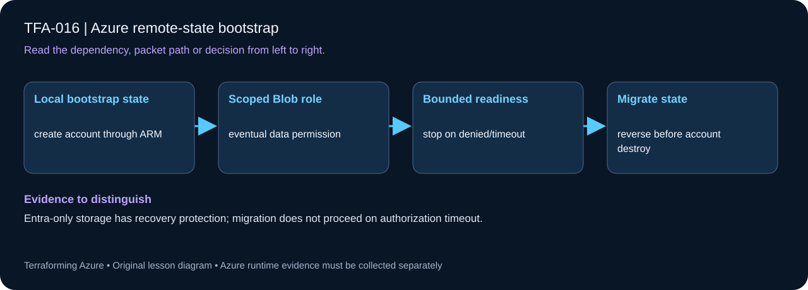

# TFA-016 — Azure remote-state bootstrap



## Goal

Create a small backend from local state, migrate the same resource bindings to Azure Blob state, and migrate back before deleting that backend.

## Prerequisites

Complete [TFA-015](../TFA-015/README.md). Earlier cloud labs should already be destroyed; this root deploys independently. You also need permission to create Storage accounts and assign the Storage Blob Data Contributor role to your signed-in principal.

## Understand the design

A backend must exist before Terraform can initialize against it. This lab first creates its own storage from local state, then adds an untracked backend block and configuration. Migration copies state ownership; it must not recreate infrastructure. Compare resource addresses and lineage before and after.

The container is private, anonymous blob access is disabled, shared-key authentication is disabled, and the applying identity receives Storage Blob Data Contributor at the account. Role assignment requires the corresponding Azure permission and may take time to propagate. The account still has a public network endpoint for this short exercise; private endpoint and runner network design come later.

## Architecture and resources

Local state → Storage account and tfstate container → Azure Entra authenticated blob backend using tfa016.terraform.tfstate and blob leasing. This isolated exercise is separate from the course’s long-lived ../../bootstrap backend.

**Cost:** Low: LRS blob capacity, transactions, and retained versions. No VM or gateway. Destroy the lesson when finished. A stopped VM may still have billable disks; deleting all lab resources is the cleanup target.

## Inputs and working directory

Use PowerShell 7 from the repository root, then enter this lesson folder. Copy the example once and edit only the untracked terraform.tfvars. location defaults to westeurope; name_prefix isolates this lesson; tags contains non-secret ownership metadata. subscription_id is required through TF_VAR_subscription_id. Provider auto-registration is disabled: complete TFA-002 readiness checks first.

```powershell
Set-Location labs/TFA-016
```

## Build and inspect

Read main.tf before running the commands. Review the proposed actions and
subscription before approving an apply. An existing tfvars file should be edited,
not overwritten; skip Copy-Item when you already have one.

```powershell
az login
az account list --output table
az account set --subscription '<your-subscription-guid>'
$env:TF_VAR_subscription_id = az account show --query id --output tsv
az account show --query '{tenant:tenantId,subscription:id,user:user.name}' --output table
Copy-Item terraform.tfvars.example terraform.tfvars
terraform init -backend=false -input=false -lockfile=readonly
terraform fmt -check
terraform validate
terraform plan -out=tfplan
terraform show tfplan
terraform apply tfplan
```

Never commit terraform.tfvars, backend runtime files, saved plans, state, crash
logs, or secret-bearing command output. Keep dependency lockfiles in source control.

## Migrate after the first local apply

Do not add a backend block until the Storage account and container exist.
Save the current lineage and addresses before proceeding. These commands write
only untracked runtime files; do not put account keys or credentials in them.

```powershell
$backend = terraform output -json backend_configuration | ConvertFrom-Json
$backend.PSObject.Properties | ForEach-Object {
    $value = if ($_.Value -is [bool]) { $_.Value.ToString().ToLowerInvariant() } else { '"' + $_.Value + '"' }
    $_.Name + ' = ' + $value
} | Set-Content backend.hcl
Copy-Item backend.tf.example backend.tf
terraform init -migrate-state -backend-config=backend.hcl
terraform state list
```

Review the storage account, tenant, subscription, container, and key before
accepting the state-copy prompt. Keep the backend alive until this lab has been
migrated back to local state during cleanup. Do not share this key with any other lab.

## Validate and collect evidence

```powershell
$backend = terraform output -json backend_configuration | ConvertFrom-Json
terraform state list
terraform state pull | ConvertFrom-Json | Select-Object lineage,serial
az storage blob show --auth-mode login --account-name $backend.storage_account_name --container-name $backend.container_name --name $backend.key --query "{name:name,size:properties.contentLength}" -o json
```

**Expected:** After the migration steps below, Azure CLI finds the state blob using login authentication. The same resource addresses and state lineage are present. A subsequent plan has no changes.

For a deployable lesson, finish with terraform plan -detailed-exitcode: 0 means
no changes, 2 means a change exists, and 1 means an error. A mock test checks
configuration behavior; it is not a network connectivity test.

## Exercises

1. Before migration record (terraform state pull | ConvertFrom-Json).lineage and terraform state list. Run the migration, compare them, and explain why provider authentication and backend authentication are separate configurations.
2. Inspect Blob versions in Azure and explain how versioning can support recovery. Never publish state contents or dump secrets while collecting evidence.
3. Explain the diagram and your validation evidence to another learner. Include
   what the evidence does and does not prove, then answer [five review questions](quiz.json).

## Break and repair

If initialization returns 403, inspect tenant/subscription, assigned blob-data role, role propagation, and any storage network restrictions. Retry after permissions propagate. Do not enable shared keys as a shortcut. If Terraform proposes recreating backend objects after migration, stop and compare addresses and lineage.

## Troubleshooting

| Symptom | Investigation |
|---|---|
| Initialization or schema validation fails | Check the working directory, Terraform version, module source paths, and tracked provider lockfile. Run init before validate. |
| Azure returns authorization, quota, or region errors | Verify the explicit subscription and tenant, role scope, registered provider, regional SKU availability, and quota from TFA-002. |
| Results differ from the expected evidence | Compare the actual resource IDs and effective state with this lesson's architecture. Read the service-specific explanation above before changing permissions or network policy. |

## Cleanup and proof

```powershell
# Keep backend.hcl values until migration is complete. Do not destroy remote storage first.
$rg = terraform output -raw resource_group_name
Rename-Item backend.tf backend.tf.remote
terraform init -migrate-state
terraform state list
Remove-Item backend.tf.remote, backend.hcl -ErrorAction SilentlyContinue
terraform destroy
terraform state list
az group exists --name $rg --subscription $env:TF_VAR_subscription_id
Remove-Item tfplan -ErrorAction SilentlyContinue
```

State should contain no managed resources. Azure CLI should return false for the deleted group (or an empty list for the multi-group lesson).

## Production differences

Production backend ownership must outlive workload states. Use the canonical ../../bootstrap root for the later platform, separate state keys, approved networking and runners, retention/recovery policy, and tested restoration. This exercise deliberately migrates its own state back before cleanup.

## Navigation

[Previous: TFA-015](../TFA-015/README.md) · [Curriculum](../../README.md) · [Next: TFA-017](../TFA-017/README.md)
