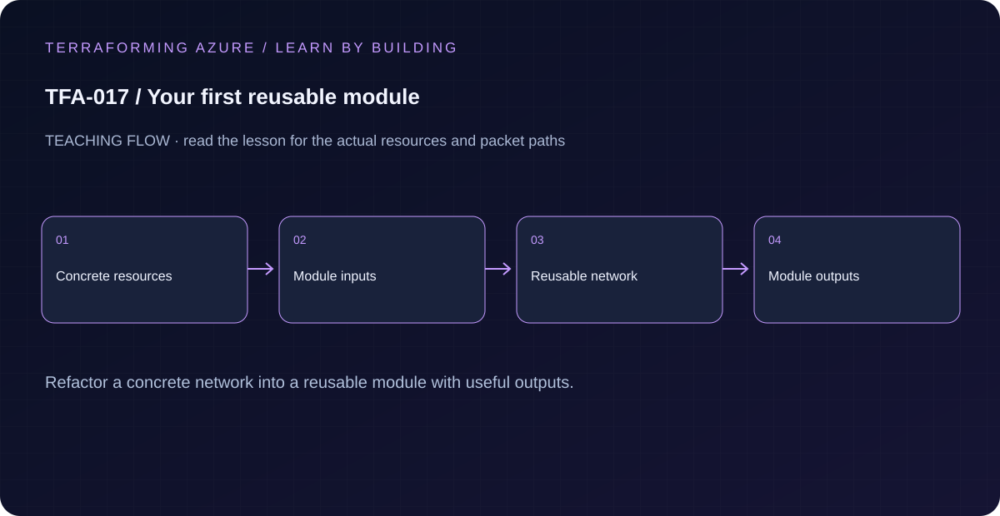

# TFA-017 — Your first reusable module

<!-- lab-metadata:start -->
**Phase 3:** Terraform engineering

**Learning target:** 75 minutes · **Cost tier:** Low · **Run mode:** `azure`

**Prerequisites:** [TFA-016 — Azure remote-state bootstrap](../TFA-016/README.md)
<!-- lab-metadata:end -->

<!-- lab-diagram:start -->

<!-- lab-diagram:end -->

## Goal

Replace repeated network declarations with a small child module whose public inputs and outputs are clear.

## Workspace and isolation

Earlier cloud labs should already be destroyed; this root deploys independently. Concept prerequisites are listed in the generated catalog block.

## Predict the mechanism

A child module groups resources behind input/output contracts; it does not get its own state file automatically. Moving a resource into a module changes its address. A refactor therefore needs an explicit moved declaration when preserving a previously deployed binding.

Before running commands, write the expected result: **Callers receive useful outputs without copying internal resource logic.** Then explain what would change in this controlled failure: Rename an internal resource without a move and explain the proposed replacement. Record your prediction before inspecting the outcome.

## Understand the design

A root module is the directory where you run Terraform. A child module groups resources behind an interface. Module calls do not create separate state by themselves; their resource addresses are recorded inside the caller’s state.

You already built the underlying resource group, VNet, and subnet resources directly. Compare that code with modules/learning-network before using it. The abstraction now removes duplication while retaining visible inputs, stable subnet keys, and outputs for composition. Authentication and backend ownership remain in the calling root.

## Architecture and resources

Lab root → learning-network child → one resource group, VNet 10.17.0.0/16, and web/app subnets. The child inherits the root’s AzureRM provider configuration.

See the catalog cost tier above and the [cost and cleanup guide](../../docs/cost-and-cleanup.md). Destroy the lesson when finished and verify its actual resource names.

## Inputs and working directory

Use PowerShell 7 from the repository root, then enter this lesson folder. Copy the example once and edit only the untracked terraform.tfvars. location defaults to westeurope; name_prefix isolates this lesson; tags contains non-secret ownership metadata. subscription_id is required through TF_VAR_subscription_id. Provider auto-registration is disabled: complete TFA-002 readiness checks first.

```powershell
Set-Location labs/TFA-017
```

## Build and inspect

Read main.tf before running the commands. Review the proposed actions and
subscription before approving an apply. An existing tfvars file should be edited,
not overwritten; skip Copy-Item when you already have one.

```powershell
az login
az account list --output table
az account set --subscription '<your-subscription-guid>'
$env:TF_VAR_subscription_id = az account show --query id --output tsv
az account show --query '{tenant:tenantId,subscription:id,user:user.name}' --output table
Copy-Item terraform.tfvars.example terraform.tfvars
terraform init -backend=false -input=false -lockfile=readonly
terraform fmt -check
terraform validate
terraform plan -out=tfplan
terraform show tfplan
terraform apply tfplan
```

Never commit terraform.tfvars, backend runtime files, saved plans, state, crash
logs, or secret-bearing command output. Keep dependency lockfiles in source control.

## Validate and collect evidence

```powershell
terraform providers
terraform state list
terraform output -json subnet_ids
terraform plan -detailed-exitcode
```

**Expected:** Addresses begin module.network, including keyed subnet instances web and app. The root outputs expose those keys without requiring callers to access internal resource names. A second plan is empty.

For a deployable lesson, finish with terraform plan -detailed-exitcode: 0 means
no changes, 2 means a change exists, and 1 means an error. A mock test checks
configuration behavior; it is not a network connectivity test.

## Exercises

1. Compare TFA-007 direct resources with ../../modules/learning-network. Identify which details became inputs and which remained implementation details.
2. Change only the module call’s tags, inspect an in-place update, apply, and verify tags on the resource group and VNet. Subnets do not support Azure tags.
3. Explain the diagram and your validation evidence to another learner. Include
   what the evidence does and does not prove, then answer [five review questions](quiz.json).

## Break and repair

Temporarily misspell the module source directory and run terraform init. Initialization must fail before deployment. Restore ../../modules/learning-network, initialize, and confirm the configuration validates.

## Troubleshooting

| Symptom | Investigation |
|---|---|
| Initialization or schema validation fails | Check the working directory, Terraform version, module source paths, and tracked provider lockfile. Run init before validate. |
| Azure returns authorization, quota, or region errors | Verify the explicit subscription and tenant, role scope, registered provider, regional SKU availability, and quota from TFA-002. |
| Results differ from the expected evidence | Compare the actual resource IDs and effective state with this lesson's architecture. Read the service-specific explanation above before changing permissions or network policy. |

## Cleanup and proof

```powershell
$rg = terraform output -raw resource_group_name
if ($LASTEXITCODE -ne 0 -or -not $rg) { throw 'Capture the exact owned group before destruction.' }
terraform destroy
if ($LASTEXITCODE -ne 0) { throw 'Destroy failed: keep state and investigate before continuing.' }
$remaining = @(terraform state list)
if ($LASTEXITCODE -ne 0 -or $remaining.Count) { throw 'Cleanup left managed objects or state could not be read.' }
$groupExists = az group exists --name $rg --subscription $env:TF_VAR_subscription_id
if ($LASTEXITCODE -ne 0 -or $groupExists -ne 'false') { throw 'The owned group is not confirmed deleted. Keep state and investigate.' }
Remove-Item tfplan -ErrorAction SilentlyContinue
```

State should contain no managed resources. Azure CLI should return false for the deleted group (or an empty list for the multi-group lesson).

## Production differences

Reusable modules need explicit ownership, documented constraints, versioning, tests, migration paths, and supported interfaces. A local module path provides code reuse; it does not supply release governance.

## Navigation

[Previous: TFA-016](../TFA-016/README.md) · [Curriculum](../../README.md) · [Next: TFA-018](../TFA-018/README.md)

## Evidence contract

Read the root/module interface and compare resource addresses before and after refactoring. Callers receive useful outputs without copying internal resource logic.

See the [40-lab evidence map](../../docs/curriculum-evidence.md) for source paths, validation level and cleanup dependencies. Authored Azure commands are learner exercises; passing local checks does not establish a live deployment.
