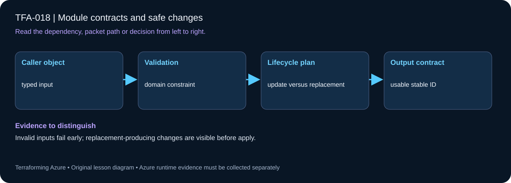

# TFA-018 — Module contracts and safe changes



## Goal

Treat typed inputs, output keys, and resource addresses as a contract and distinguish additive changes from replacements.

## Prerequisites

Complete [TFA-017](../TFA-017/README.md). Earlier cloud labs should already be destroyed; this root deploys independently.

## Understand the design

A module’s contract includes more than variable types. Callers may rely on output names and keys, resource naming behavior, and migration compatibility. Adding a new subnet key is normally additive. Renaming an existing key changes its Terraform address even if a person thinks of it as the same subnet.

The module validates CIDR syntax and nonempty input maps. It intentionally does not implement full CIDR containment and overlap checking. Azure still validates those dynamic network constraints. Document the limit instead of implying terraform validate proves the complete address plan.

## Architecture and resources

The same learning-network module now accepts a caller-supplied subnets map for 10.18.0.0/16. web and app are stable identities; new keys can be added without changing them.

**Cost:** Low: network resources only. Destroy the lesson when finished. A stopped VM may still have billable disks; deleting all lab resources is the cleanup target.

## Inputs and working directory

Use PowerShell 7 from the repository root, then enter this lesson folder. Copy the example once and edit only the untracked terraform.tfvars. location defaults to westeurope; name_prefix isolates this lesson; tags contains non-secret ownership metadata. subscription_id is required through TF_VAR_subscription_id. Provider auto-registration is disabled: complete TFA-002 readiness checks first.

```powershell
Set-Location labs/TFA-018
```

## Build and inspect

Read main.tf before running the commands. Review the proposed actions and
subscription before approving an apply. An existing tfvars file should be edited,
not overwritten; skip Copy-Item when you already have one.

```powershell
az login
az account list --output table
az account set --subscription '<your-subscription-guid>'
$env:TF_VAR_subscription_id = az account show --query id --output tsv
az account show --query '{tenant:tenantId,subscription:id,user:user.name}' --output table
Copy-Item terraform.tfvars.example terraform.tfvars
terraform init -backend=false -input=false -lockfile=readonly
terraform fmt -check
terraform validate
terraform plan -out=tfplan
terraform show tfplan
terraform apply tfplan
```

Never commit terraform.tfvars, backend runtime files, saved plans, state, crash
logs, or secret-bearing command output. Keep dependency lockfiles in source control.

## Validate and collect evidence

```powershell
terraform output -json subnet_ids
terraform state list
terraform plan -detailed-exitcode
```

**Expected:** The initial subnet output contains web and app. Adding data=10.18.3.0/24 must propose one subnet creation while retaining existing keyed addresses.

For a deployable lesson, finish with terraform plan -detailed-exitcode: 0 means
no changes, 2 means a change exists, and 1 means an error. A mock test checks
configuration behavior; it is not a network connectivity test.

## Exercises

1. Set subnets={web="10.18.1.0/24",app="10.18.2.0/24",data="10.18.3.0/24"} in tfvars. Review and apply the additive plan, then confirm all three keys.
2. Plan a web-to-frontend key rename. Do not apply: identify destroy/create actions and explain why a reviewed moved block plus Azure name compatibility is needed for an address migration.
3. Explain the diagram and your validation evidence to another learner. Include
   what the evidence does and does not prove, then answer [five review questions](quiz.json).

## Break and repair

Supply subnets={} or a value such as "not-a-cidr" and plan. Validation must fail before cloud changes. Repair the map. For a syntactically valid but overlapping CIDR, recognize that this module still relies on Azure validation.

## Troubleshooting

| Symptom | Investigation |
|---|---|
| Initialization or schema validation fails | Check the working directory, Terraform version, module source paths, and tracked provider lockfile. Run init before validate. |
| Azure returns authorization, quota, or region errors | Verify the explicit subscription and tenant, role scope, registered provider, regional SKU availability, and quota from TFA-002. |
| Results differ from the expected evidence | Compare the actual resource IDs and effective state with this lesson's architecture. Read the service-specific explanation above before changing permissions or network policy. |

## Cleanup and proof

```powershell
$rg = terraform output -raw resource_group_name
terraform destroy
terraform state list
az group exists --name $rg --subscription $env:TF_VAR_subscription_id
Remove-Item tfplan -ErrorAction SilentlyContinue
```

State should contain no managed resources. Azure CLI should return false for the deleted group (or an empty list for the multi-group lesson).

## Production differences

Publish breaking interface or naming changes as explicit releases with upgrade notes and migrations. Test both expected behavior and rejected inputs, and inspect real plans for replacements before upgrading a shared module.

## Navigation

[Previous: TFA-017](../TFA-017/README.md) · [Curriculum](../../README.md) · [Next: TFA-019](../TFA-019/README.md)
