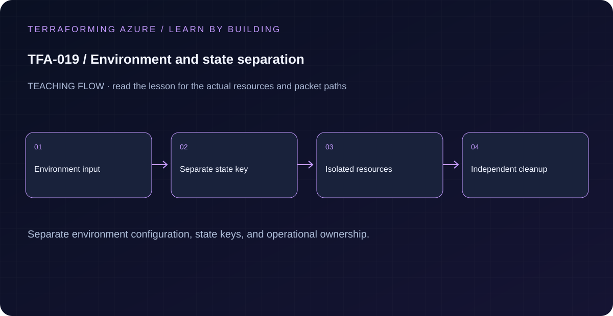

# TFA-019 — Environment and state separation



## Goal

Demonstrate that a shared codebase and separate state boundaries are different concerns using independent dev and prod roots.

## Prerequisites

Complete [TFA-018](../TFA-018/README.md). Earlier cloud labs should already be destroyed; this root deploys independently.

## Understand the design

State defines the set of resources changed together by one Terraform operation. A map named environments does not isolate infrastructure. Separate root directories with separate backend keys provide visible operational boundaries; code can still be shared through modules.

The top-level output previews a dev/prod design. The actual exercise runs independent local roots under environments/dev and environments/prod, each recording a different terraform_data object and lineage. No Azure access is required, so you can observe isolation without creating duplicate infrastructure.

## Architecture and resources

One repo → environments/dev local state and environments/prod local state. Dev uses 10.19.0.0/16; prod uses 10.119.0.0/16. The root-level preview does not manage either environment.

**Cost:** None Destroy the lesson when finished. A stopped VM may still have billable disks; deleting all lab resources is the cleanup target.

## Inputs and working directory

Use PowerShell 7 from the repository root, then enter this lesson folder. Copy the example once and edit only the untracked terraform.tfvars. Use only the lesson-specific inputs shown in main.tf and the example file. This local model does not require Azure authentication.

```powershell
Set-Location labs/TFA-019
```

## Build and inspect

Read main.tf before running the commands. Review the proposed actions and
subscription before approving an apply. An existing tfvars file should be edited,
not overwritten; skip Copy-Item when you already have one.

```powershell
Copy-Item terraform.tfvars.example terraform.tfvars
terraform init -backend=false -input=false
terraform fmt -check
terraform validate
terraform plan -out=tfplan
terraform show tfplan
terraform apply tfplan
terraform -chdir=environments/dev init -backend=false -input=false
terraform -chdir=environments/dev apply
terraform -chdir=environments/prod init -backend=false -input=false
terraform -chdir=environments/prod apply
```

Never commit terraform.tfvars, backend runtime files, saved plans, state, crash
logs, or secret-bearing command output. Keep dependency lockfiles in source control.

## Validate and collect evidence

```powershell
terraform -chdir=environments/dev output -json environment
terraform -chdir=environments/prod output -json environment
terraform -chdir=environments/dev state pull | ConvertFrom-Json | Select-Object lineage,serial
terraform -chdir=environments/prod state pull | ConvertFrom-Json | Select-Object lineage,serial
```

**Expected:** The two output objects identify their correct environment and CIDR. Their lineages differ. Changing dev revision does not change prod state or its next plan.

For a deployable lesson, finish with terraform plan -detailed-exitcode: 0 means
no changes, 2 means a change exists, and 1 means an error. A mock test checks
configuration behavior; it is not a network connectivity test.

## Exercises

1. Apply revision=2 only in environments/dev, then run a normal prod plan. Dev changes; prod must report no changes.
2. Write intended future Azure backend keys such as platform/dev/network.tfstate and platform/prod/network.tfstate. Explain why changing only a variable named environment would not isolate state.
3. Explain the diagram and your validation evidence to another learner. Include
   what the evidence does and does not prove, then answer [five review questions](quiz.json).

## Break and repair

Run terraform -chdir=environments/prod plan -var="revision=2" without applying. Notice that directory selection controls which state would change. Cancel, return to the intended dev path, and verify the environment output before applying.

## Troubleshooting

| Symptom | Investigation |
|---|---|
| Initialization or schema validation fails | Check the working directory, Terraform version, module source paths, and tracked provider lockfile. Run init before validate. |
| Azure returns authorization, quota, or region errors | Verify the explicit subscription and tenant, role scope, registered provider, regional SKU availability, and quota from TFA-002. |
| Results differ from the expected evidence | Compare the actual resource IDs and effective state with this lesson's architecture. Read the service-specific explanation above before changing permissions or network policy. |

## Cleanup and proof

```powershell
terraform -chdir=environments/dev destroy
terraform -chdir=environments/prod destroy
terraform -chdir=environments/dev state list
terraform -chdir=environments/prod state list
terraform destroy
Remove-Item tfplan -ErrorAction SilentlyContinue
```

No Azure resource exists in this workflow. Managed local resources, when present, must be absent from state after cleanup.

## Production differences

Separate access rights, backend keys, identities, approval rules, subscriptions where appropriate, and recovery boundaries. Terraform workspaces can select state, but a workspace alone is not a security boundary.

## Navigation

[Previous: TFA-018](../TFA-018/README.md) · [Curriculum](../../README.md) · [Next: TFA-020](../TFA-020/README.md)
