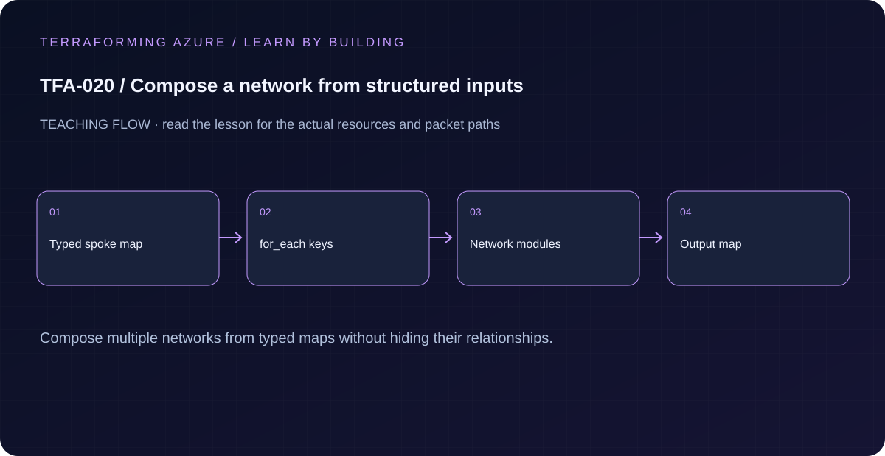

# TFA-020 — Compose a network from structured inputs

<!-- lab-metadata:start -->
**Phase 3:** Terraform engineering

**Learning target:** 75 minutes · **Cost tier:** Low · **Run mode:** `azure`

**Prerequisites:** [TFA-019 — Environment and state separation](../TFA-019/README.md)
<!-- lab-metadata:end -->

<!-- lab-diagram:start -->

<!-- lab-diagram:end -->

## Goal

Use a typed topology map and for_each module calls to compose multiple predictable networks without copying resource blocks.

## Workspace and isolation

Earlier cloud labs should already be destroyed; this root deploys independently. Concept prerequisites are listed in the generated catalog block.

## Predict the mechanism

Structured input maps let the caller name each spoke and its subnets. Transformations should preserve meaningful keys so resource identity remains stable. dynamic blocks generate repeated nested arguments; they do not replace for_each when independently addressed resources are required.

Before running commands, write the expected result: **Existing keyed spokes remain unchanged while only the new key is added.** Then explain what would change in this controlled failure: Change a key versus its value and explain the different address consequences. Record your prediction before inspecting the outcome.

## Understand the design

The topology map carries each network’s address spaces and subnet map. for_each applies the same module contract to each stable network key. This produces addresses such as module.network["hub"] and module.network["spoke"], with nested keyed subnet resources.

A data structure named hub is not a hub architecture yet. This lesson creates separate network containers only: there are no peering links, forwarding services, routes, DNS links, or workload paths. Later lessons add those behaviors deliberately rather than inferring them from labels.

## Architecture and resources

hub:10.20.0.0/16 with services subnet; spoke:10.21.0.0/16 with web/app subnets. Each module instance has its own resource group, and both live in this root’s single state.

See the catalog cost tier above and the [cost and cleanup guide](../../docs/cost-and-cleanup.md). Destroy the lesson when finished and verify its actual resource names.

## Inputs and working directory

Use PowerShell 7 from the repository root, then enter this lesson folder. Copy the example once and edit only the untracked terraform.tfvars. location defaults to westeurope; name_prefix isolates this lesson; tags contains non-secret ownership metadata. subscription_id is required through TF_VAR_subscription_id. Provider auto-registration is disabled: complete TFA-002 readiness checks first.

```powershell
Set-Location labs/TFA-020
```

## Build and inspect

Read main.tf before running the commands. Review the proposed actions and
subscription before approving an apply. An existing tfvars file should be edited,
not overwritten; skip Copy-Item when you already have one.

```powershell
az login
az account list --output table
az account set --subscription '<your-subscription-guid>'
$env:TF_VAR_subscription_id = az account show --query id --output tsv
az account show --query '{tenant:tenantId,subscription:id,user:user.name}' --output table
Copy-Item terraform.tfvars.example terraform.tfvars
terraform init -backend=false -input=false -lockfile=readonly
terraform fmt -check
terraform validate
terraform plan -out=tfplan
terraform show tfplan
terraform apply tfplan
```

Never commit terraform.tfvars, backend runtime files, saved plans, state, crash
logs, or secret-bearing command output. Keep dependency lockfiles in source control.

## Validate and collect evidence

```powershell
terraform output -json networks
terraform state list
az group list --tag lab=TFA-020 --subscription $env:TF_VAR_subscription_id --query "[].name" -o table
```

**Expected:** Outputs preserve hub and spoke keys and each nested subnet key. Two resource groups exist. State contains both module instances, and a second plan is empty.

For a deployable lesson, finish with terraform plan -detailed-exitcode: 0 means
no changes, 2 means a change exists, and 1 means an error. A mock test checks
configuration behavior; it is not a network connectivity test.

## Exercises

1. Add a data subnet to the spoke map with CIDR 10.21.3.0/24. Expect one additional subnet while existing module addresses remain unchanged.
2. Plan adding a second spoke keyed app2 with nonoverlapping 10.22.0.0/16 and 10.22.1.0/24 ranges. Identify exactly one new module instance and its resource group/VNet/subnet.
3. Explain the diagram and your validation evidence to another learner. Include
   what the evidence does and does not prove, then answer [five review questions](quiz.json).

## Break and repair

Temporarily rename the hub key to core and review the proposed changes without applying. Renaming a for_each module key changes every nested address; restore hub. A later migration must explicitly map addresses and account for resource names.

## Troubleshooting

| Symptom | Investigation |
|---|---|
| Initialization or schema validation fails | Check the working directory, Terraform version, module source paths, and tracked provider lockfile. Run init before validate. |
| Azure returns authorization, quota, or region errors | Verify the explicit subscription and tenant, role scope, registered provider, regional SKU availability, and quota from TFA-002. |
| Results differ from the expected evidence | Compare the actual resource IDs and effective state with this lesson's architecture. Read the service-specific explanation above before changing permissions or network policy. |

## Cleanup and proof

```powershell
$cleanupGroups = @(terraform output -json cleanup_group_names | ConvertFrom-Json)
if ($LASTEXITCODE -ne 0 -or -not $cleanupGroups.Count) { throw 'Capture the exact owned groups before destruction.' }
terraform destroy
if ($LASTEXITCODE -ne 0) { throw 'Destroy failed: keep state and investigate before continuing.' }
$remaining = @(terraform state list)
if ($LASTEXITCODE -ne 0 -or $remaining.Count) { throw 'Cleanup left managed objects or state could not be read.' }
foreach ($groupName in $cleanupGroups) {
    $groupExists = az group exists --name $groupName --subscription $env:TF_VAR_subscription_id
    if ($LASTEXITCODE -ne 0 -or $groupExists -ne 'false') { throw "Owned group $groupName is not confirmed deleted." }
}
Remove-Item tfplan -ErrorAction SilentlyContinue
```

State should contain no managed resources. Azure CLI should return false for the deleted group (or an empty list for the multi-group lesson).

## Production differences

Split platform and workload state by lifecycle and access boundaries as the architecture grows. Input-driven reuse simplifies code but does not make a single enormous state desirable.

## Navigation

[Previous: TFA-019](../TFA-019/README.md) · [Curriculum](../../README.md) · [Next: TFA-021](../TFA-021/README.md)

## Evidence contract

Run the structured-input example and inspect a plan that adds exactly one named spoke. Existing keyed spokes remain unchanged while only the new key is added.

See the [40-lab evidence map](../../docs/curriculum-evidence.md) for source paths, validation level and cleanup dependencies. Authored Azure commands are learner exercises; passing local checks does not establish a live deployment.
