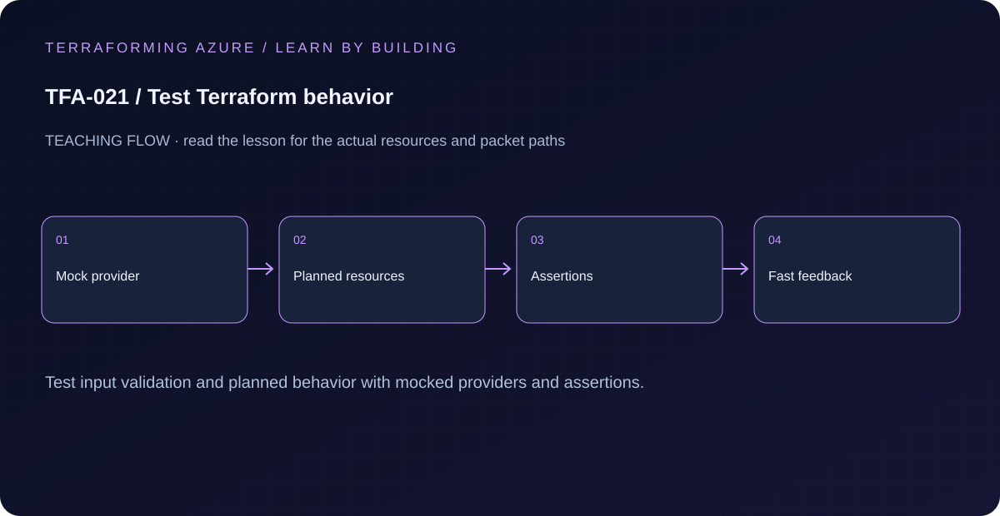

# TFA-021 — Test Terraform behavior

<!-- lab-metadata:start -->
**Phase 3:** Terraform engineering

**Learning target:** 75 minutes · **Cost tier:** None · **Run mode:** `mock`

**Prerequisites:** [TFA-020 — Compose a network from structured inputs](../TFA-020/README.md)
<!-- lab-metadata:end -->

<!-- lab-diagram:start -->

<!-- lab-diagram:end -->

## Goal

Run real terraform test assertions against an AzureRM mock and distinguish tested configuration contracts from cloud acceptance.

## Workspace and isolation

Earlier cloud labs should already be destroyed; this root deploys independently. Concept prerequisites are listed in the generated catalog block.

## Predict the mechanism

Mock providers replace cloud responses while retaining Terraform expressions and schema checks. They can prove validation, conditional resources and relationships but cannot prove connectivity or Azure service readiness. A useful negative test fails for one intended reason and then passes after repair.

Before running commands, write the expected result: **Mocked plans reject invalid values and preserve tested relationships without Azure access.** Then explain what would change in this controlled failure: Break one relationship, observe the focused failing assertion, restore it. Record your prediction before inspecting the outcome.

## Understand the design

Formatting catches layout drift. Validation checks language and provider schema. A Terraform test evaluates behavior and assertions, such as naming and preserved keys, and can exercise expected validation failures. Mocking the provider removes cloud calls and cloud credentials from these checks.

The lesson root calls the learning-network module, but the documented workflow runs tests, not a normal apply. The mock tests verify its public names, subnet keys, and rejected prefix. Child-module tests additionally check tags and the explicit outbound posture. These are meaningful contracts that can regress when a module changes.

## Architecture and resources

terraform test → mocked AzureRM provider → planned network configuration → assertions. No actual Azure resources are created by these tests.

See the catalog cost tier above and the [cost and cleanup guide](../../docs/cost-and-cleanup.md). Destroy the lesson when finished and verify its actual resource names.

## Inputs and working directory

Use PowerShell 7 from the repository root, then enter this lesson folder. Copy the example once and edit only the untracked terraform.tfvars. location defaults to westeurope; name_prefix isolates this lesson; tags contains non-secret ownership metadata. Tests supply a synthetic subscription GUID to the mocked provider. Do not run a normal plan/apply with that value.

```powershell
Set-Location labs/TFA-021
```

## Build and inspect

Read main.tf before running the commands. Review the proposed actions and
subscription before approving an apply. An existing tfvars file should be edited,
not overwritten; skip Copy-Item when you already have one.

```powershell
terraform init -backend=false -input=false -lockfile=readonly
terraform fmt -check
terraform validate
terraform test -no-color
```

Never commit terraform.tfvars, backend runtime files, saved plans, state, crash
logs, or secret-bearing command output. Keep dependency lockfiles in source control.

## Validate and collect evidence

```powershell
terraform test -no-color
terraform -chdir=../../modules/learning-network init -backend=false -input=false
terraform -chdir=../../modules/learning-network test -no-color
```

**Expected:** The lesson reports three passing runs and the module reports four passing runs. No Azure login is requested. Invalid input tests pass because the expected validation failure occurs.

For a deployable lesson, finish with terraform plan -detailed-exitcode: 0 means
no changes, 2 means a change exists, and 1 means an error. A mock test checks
configuration behavior; it is not a network connectivity test.

## Exercises

1. Change the expected VNet name in the first assertion to an incorrect value, run tests, and read the actionable failure. Restore the correct expectation rather than weakening the production code contract.
2. Add a test run checking the module output name for a different valid name_prefix. It should prove the naming rule is parameterized, not hardcoded to tfa021.
3. Explain the diagram and your validation evidence to another learner. Include
   what the evidence does and does not prove, then answer [five review questions](quiz.json).

## Break and repair

Delete expect_failures from reject_bad_prefix temporarily and run the tests. The validation error now fails the run. Restore the expected failure assertion and confirm the suite passes. This proves the negative test is checking rejection intentionally.

## Troubleshooting

| Symptom | Investigation |
|---|---|
| Initialization or schema validation fails | Check the working directory, Terraform version, module source paths, and tracked provider lockfile. Run init before validate. |
| Azure returns authorization, quota, or region errors | Verify the explicit subscription and tenant, role scope, registered provider, regional SKU availability, and quota from TFA-002. |
| Results differ from the expected evidence | Compare the actual resource IDs and effective state with this lesson's architecture. Read the service-specific explanation above before changing permissions or network policy. |

## Cleanup and proof

```powershell
# Mock plan tests have no persistent Azure deployment to destroy.
terraform state list
Remove-Item tfplan -ErrorAction SilentlyContinue
```

No Azure resource exists in this workflow. Managed local resources, when present, must be absent from state after cleanup.

## Production differences

Mock tests do not prove SKU availability, Azure policy compliance, permissions, DNS, routing, application behavior, or safe teardown. Keep a separate opt-in Azure smoke matrix that deploys, proves behavior, replans, and destroys with real evidence.

## Navigation

[Previous: TFA-020](../TFA-020/README.md) · [Curriculum](../../README.md) · [Next: TFA-022](../TFA-022/README.md)

## Evidence contract

terraform test; inspect positive and negative contract assertions and expected_failures. Mocked plans reject invalid values and preserve tested relationships without Azure access.

See the [40-lab evidence map](../../docs/curriculum-evidence.md) for source paths, validation level and cleanup dependencies. Authored Azure commands are learner exercises; passing local checks does not establish a live deployment.
