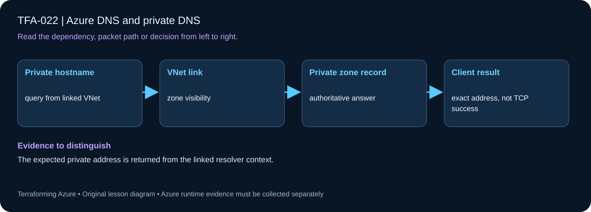

# TFA-022 - Azure DNS and private DNS

<!-- lab-metadata:start -->
**Phase 4:** Private platforms

**Learning target:** 75 minutes · **Cost tier:** Low · **Run mode:** `azure`

**Prerequisites:** [TFA-021 — Test Terraform behavior](../TFA-021/README.md)
<!-- lab-metadata:end -->

[Course home](../../README.md) | [Previous lab](../TFA-021/README.md) | [Next lab](../TFA-023/README.md)

## Why this lab exists

A network can route correctly while an application still fails because it resolves the wrong address. This lab separates DNS records, delegation, VNet links, and actual reachability.

## What you will learn

Resolve a private name and understand zone links and authoritative DNS boundaries. Your evidence must distinguish configuration intent from the observed result: The expected private address is returned from the linked resolver context.

## Predict the mechanism

A private DNS zone becomes visible through VNet links; creating its record alone is insufficient. The original query name and its eventual private answer are different facts when aliases are involved. A successful lookup is name resolution evidence, not proof that a service port or identity authorization works.

Before running commands, write the expected result: **The expected private address is returned from the linked resolver context.** Then explain what would change in this controlled failure: Remove one VNet link, account for TTL/cache, then restore it. Record your prediction before inspecting the outcome.

## Concepts before commands

Azure DNS hosts an authoritative public zone. Creating that zone does not delegate a name to it: the parent zone must publish its name servers. The public `tfa022.example.com` zone and `192.0.2.10` documentation address deliberately demonstrate records without claiming ownership of example.com. A private zone is visible through linked VNets. A DNS record does not create the server at its address.

## Architecture

<!-- lab-diagram:start -->

<!-- lab-diagram:end -->

One VNet, a public demonstration zone and A record, a private `.test` zone, an explicit VNet link, and a private A record.

## Runtime and cost checkpoint

PowerShell 7.4 or newer (under 8), Terraform 1.15.8, Git, and the preceding concepts. Azure CLI, an explicitly selected sandbox subscription, approved permissions and regional quota. AzureRM is pinned to 4.77.0; do not silently upgrade it during the lesson.

Charged resources include public/private DNS zones and queries. Read the selected services in the [Azure pricing calculator](https://azure.microsoft.com/en-us/pricing/calculator/) before apply. A stopped VM can retain charged disks; a gateway/firewall is not stopped by leaving the terminal. Each lab owns its own local state; keep that state until cleanup. Do not reuse another lab's backend or import its resources.

## Step 1 - Read the implementation

Open `versions.tf`, `variables.tf`, `main.tf`, and `outputs.tf` in this directory. Follow `azurerm_dns_zone.public` -> `azurerm_dns_a_record.public`, then `azurerm_private_dns_zone.internal` -> its link and record. Compare TTLs and explain why registration is disabled. If a shared Windows VM pattern is referenced, read its [implementation](../../modules/patterns/windows-vm/main.tf) as part of this lesson.

## Step 2 - Plan and build

Run from `labs/TFA-022` in PowerShell 7. Tests use provider mocks or local resources and do not apply Azure infrastructure. Supply real cloud inputs only for your deliberate plan/apply. The example tfvars file is an alternative to environment variables; a real terraform.tfvars value takes precedence over TF_VAR values.

```powershell
$env:TF_VAR_subscription_id = Read-Host 'Explicit Azure subscription ID'
az login
az account set --subscription $env:TF_VAR_subscription_id
$env:TF_VAR_location = 'westeurope'
terraform init
terraform fmt -check
terraform validate
terraform test
terraform plan -out=lab.tfplan
terraform show lab.tfplan
# Read the whole plan and confirm the subscription, scope, and charged services.
terraform apply lab.tfplan
```

Record what Terraform creates, which values are unknown until apply, and which resources carry ongoing charges. Keep passwords, VPN keys, PFX files, plans, and state out of Git. `sensitive` hides console values; it does not remove them from state.

## Step 3 - Verify with evidence

```powershell
$rg = terraform output -raw resource_group_name
az network dns record-set a show -g $rg -z tfa022.example.com -n demo
az network private-dns record-set a show -g $rg -z internal.terraforming-azure.test -n app
az network private-dns link vnet list -g $rg -z internal.terraforming-azure.test -o table
$ns = (terraform output -json authoritative_name_servers | ConvertFrom-Json)[0]
Resolve-DnsName demo.tfa022.example.com -Server $ns
```

The authoritative public server answers `192.0.2.10`, even though ordinary recursive lookup has no delegated path to this demonstration zone. Azure lists the private record `10.22.1.10` and its VNet link. Your laptop is outside that linked VNet; do not interpret a laptop private-name lookup failure as a missing Azure record.

Save a short local evidence note with the time, exact probe, observed result, and your explanation. Resource existence, DNS, routing, authorization, and application success are different kinds of evidence.

## Troubleshooting

If a private query fails, check its client VNet, the zone link, the resolver it uses, and its cached TTL. If public lookup fails, distinguish querying the authoritative name server directly from following public delegation.

## Challenge

Change the private A record to `10.22.1.20`, reduce its TTL to 30, review the plan, and apply. Explain why neither action provisions a VM.

## Knowledge check

Complete the five questions in [quiz.json](quiz.json), or use the course site's interactive quiz. Explain each answer before revealing its explanation. The quiz checks reasoning; it is not a substitute for the evidence above.

## Cleanup

```powershell
$cleanupGroup = terraform output -raw resource_group_name
if ($LASTEXITCODE -ne 0 -or -not $cleanupGroup) { throw 'Capture the actual lab group before planning destruction.' }
terraform plan -destroy -out=cleanup.tfplan
if ($LASTEXITCODE -ne 0) { throw 'Destroy plan failed: do not apply an older cleanup plan.' }
terraform show cleanup.tfplan
if ($LASTEXITCODE -ne 0) { throw 'Destroy plan could not be reviewed: stop before apply.' }
terraform apply cleanup.tfplan
if ($LASTEXITCODE -ne 0) { throw 'Destroy failed: retain state and investigate remaining resources before claiming cleanup.' }
$remaining = @(terraform state list)
if ($LASTEXITCODE -ne 0 -or $remaining.Count) { throw 'Cleanup left managed objects or state could not be read.' }
# Check the Azure resource group no longer exists after successful destroy.
$groupExists = az group exists --subscription $env:TF_VAR_subscription_id --name $cleanupGroup
if ($LASTEXITCODE -ne 0 -or $groupExists -ne 'false') { throw 'The owned group is not confirmed deleted. Keep state and investigate.' }
```

A successful destroy and an empty state are the expected result. The cleanup command uses the captured group, including a changed prefix. Soft-deleted vaults and retained logs can outlive their active resource; review the relevant Azure lifecycle and cost settings. Do not commit generated plans or state as evidence.

## Completion criteria

- You can explain why this design produces the observed behavior.
- You captured the required success evidence and investigated the controlled limitation or failure.
- You completed the challenge and five questions.
- You reviewed and completed cleanup, or recorded an explicit owner and deadline for intentionally retained resources.

## Continue learning

[Official documentation](https://learn.microsoft.com/en-us/azure/dns/private-dns-overview) | [Continue to TFA-023](../TFA-023/README.md)

## Evidence contract

Resolve the exact private lab name from the linked network and compare with its record. The expected private address is returned from the linked resolver context.

See the [40-lab evidence map](../../docs/curriculum-evidence.md) for source paths, validation level and cleanup dependencies. Authored Azure commands are learner exercises; passing local checks does not establish a live deployment.
