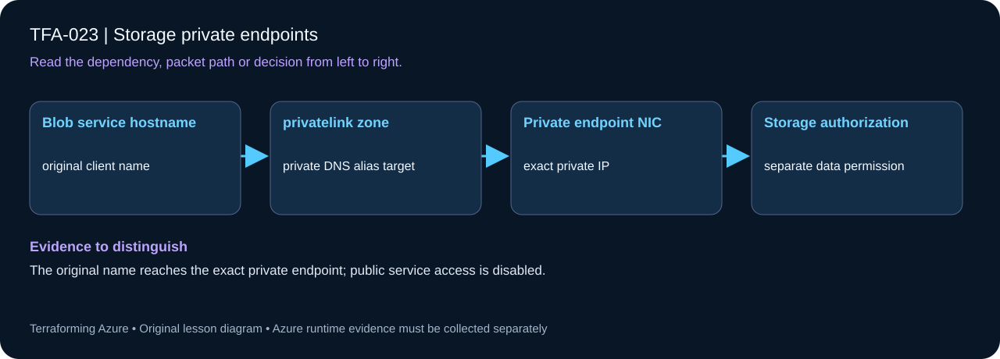

# TFA-023 - Storage private endpoints

<!-- lab-metadata:start -->
**Phase 4:** Private platforms

**Learning target:** 75 minutes · **Cost tier:** Moderate · **Run mode:** `azure`

**Prerequisites:** [TFA-022 — Azure DNS and private DNS](../TFA-022/README.md)
<!-- lab-metadata:end -->

[Course home](../../README.md) | [Previous lab](../TFA-022/README.md) | [Next lab](../TFA-024/README.md)

## Why this lab exists

Private connectivity needs an address, a route, a DNS answer, and data-plane permission. A private endpoint only supplies part of that chain.

## What you will learn

Resolve Blob Storage to a private endpoint and disable its public service path. Your evidence must distinguish configuration intent from the observed result: The original name reaches the exact private endpoint; public service access is disabled.

## Predict the mechanism

A private endpoint creates a private NIC for one service subresource. Blob clients still use the original storage hostname and its public-to-private DNS alias chain. Disabling public service access closes that path but does not grant the client a data role or guarantee a private route.

Before running commands, write the expected result: **The original name reaches the exact private endpoint; public service access is disabled.** Then explain what would change in this controlled failure: Break the zone link, compare wrong resolution with endpoint existence, then restore. Record your prediction before inspecting the outcome.

## Concepts before commands

A Blob private endpoint gives the Blob service a private address in your VNet. Applications continue using `<account>.blob.core.windows.net`; the private DNS chain resolves it to that private address. `public_network_access_enabled = false` closes the public service network path, while disabling shared keys removes one credential mechanism. Neither property grants an identity permission to read blobs.

## Architecture

<!-- lab-diagram:start -->

<!-- lab-diagram:end -->

An isolated VNet and private-endpoint subnet, a private-only storage account, a Blob private endpoint, the matching private DNS zone/group/link, and a private Windows probe with explicit NAT egress.

## Runtime and cost checkpoint

PowerShell 7.4 or newer (under 8), Terraform 1.15.8, Git, and the preceding concepts. Azure CLI, an explicitly selected sandbox subscription, approved permissions and regional quota. AzureRM is pinned to 4.77.0; do not silently upgrade it during the lesson.

Charged resources include a private endpoint, DNS zone, storage account, private Windows probe, and NAT Gateway. Read the selected services in the [Azure pricing calculator](https://azure.microsoft.com/en-us/pricing/calculator/) before apply. A stopped VM can retain charged disks; a gateway/firewall is not stopped by leaving the terminal. Each lab owns its own local state; keep that state until cleanup. Do not reuse another lab's backend or import its resources.

## Step 1 - Read the implementation

Open `versions.tf`, `variables.tf`, `main.tf`, and `outputs.tf` in this directory. Trace `subresource_names = ["blob"]` and the DNS zone group. The provider storage feature disables data-plane polling so this ARM-only lab can create a private-only account from your laptop. This is not a general workaround for creating containers or uploading blobs from an unconnected runner. If a shared Windows VM pattern is referenced, read its [implementation](../../modules/patterns/windows-vm/main.tf) as part of this lesson.

## Step 2 - Plan and build

Run from `labs/TFA-023` in PowerShell 7. Tests use provider mocks or local resources and do not apply Azure infrastructure. Supply real cloud inputs only for your deliberate plan/apply. The example tfvars file is an alternative to environment variables; a real terraform.tfvars value takes precedence over TF_VAR values.

```powershell
$env:TF_VAR_subscription_id = Read-Host 'Explicit Azure subscription ID'
az login
az account set --subscription $env:TF_VAR_subscription_id
$env:TF_VAR_location = 'westeurope'
terraform init
terraform fmt -check
terraform validate
terraform test
$env:TF_VAR_admin_password = Read-Host 'Unique Windows lab password (14+ characters)' -MaskInput
terraform plan -out=lab.tfplan
terraform show lab.tfplan
# Read the whole plan and confirm the subscription, scope, and charged services.
terraform apply lab.tfplan
```

Record what Terraform creates, which values are unknown until apply, and which resources carry ongoing charges. Keep passwords, VPN keys, PFX files, plans, and state out of Git. `sensitive` hides console values; it does not remove them from state.

## Step 3 - Verify with evidence

```powershell
$rg = terraform output -raw resource_group_name
$account = terraform output -raw storage_account_name
az storage account show -g $rg -n $account --query "{public:publicNetworkAccess,sharedKey:allowSharedKeyAccess}" -o json
az network private-endpoint list -g $rg --query "[].{name:name,status:privateLinkServiceConnections[0].privateLinkServiceConnectionState.status}" -o table
az network private-dns record-set a list -g $rg -z privatelink.blob.core.windows.net -o table
terraform output private_endpoint_ip
```

The account reports public network access Disabled and shared keys false; the endpoint connection is Approved and its DNS A record matches the private endpoint IP. The private probe below verifies DNS, TCP, and an HTTP service response from the connected VNet. TFA-031 extends that DNS path across a VPN.

Save a short local evidence note with the time, exact probe, observed result, and your explanation. Resource existence, DNS, routing, authorization, and application success are different kinds of evidence.

## Step 4 - Prove private service access, then break and repair DNS

The probe has no public IP. Run the committed script inside it, never on your laptop:

```powershell
$probe = terraform output -raw probe_vm_name
$blob = terraform output -raw blob_hostname
$privateIp = terraform output -raw private_endpoint_ip
$probeScript = Get-Content -Raw ./Probe-PrivateBlob.ps1
az vm run-command invoke -g $rg -n $probe --command-id RunPowerShellScript --scripts $probeScript --parameters "BlobHost=$blob" "ExpectedPrivateIp=$privateIp" 'Mode=Baseline'
az vm run-command invoke -g $rg -n $probe --command-id RunPowerShellScript --scripts $probeScript --parameters "BlobHost=$blob" "ExpectedPrivateIp=$privateIp" 'Mode=Break'
az vm run-command invoke -g $rg -n $probe --command-id RunPowerShellScript --scripts $probeScript --parameters "BlobHost=$blob" "ExpectedPrivateIp=$privateIp" 'Mode=Repair'
```

Baseline and Repair must return the private endpoint address, TCP 443 success, and an HTTP response from the service (unauthenticated Blob listing normally returns 403). Break adds one marked hosts-file entry to a documentation-only unreachable address; DNS/address and transport evidence should fail. Repair removes only that marked line. A 403 is not a successful blob read: this step proves network access, while TFA-024 teaches identity permissions.

## Troubleshooting

An approved endpoint can still be unusable if the wrong service subresource or DNS zone was selected. A laptop request can still receive a DNS answer for a public endpoint, and a 403 can reflect network policy or missing RBAC: inspect both.

## Challenge

Add an output explaining which additional private endpoint and DNS zone would be needed for Azure Files. Keep the deployed Blob endpoint intact; do not assume one endpoint privately exposes every storage service.

## Knowledge check

Complete the five questions in [quiz.json](quiz.json), or use the course site's interactive quiz. Explain each answer before revealing its explanation. The quiz checks reasoning; it is not a substitute for the evidence above.

## Cleanup

```powershell
$cleanupGroup = terraform output -raw resource_group_name
if ($LASTEXITCODE -ne 0 -or -not $cleanupGroup) { throw 'Capture the actual lab group before planning destruction.' }
terraform plan -destroy -out=cleanup.tfplan
if ($LASTEXITCODE -ne 0) { throw 'Destroy plan failed: do not apply an older cleanup plan.' }
terraform show cleanup.tfplan
if ($LASTEXITCODE -ne 0) { throw 'Destroy plan could not be reviewed: stop before apply.' }
terraform apply cleanup.tfplan
if ($LASTEXITCODE -ne 0) { throw 'Destroy failed: retain state and investigate remaining resources before claiming cleanup.' }
$remaining = @(terraform state list)
if ($LASTEXITCODE -ne 0 -or $remaining.Count) { throw 'Cleanup left managed objects or state could not be read.' }
Remove-Item Env:TF_VAR_admin_password -ErrorAction SilentlyContinue
# Check the Azure resource group no longer exists after successful destroy.
$groupExists = az group exists --subscription $env:TF_VAR_subscription_id --name $cleanupGroup
if ($LASTEXITCODE -ne 0 -or $groupExists -ne 'false') { throw 'The owned group is not confirmed deleted. Keep state and investigate.' }
```

A successful destroy and an empty state are the expected result. The cleanup command uses the captured group, including a changed prefix. Soft-deleted vaults and retained logs can outlive their active resource; review the relevant Azure lifecycle and cost settings. Do not commit generated plans or state as evidence.

## Completion criteria

- You can explain why this design produces the observed behavior.
- You captured the required success evidence and investigated the controlled limitation or failure.
- You completed the challenge and five questions.
- You reviewed and completed cleanup, or recorded an explicit owner and deadline for intentionally retained resources.

## Continue learning

[Official documentation](https://learn.microsoft.com/en-us/azure/storage/common/storage-private-endpoints) | [Continue to TFA-024](../TFA-024/README.md)

## Evidence contract

Resolve the Blob hostname to the output endpoint IP and compare public access configuration. The original name reaches the exact private endpoint; public service access is disabled.

See the [40-lab evidence map](../../docs/curriculum-evidence.md) for source paths, validation level and cleanup dependencies. Authored Azure commands are learner exercises; passing local checks does not establish a live deployment.
