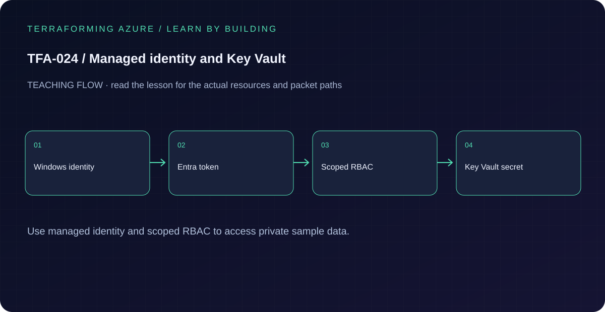

# TFA-024 - Managed identity and Key Vault

[Course home](../../README.md) | [Previous lab](../TFA-023/README.md) | [Next lab](../TFA-025/README.md)

> **Mode:** Azure deployment | **Time:** 50-70 minutes | **Cost:** Medium: private Windows probe, NAT Gateway, identity, vault, and vault operations.

## Why this lab exists

An application should obtain Azure credentials from its runtime identity rather than carry a long-lived client secret in a repository.

## What you will learn

By the end, explain the mechanism below, follow its dependencies in Terraform, reproduce its evidence, diagnose the named failure, and clean up the resources you created. The final challenge checks whether you can apply the concept without copying another resource block.

## Concepts before commands

A user-assigned managed identity is an Azure resource with a principal ID for role assignments and a client ID for token selection. Authentication identifies the principal; authorization decides what it can do. Key Vault Secrets User is a data-plane read role; Secrets Officer can additionally write secrets. It differs from a management role that can configure the vault. An unattached managed identity cannot be used as a laptop login.

## Architecture



A user-assigned identity, an RBAC-enabled Key Vault, and a private Windows VM with that identity attached, explicit NAT egress, and a vault-scoped role. The initial Secrets Officer role allows runtime seeding of one dummy secret; it is then reduced to Secrets User. No secret value is managed by Terraform.

## Prerequisites and cost checkpoint

PowerShell 7, Terraform 1.9 or later (under 2.0; course tested with 1.15.8), Git, and the preceding concepts. Azure CLI, an explicitly selected sandbox subscription, approved permissions and regional quota. AzureRM is pinned to 4.77.0; do not silently upgrade it during the lesson.

Medium: private Windows probe, NAT Gateway, identity, vault, and vault operations. Read the selected services in the [Azure pricing calculator](https://azure.microsoft.com/en-us/pricing/calculator/) before apply. A stopped VM can retain charged disks; a gateway/firewall is not stopped by leaving the terminal. Each lab owns its own local state; keep that state until cleanup. Do not reuse another lab's backend or import its resources.

## Step 1 - Read the implementation

Open `versions.tf`, `variables.tf`, `main.tf`, and `outputs.tf` in this directory. Compare the principal ID used by `azurerm_role_assignment.read_secrets` with the client ID output. Inspect the seven-day soft-delete retention and explain the exercise setting for purge protection. This lab isolates identity/RBAC; private vault networking is added to the capstone. If a shared Windows VM pattern is referenced, read its [implementation](../../modules/patterns/windows-vm/main.tf) as part of this lesson.

## Step 2 - Plan and build

Run from `labs/TFA-024` in PowerShell 7. Tests use provider mocks or local resources and do not apply Azure infrastructure. Supply real cloud inputs only for your deliberate plan/apply. The example tfvars file is an alternative to environment variables; a real terraform.tfvars value takes precedence over TF_VAR values.

```powershell
$env:TF_VAR_subscription_id = Read-Host 'Explicit Azure subscription ID'
az login
az account set --subscription $env:TF_VAR_subscription_id
$env:TF_VAR_location = 'westeurope'
terraform init
terraform fmt -check
terraform validate
terraform test
$env:TF_VAR_admin_password = Read-Host 'Unique Windows lab password (14+ characters)' -MaskInput
terraform plan -out=lab.tfplan
terraform show lab.tfplan
# Read the whole plan and confirm the subscription, scope, and charged services.
terraform apply lab.tfplan
```

Record what Terraform creates, which values are unknown until apply, and which resources carry ongoing charges. Keep passwords, VPN keys, PFX files, plans, and state out of Git. `sensitive` hides console values; it does not remove them from state.

## Step 3 - Verify with evidence

```powershell
$rg = terraform output -raw resource_group_name
az identity list -g $rg --query "[].{name:name,clientId:clientId,principalId:principalId}" -o table
az keyvault list -g $rg --query "[].{name:name,rbac:properties.enableRbacAuthorization}" -o table
az role assignment list --resource-group $rg --all --query "[?roleDefinitionName=='Key Vault Secrets User' || roleDefinitionName=='Key Vault Secrets Officer'].{scope:scope,principal:principalId}" -o table
```

The vault uses RBAC and the identity initially has Secrets Officer only at that vault. There are no Azure AD app registrations or client secrets. A successful role assignment does not mean your personal account can read secrets.

Save a short local evidence note with the time, exact probe, observed result, and your explanation. Resource existence, DNS, routing, authorization, and application success are different kinds of evidence.

## Step 4 - Read through the VM identity, deny, and restore

This is a real runtime token request to the VM metadata service. No client secret, token, or Key Vault value is written to Terraform state. The demonstration value is intentionally non-secret.

```powershell
$probe = terraform output -raw probe_vm_name
$vault = terraform output -raw vault_uri
$clientId = terraform output -raw identity_client_id
$probeScript = Get-Content -Raw ./Probe-KeyVault.ps1
# Allow RBAC propagation before retrying; do not broaden scope to bypass it.
az vm run-command invoke -g $rg -n $probe --command-id RunPowerShellScript --scripts $probeScript --parameters "VaultUri=$vault" "ClientId=$clientId" 'Action=Seed'
terraform plan -var='identity_secret_role=Key Vault Secrets User' -out=reader.tfplan
terraform apply reader.tfplan
az vm run-command invoke -g $rg -n $probe --command-id RunPowerShellScript --scripts $probeScript --parameters "VaultUri=$vault" "ClientId=$clientId" 'Action=Read'
terraform plan -var='identity_secret_role=None' -out=deny.tfplan
terraform apply deny.tfplan
az vm run-command invoke -g $rg -n $probe --command-id RunPowerShellScript --scripts $probeScript --parameters "VaultUri=$vault" "ClientId=$clientId" 'Action=Read'
# After propagation, expect Key Vault HTTP 403 with the role removed.
terraform plan -var='identity_secret_role=Key Vault Secrets User' -out=restore.tfplan
terraform apply restore.tfplan
az vm run-command invoke -g $rg -n $probe --command-id RunPowerShellScript --scripts $probeScript --parameters "VaultUri=$vault" "ClientId=$clientId" 'Action=Read'
```

Capture successful seeding, read under Secrets User, denied read under None, and restored read. Role changes can take time to propagate and managed-identity authorization can be cached; record the delay and retry instead of treating the first cached response as definitive. Use the same explicit role input on subsequent plans so a default does not unintentionally restore Officer.

## Troubleshooting

RBAC changes can take time to propagate. Check the scope and principal ID before adding broader roles. A deleted vault name may remain reserved by soft delete; use a new prefix or deliberately recover the soft-deleted vault.

## Challenge

Design the smallest extra role needed for an application that writes secrets. Explain why subscription Contributor is neither the correct minimal data-plane role nor an acceptable substitute.

## Knowledge check

Complete the five questions in [quiz.json](quiz.json), or use the course site's interactive quiz. Explain each answer before revealing its explanation. The quiz checks reasoning; it is not a substitute for the evidence above.

## Cleanup

```powershell
terraform plan -destroy -var='identity_secret_role=Key Vault Secrets User' -out=cleanup.tfplan
terraform show cleanup.tfplan
terraform apply cleanup.tfplan
terraform state list
Remove-Item Env:TF_VAR_admin_password -ErrorAction SilentlyContinue
# Check the Azure resource group no longer exists after successful destroy.
az group exists --subscription $env:TF_VAR_subscription_id --name rg-tfa024
```

A successful destroy and an empty state are the expected result. Verify the actual lab group name from the earlier output if you changed name_prefix. Soft-deleted vaults and retained logs can outlive their active resource; review the relevant Azure lifecycle and cost settings. Do not commit generated plans or state as evidence.

## Completion criteria

- You can explain why this design produces the observed behavior.
- You captured the required success evidence and investigated the controlled limitation or failure.
- You completed the challenge and five questions.
- You reviewed and completed cleanup, or recorded an explicit owner and deadline for intentionally retained resources.

## Continue learning

[Official documentation](https://learn.microsoft.com/en-us/azure/key-vault/general/rbac-guide) | [Continue to TFA-025](../TFA-025/README.md)
