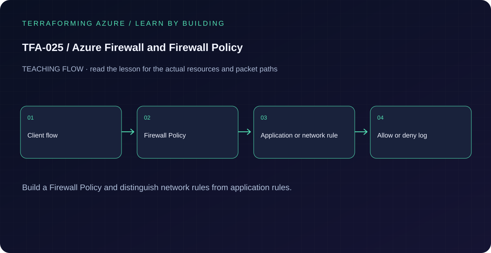

# TFA-025 - Azure Firewall and Firewall Policy

[Course home](../../README.md) | [Previous lab](../TFA-024/README.md) | [Next lab](../TFA-026/README.md)

> **Mode:** Azure deployment | **Time:** 60-90 minutes plus service provisioning | **Cost:** High: Azure Firewall Standard, private Windows probe, and Log Analytics ingestion. Destroy when finished.

## Why this lab exists

Centralized inspection is valuable only when routes direct traffic through the firewall and policy permits the intended flow.

## What you will learn

By the end, explain the mechanism below, follow its dependencies in Terraform, reproduce its evidence, diagnose the named failure, and clean up the resources you created. The final challenge checks whether you can apply the concept without copying another resource block.

## Concepts before commands

Azure Firewall Policy groups ordered collections and rules. This lab permits HTTPS to two Microsoft FQDNs from one source subnet. Application rules understand FQDNs; a network rule allowing TCP/443 to every IP would allow far more traffic. Standard firewall HTTPS application rules do not demonstrate TLS decryption. Unmatched traffic is denied.

## Architecture



A hub VNet with the required AzureFirewallSubnet, Firewall Standard and a public IP, Firewall Policy with a narrow application rule, and a private Windows probe in a workload subnet whose default route points to the firewall.

## Prerequisites and cost checkpoint

PowerShell 7, Terraform 1.9 or later (under 2.0; course tested with 1.15.8), Git, and the preceding concepts. Azure CLI, an explicitly selected sandbox subscription, approved permissions and regional quota. AzureRM is pinned to 4.77.0; do not silently upgrade it during the lesson.

High: Azure Firewall Standard, private Windows probe, and Log Analytics ingestion. Destroy when finished. Read the selected services in the [Azure pricing calculator](https://azure.microsoft.com/en-us/pricing/calculator/) before apply. A stopped VM can retain charged disks; a gateway/firewall is not stopped by leaving the terminal. Each lab owns its own local state; keep that state until cleanup. Do not reuse another lab's backend or import its resources.

## Step 1 - Read the implementation

Open `versions.tf`, `variables.tf`, `main.tf`, and `outputs.tf` in this directory. Find the source CIDR, protocol/port, collection priority, and destination FQDNs. Follow the firewall private IP into the route table. A private Windows probe sends the actual HTTPS requests through the configured Firewall path; TFA-026 adds a second spoke and symmetric east-west routing. If a shared Windows VM pattern is referenced, read its [implementation](../../modules/patterns/windows-vm/main.tf) as part of this lesson.

## Step 2 - Plan and build

Run from `labs/TFA-025` in PowerShell 7. Tests use provider mocks or local resources and do not apply Azure infrastructure. Supply real cloud inputs only for your deliberate plan/apply. The example tfvars file is an alternative to environment variables; a real terraform.tfvars value takes precedence over TF_VAR values.

```powershell
$env:TF_VAR_subscription_id = Read-Host 'Explicit Azure subscription ID'
az login
az account set --subscription $env:TF_VAR_subscription_id
$env:TF_VAR_location = 'westeurope'
terraform init
terraform fmt -check
terraform validate
terraform test
$env:TF_VAR_admin_password = Read-Host 'Unique Windows lab password (14+ characters)' -MaskInput
terraform plan -out=lab.tfplan
terraform show lab.tfplan
# Read the whole plan and confirm the subscription, scope, and charged services.
terraform apply lab.tfplan
```

Record what Terraform creates, which values are unknown until apply, and which resources carry ongoing charges. Keep passwords, VPN keys, PFX files, plans, and state out of Git. `sensitive` hides console values; it does not remove them from state.

## Step 3 - Verify with evidence

```powershell
$rg = terraform output -raw resource_group_name
az network firewall list -g $rg --query "[].{name:name,provisioning:provisioningState,privateIp:ipConfigurations[0].privateIPAddress}" -o table
az network firewall policy list -g $rg -o table
az network route-table list -g $rg --query "[].routes[].{prefix:addressPrefix,nextHop:nextHopType,ip:nextHopIpAddress}" -o table
terraform output policy_id
```

Firewall provisioning is Succeeded, the policy is attached, and the workload default route points to the firewall private IP. The additional probe below demonstrates the allowed and denied data-plane behavior.

Save a short local evidence note with the time, exact probe, observed result, and your explanation. Resource existence, DNS, routing, authorization, and application success are different kinds of evidence.

## Step 4 - Prove allow/deny, inject a policy fault, and repair

The probe has no direct NAT or public IP. Its default route reaches Azure Firewall, whose public IP supplies the egress path.

```powershell
$probe = terraform output -raw probe_vm_name
$request = Get-Content -Raw ./Probe-Firewall.ps1
az vm run-command invoke -g $rg -n $probe --command-id RunPowerShellScript --scripts $request
terraform plan -var='allow_learning_site=false' -out=deny.tfplan
terraform apply deny.tfplan
az vm run-command invoke -g $rg -n $probe --command-id RunPowerShellScript --scripts $request
terraform plan -var='allow_learning_site=true' -out=repair.tfplan
terraform apply repair.tfplan
az vm run-command invoke -g $rg -n $probe --command-id RunPowerShellScript --scripts $request
```

The Microsoft origin should return an HTTP response (a redirect is still an origin response), while example.org should be denied by the Firewall proxy. With the learning FQDNs removed, the Microsoft request should also be denied. Restore the rule and repeat the baseline. Capture HTTP status and Firewall logs; do not confuse the Firewall denial page with the destination application. The diagnostic setting sends application decisions to the dedicated AZFWApplicationRule table. Allow ingestion time and correlate source IP, FQDN, action, and rule with your probes:

```powershell
$workspace = terraform output -raw workspace_id
az monitor log-analytics query -w $workspace --analytics-query "AZFWApplicationRule | where TimeGenerated > ago(1h) | project TimeGenerated, SourceIp, Fqdn, Action, Rule | order by TimeGenerated desc"
```

TFA-028 expands monitoring to guest telemetry and other platform audit logs.

## Troubleshooting

Firewall must use its dedicated, correctly named subnet. If a future host loses all internet access, first distinguish a missing route association, a policy deny, and a DNS failure. Do not fix every failure by allowing `*`.

## Challenge

Add a second rule for one clearly justified learning destination. Document the source, protocol, and destination, review the diff, then remove the rule before cleanup.

## Knowledge check

Complete the five questions in [quiz.json](quiz.json), or use the course site's interactive quiz. Explain each answer before revealing its explanation. The quiz checks reasoning; it is not a substitute for the evidence above.

## Cleanup

```powershell
terraform plan -destroy -out=cleanup.tfplan
terraform show cleanup.tfplan
terraform apply cleanup.tfplan
terraform state list
Remove-Item Env:TF_VAR_admin_password -ErrorAction SilentlyContinue
# Check the Azure resource group no longer exists after successful destroy.
az group exists --subscription $env:TF_VAR_subscription_id --name rg-tfa025
```

A successful destroy and an empty state are the expected result. Verify the actual lab group name from the earlier output if you changed name_prefix. Soft-deleted vaults and retained logs can outlive their active resource; review the relevant Azure lifecycle and cost settings. Do not commit generated plans or state as evidence.

## Completion criteria

- You can explain why this design produces the observed behavior.
- You captured the required success evidence and investigated the controlled limitation or failure.
- You completed the challenge and five questions.
- You reviewed and completed cleanup, or recorded an explicit owner and deadline for intentionally retained resources.

## Continue learning

[Official documentation](https://learn.microsoft.com/en-us/azure/firewall/policy-rule-sets) | [Continue to TFA-026](../TFA-026/README.md)
