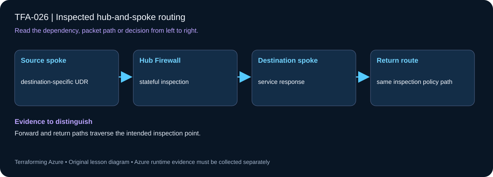

# TFA-026 - Inspected hub-and-spoke routing

<!-- lab-metadata:start -->
**Phase 4:** Private platforms

**Learning target:** 120 minutes · **Cost tier:** High · **Run mode:** `azure`

**Prerequisites:** [TFA-025 — Azure Firewall and Firewall Policy](../TFA-025/README.md)
<!-- lab-metadata:end -->

[Course home](../../README.md) | [Previous lab](../TFA-025/README.md) | [Next lab](../TFA-027/README.md)

## Why this lab exists

Peering two spokes to a hub does not automatically let the spokes communicate. You must design and prove the transit path.

## What you will learn

Inspect selected spoke and outbound traffic without creating asymmetric routing. Your evidence must distinguish configuration intent from the observed result: Forward and return paths traverse the intended inspection point.

## Predict the mechanism

Peering system routes are more specific than a default route. Inspected interspoke traffic therefore needs destination-specific UDRs as well as an egress default. A stateful Firewall also needs a compatible return path; one-way inspection can fail or bypass the intended policy.

Before running commands, write the expected result: **Forward and return paths traverse the intended inspection point.** Then explain what would change in this controlled failure: Remove a destination route and distinguish bypass or asymmetry from a policy denial. Record your prediction before inspecting the outcome.

## Concepts before commands

VNet peering is non-transitive. Each workload subnet receives a UDR for the other spoke prefix with Azure Firewall as its next hop. Both directions use the firewall, so stateful inspection sees a symmetric flow. The peerings allow forwarded traffic. There is no direct spoke-to-spoke peering that could bypass the firewall.

## Architecture

<!-- lab-diagram:start -->

<!-- lab-diagram:end -->

One hub, two spoke VNets, four directional hub/spoke peerings, Firewall Standard with a narrow ICMP rule, two private Windows VMs, and reciprocal spoke-prefix UDRs.

## Runtime and cost checkpoint

PowerShell 7.4 or newer (under 8), Terraform 1.15.8, Git, and the preceding concepts. Azure CLI, an explicitly selected sandbox subscription, approved permissions and regional quota. AzureRM is pinned to 4.77.0; do not silently upgrade it during the lesson.

Charged resources include Firewall Standard and two Windows VMs. No public VM addresses. Read the selected services in the [Azure pricing calculator](https://azure.microsoft.com/en-us/pricing/calculator/) before apply. A stopped VM can retain charged disks; a gateway/firewall is not stopped by leaving the terminal. Each lab owns its own local state; keep that state until cleanup. Do not reuse another lab's backend or import its resources.

## Step 1 - Read the implementation

Open `versions.tf`, `variables.tf`, `main.tf`, and `outputs.tf` in this directory. Compare the two `azurerm_route_table.spokes` entries. Specific spoke routes make the intended east-west path visible; do not rely on an internet default route as an explanation of every possible Azure route. Inspect the Windows VM module to confirm neither NIC has a public IP. If a shared Windows VM pattern is referenced, read its [implementation](../../modules/patterns/windows-vm/main.tf) as part of this lesson.

## Step 2 - Plan and build

Run from `labs/TFA-026` in PowerShell 7. Tests use provider mocks or local resources and do not apply Azure infrastructure. Supply real cloud inputs only for your deliberate plan/apply. The example tfvars file is an alternative to environment variables; a real terraform.tfvars value takes precedence over TF_VAR values.

```powershell
$env:TF_VAR_subscription_id = Read-Host 'Explicit Azure subscription ID'
az login
az account set --subscription $env:TF_VAR_subscription_id
$env:TF_VAR_location = 'westeurope'
terraform init
terraform fmt -check
terraform validate
terraform test
$env:TF_VAR_admin_password = Read-Host 'Unique Windows lab password (14+ characters)' -MaskInput
terraform plan -out=lab.tfplan
terraform show lab.tfplan
# Read the whole plan and confirm the subscription, scope, and charged services.
terraform apply lab.tfplan
```

Record what Terraform creates, which values are unknown until apply, and which resources carry ongoing charges. Keep passwords, VPN keys, PFX files, plans, and state out of Git. `sensitive` hides console values; it does not remove them from state.

## Step 3 - Verify with evidence

```powershell
$rg = terraform output -raw resource_group_name
$client = terraform output -raw client_vm_name
$server = terraform output -raw server_vm_name
$ip = terraform output -raw server_private_ip
az vm run-command invoke -g $rg -n $server --command-id RunPowerShellScript --scripts "New-NetFirewallRule -DisplayName 'TFA ICMPv4' -Protocol ICMPv4 -IcmpType 8 -Direction Inbound -Action Allow"
az vm run-command invoke -g $rg -n $client --command-id RunPowerShellScript --scripts "Test-Connection -ComputerName $ip -Count 3"
$nic = Split-Path (terraform output -raw client_nic_id) -Leaf
az network nic show-effective-route-table -g $rg -n $nic -o table
```

The effective route to `10.226.0.0/16` has VirtualAppliance as next hop and the firewall IP. ICMP succeeds after the deliberate guest firewall allowance. TCP/3389 across the spokes is not allowed by the Azure Firewall policy. Guest firewall, Azure policy, and routes are distinct checks.

Save a short local evidence note with the time, exact probe, observed result, and your explanation. Resource existence, DNS, routing, authorization, and application success are different kinds of evidence.

## Troubleshooting

Check outbound route, return route, forwarded-traffic peering flags, firewall policy, and guest firewall. Do not add direct peering as a troubleshooting shortcut: that changes the architecture.

## Challenge

Remove the reciprocal route association in code, plan/apply, and record the failed test. Restore it and repeat. Explain how a missing return route can resemble a forward-path deny.

## Knowledge check

Complete the five questions in [quiz.json](quiz.json), or use the course site's interactive quiz. Explain each answer before revealing its explanation. The quiz checks reasoning; it is not a substitute for the evidence above.

## Cleanup

```powershell
$cleanupGroup = terraform output -raw resource_group_name
if ($LASTEXITCODE -ne 0 -or -not $cleanupGroup) { throw 'Capture the actual lab group before planning destruction.' }
terraform plan -destroy -out=cleanup.tfplan
if ($LASTEXITCODE -ne 0) { throw 'Destroy plan failed: do not apply an older cleanup plan.' }
terraform show cleanup.tfplan
if ($LASTEXITCODE -ne 0) { throw 'Destroy plan could not be reviewed: stop before apply.' }
terraform apply cleanup.tfplan
if ($LASTEXITCODE -ne 0) { throw 'Destroy failed: retain state and investigate remaining resources before claiming cleanup.' }
$remaining = @(terraform state list)
if ($LASTEXITCODE -ne 0 -or $remaining.Count) { throw 'Cleanup left managed objects or state could not be read.' }
# Check the Azure resource group no longer exists after successful destroy.
$groupExists = az group exists --subscription $env:TF_VAR_subscription_id --name $cleanupGroup
if ($LASTEXITCODE -ne 0 -or $groupExists -ne 'false') { throw 'The owned group is not confirmed deleted. Keep state and investigate.' }
Remove-Item Env:TF_VAR_admin_password -ErrorAction SilentlyContinue
```

A successful destroy and an empty state are the expected result. The cleanup command uses the captured group, including a changed prefix. Soft-deleted vaults and retained logs can outlive their active resource; review the relevant Azure lifecycle and cost settings. Do not commit generated plans or state as evidence.

## Completion criteria

- You can explain why this design produces the observed behavior.
- You captured the required success evidence and investigated the controlled limitation or failure.
- You completed the challenge and five questions.
- You reviewed and completed cleanup, or recorded an explicit owner and deadline for intentionally retained resources.

## Continue learning

[Official documentation](https://learn.microsoft.com/en-us/azure/networking/design-guide/hub-spoke) | [Continue to TFA-027](../TFA-027/README.md)

## Evidence contract

Inspect workload UDRs and compare allowed/denied interspoke probes with Firewall logs. Forward and return paths traverse the intended inspection point.

See the [40-lab evidence map](../../docs/curriculum-evidence.md) for source paths, validation level and cleanup dependencies. Authored Azure commands are learner exercises; passing local checks does not establish a live deployment.
