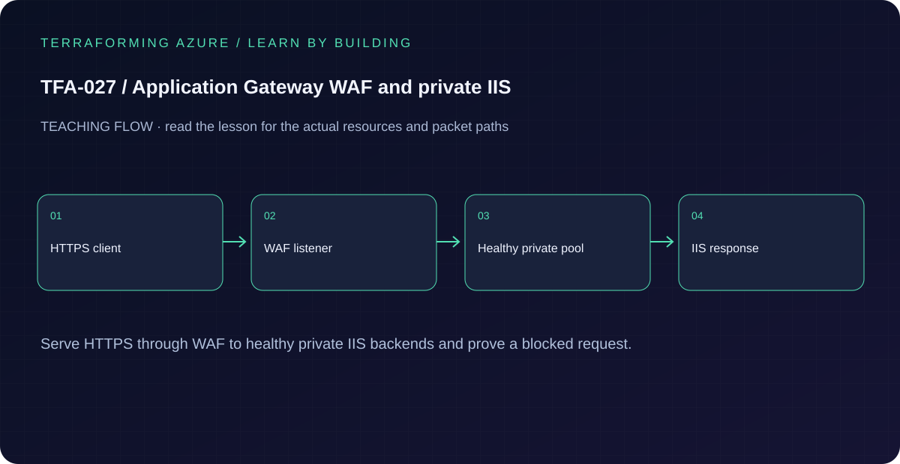

# TFA-027 - Application Gateway WAF and private IIS

[Course home](../../README.md) | [Previous lab](../TFA-026/README.md) | [Next lab](../TFA-028/README.md)

> **Mode:** Azure deployment | **Time:** 90-120 minutes plus WAF/VM provisioning | **Cost:** High: WAF_v2, a public IP, and two Windows VMs. A self-signed certificate is used only for this lab.

## Why this lab exists

A public application entry point can terminate HTTPS and filter requests while its backend servers keep private addresses.

## What you will learn

By the end, explain the mechanism below, follow its dependencies in Terraform, reproduce its evidence, diagnose the named failure, and clean up the resources you created. The final challenge checks whether you can apply the concept without copying another resource block.

## Concepts before commands

Application Gateway terminates client TLS, applies its WAF policy, and forwards HTTP to two IIS backends. This lesson deliberately uses HTTP inside the VNet; it is not an end-to-end TLS design. The backend NSG allows port 80 from the gateway subnet and denies other VNet inbound flows. The gateway has a dedicated subnet with no forced-tunnel route table.

## Architecture



WAF_v2 in Prevention mode, an HTTPS host listener, a self-signed PFX, a health probe, two private IIS VMs, and a backend NSG. No public IIS VM or public RDP rule is created.

## Prerequisites and cost checkpoint

PowerShell 7, Terraform 1.9 or later (under 2.0; course tested with 1.15.8), Git, and the preceding concepts. Azure CLI, an explicitly selected sandbox subscription, approved permissions and regional quota. AzureRM is pinned to 4.77.0; do not silently upgrade it during the lesson.

High: WAF_v2, a public IP, and two Windows VMs. A self-signed certificate is used only for this lab. Read the selected services in the [Azure pricing calculator](https://azure.microsoft.com/en-us/pricing/calculator/) before apply. A stopped VM can retain charged disks; a gateway/firewall is not stopped by leaving the terminal. Each lab owns its own local state; keep that state until cleanup. Do not reuse another lab's backend or import its resources.

## Step 1 - Read the implementation

Open `versions.tf`, `variables.tf`, `main.tf`, and `outputs.tf` in this directory. Read the certificate inputs, listener hostname, routing rule priority, probe host/path, and backend HTTP settings. Keep the listener hostname consistent when testing by IP. Inspect WAF and NSG as different enforcement layers. If a shared Windows VM pattern is referenced, read its [implementation](../../modules/patterns/windows-vm/main.tf) as part of this lesson.

## Step 2 - Plan and build

Run from `labs/TFA-027` in PowerShell 7. Tests use provider mocks or local resources and do not apply Azure infrastructure. Supply real cloud inputs only for your deliberate plan/apply. The example tfvars file is an alternative to environment variables; a real terraform.tfvars value takes precedence over TF_VAR values.

```powershell
$env:TF_VAR_subscription_id = Read-Host 'Explicit Azure subscription ID'
az login
az account set --subscription $env:TF_VAR_subscription_id
$env:TF_VAR_location = 'westeurope'
terraform init
terraform fmt -check
terraform validate
terraform test
$env:TF_VAR_admin_password = Read-Host 'Unique Windows lab password (14+ characters)' -MaskInput
../../scripts/New-LabCertificate.ps1 -SetTerraformEnvironment
terraform plan -out=lab.tfplan
terraform show lab.tfplan
# Read the whole plan and confirm the subscription, scope, and charged services.
terraform apply lab.tfplan
```

Record what Terraform creates, which values are unknown until apply, and which resources carry ongoing charges. Keep passwords, VPN keys, PFX files, plans, and state out of Git. `sensitive` hides console values; it does not remove them from state.

## Step 3 - Verify with evidence

```powershell
$rg = terraform output -raw resource_group_name
$gateway = terraform output -raw gateway_name
$ip = terraform output -raw gateway_public_ip
$hostName = terraform output -raw request_host
az network application-gateway show-backend-health -g $rg -n $gateway -o json
curl.exe --resolve "${hostName}:443:${ip}" -k "https://${hostName}/"
curl.exe --resolve "${hostName}:443:${ip}" -k -i "https://${hostName}/?q=%3Cscript%3Ealert(1)%3C%2Fscript%3E"
```

Both backend health entries become Healthy and the normal request returns a Terraforming Azure IIS page. The attack-shaped request should receive a WAF denial (commonly HTTP 403); inspect the policy and logs if its rule set behaves differently. `-k` bypasses trust only for this self-signed exercise; it is not production client guidance.

Save a short local evidence note with the time, exact probe, observed result, and your explanation. Resource existence, DNS, routing, authorization, and application success are different kinds of evidence.

## Troubleshooting

A 502 commonly means an unhealthy backend: inspect IIS, port 80, the probe host/path, and the backend NSG before changing WAF. A TLS trust error is expected without trusting the self-signed issuer. Never attach a generic default route through a virtual appliance to the gateway subnet.

## Challenge

Stop IIS on one backend through Run Command, observe health and continued service from the other VM, then restart it. Document that this is one region and not a regional disaster-recovery solution.

## Knowledge check

Complete the five questions in [quiz.json](quiz.json), or use the course site's interactive quiz. Explain each answer before revealing its explanation. The quiz checks reasoning; it is not a substitute for the evidence above.

## Cleanup

```powershell
terraform plan -destroy -out=cleanup.tfplan
terraform show cleanup.tfplan
terraform apply cleanup.tfplan
terraform state list
# Check the Azure resource group no longer exists after successful destroy.
az group exists --subscription $env:TF_VAR_subscription_id --name rg-tfa027
Remove-Item Env:TF_VAR_admin_password -ErrorAction SilentlyContinue
Remove-Item Env:TF_VAR_certificate_password -ErrorAction SilentlyContinue
# Remove the generated .secrets directory only after confirming its contents are lab-only.
```

A successful destroy and an empty state are the expected result. Verify the actual lab group name from the earlier output if you changed name_prefix. Soft-deleted vaults and retained logs can outlive their active resource; review the relevant Azure lifecycle and cost settings. Do not commit generated plans or state as evidence.

## Completion criteria

- You can explain why this design produces the observed behavior.
- You captured the required success evidence and investigated the controlled limitation or failure.
- You completed the challenge and five questions.
- You reviewed and completed cleanup, or recorded an explicit owner and deadline for intentionally retained resources.

## Continue learning

[Official documentation](https://learn.microsoft.com/en-us/azure/application-gateway/configuration-infrastructure) | [Continue to TFA-028](../TFA-028/README.md)
