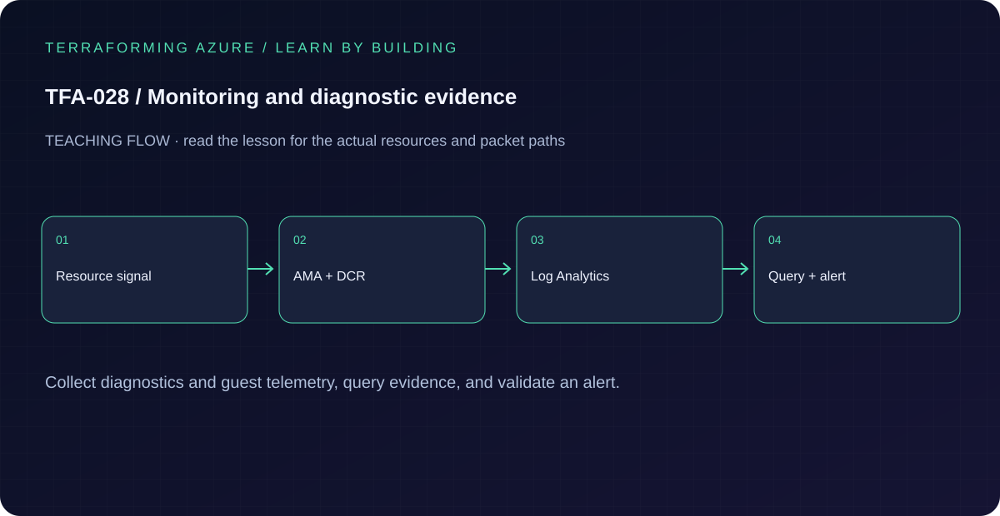

# TFA-028 - Monitoring and diagnostic evidence

[Course home](../../README.md) | [Previous lab](../TFA-027/README.md) | [Next lab](../TFA-029/README.md)

> **Mode:** Azure deployment | **Time:** 70-100 minutes; allow ingestion time | **Cost:** Medium: one Windows VM, NAT Gateway, Log Analytics ingestion, and diagnostic operations. A daily ingestion cap is not a spending guarantee.

## Why this lab exists

A successful resource deployment does not show whether an application works. Monitoring needs an agent, collection rules, a destination, and a repeatable evidence query.

## What you will learn

By the end, explain the mechanism below, follow its dependencies in Terraform, reproduce its evidence, diagnose the named failure, and clean up the resources you created. The final challenge checks whether you can apply the concept without copying another resource block.

## Concepts before commands

Azure Monitor Agent runs under the VM system-assigned identity. A DCR selects Windows events and performance counters; an association binds that rule to the VM. Log Analytics is the destination. Platform diagnostic settings are a separate mechanism for resource logs. Explicit NAT supplies outbound connectivity for agent endpoints without exposing a VM inbound port.

## Architecture



A private Windows VM, system-assigned identity, NAT egress, Azure Monitor Agent, a Windows DCR and association, and a Log Analytics workspace. A Key Vault diagnostic setting demonstrates platform audit logs alongside guest telemetry.

## Prerequisites and cost checkpoint

PowerShell 7, Terraform 1.9 or later (under 2.0; course tested with 1.15.8), Git, and the preceding concepts. Azure CLI, an explicitly selected sandbox subscription, approved permissions and regional quota. AzureRM is pinned to 4.77.0; do not silently upgrade it during the lesson.

Medium: one Windows VM, NAT Gateway, Log Analytics ingestion, and diagnostic operations. A daily ingestion cap is not a spending guarantee. Read the selected services in the [Azure pricing calculator](https://azure.microsoft.com/en-us/pricing/calculator/) before apply. A stopped VM can retain charged disks; a gateway/firewall is not stopped by leaving the terminal. Each lab owns its own local state; keep that state until cleanup. Do not reuse another lab's backend or import its resources.

## Step 1 - Read the implementation

Open `versions.tf`, `variables.tf`, `main.tf`, and `outputs.tf` in this directory. Follow the AMA extension, the DCR data sources/streams, the destination name, and the DCR association. Read `queries.kql`. Distinguish a missing Heartbeat from a valid heartbeat with an incorrectly filtered Event query. If a shared Windows VM pattern is referenced, read its [implementation](../../modules/patterns/windows-vm/main.tf) as part of this lesson.

## Step 2 - Plan and build

Run from `labs/TFA-028` in PowerShell 7. Tests use provider mocks or local resources and do not apply Azure infrastructure. Supply real cloud inputs only for your deliberate plan/apply. The example tfvars file is an alternative to environment variables; a real terraform.tfvars value takes precedence over TF_VAR values.

```powershell
$env:TF_VAR_subscription_id = Read-Host 'Explicit Azure subscription ID'
az login
az account set --subscription $env:TF_VAR_subscription_id
$env:TF_VAR_location = 'westeurope'
terraform init
terraform fmt -check
terraform validate
terraform test
$env:TF_VAR_admin_password = Read-Host 'Unique Windows lab password (14+ characters)' -MaskInput
terraform plan -out=lab.tfplan
terraform show lab.tfplan
# Read the whole plan and confirm the subscription, scope, and charged services.
terraform apply lab.tfplan
```

Record what Terraform creates, which values are unknown until apply, and which resources carry ongoing charges. Keep passwords, VPN keys, PFX files, plans, and state out of Git. `sensitive` hides console values; it does not remove them from state.

## Step 3 - Verify with evidence

```powershell
$rg = terraform output -raw resource_group_name
$vm = terraform output -raw ops_vm_name
$workspace = terraform output -raw workspace_id
az vm extension list -g $rg --vm-name $vm -o table
az vm run-command invoke -g $rg -n $vm --command-id RunPowerShellScript --scripts "eventcreate /T ERROR /ID 100 /L APPLICATION /D 'TFA-028 monitoring evidence'"
az monitor log-analytics query -w $workspace --analytics-query "Heartbeat | where TimeGenerated > ago(30m) | summarize LastSeen=max(TimeGenerated) by Computer"
az monitor log-analytics query -w $workspace --analytics-query "Event | where TimeGenerated > ago(1h) | where RenderedDescription contains 'TFA-028' | project TimeGenerated, Computer, RenderedDescription"
```

The agent extension provisions, a recent heartbeat arrives, and the synthetic Application error appears in Event after ingestion. An empty table immediately after apply is not proof of failure. Generate a Key Vault data-plane request and inspect its audit category separately; management-plane activity is not equivalent to a secret read.

Save a short local evidence note with the time, exact probe, observed result, and your explanation. Resource existence, DNS, routing, authorization, and application success are different kinds of evidence.

## Troubleshooting

Check VM outbound DNS/HTTPS, extension status, DCR association, stream names, XPath filters, workspace destination, and query time window. Avoid installing the retired Log Analytics/MMA agent alongside AMA to mask a collection mistake.

## Challenge

Change the collection interval to 120 seconds and explain the signal/cost tradeoff. Add an informational-event query only after adjusting the XPath, then restore the original noise level.

## Knowledge check

Complete the five questions in [quiz.json](quiz.json), or use the course site's interactive quiz. Explain each answer before revealing its explanation. The quiz checks reasoning; it is not a substitute for the evidence above.

## Cleanup

```powershell
terraform plan -destroy -out=cleanup.tfplan
terraform show cleanup.tfplan
terraform apply cleanup.tfplan
terraform state list
# Check the Azure resource group no longer exists after successful destroy.
az group exists --subscription $env:TF_VAR_subscription_id --name rg-tfa028
Remove-Item Env:TF_VAR_admin_password -ErrorAction SilentlyContinue
```

A successful destroy and an empty state are the expected result. Verify the actual lab group name from the earlier output if you changed name_prefix. Soft-deleted vaults and retained logs can outlive their active resource; review the relevant Azure lifecycle and cost settings. Do not commit generated plans or state as evidence.

## Completion criteria

- You can explain why this design produces the observed behavior.
- You captured the required success evidence and investigated the controlled limitation or failure.
- You completed the challenge and five questions.
- You reviewed and completed cleanup, or recorded an explicit owner and deadline for intentionally retained resources.

## Continue learning

[Official documentation](https://learn.microsoft.com/en-us/azure/azure-monitor/vm/data-collection) | [Continue to TFA-029](../TFA-029/README.md)
