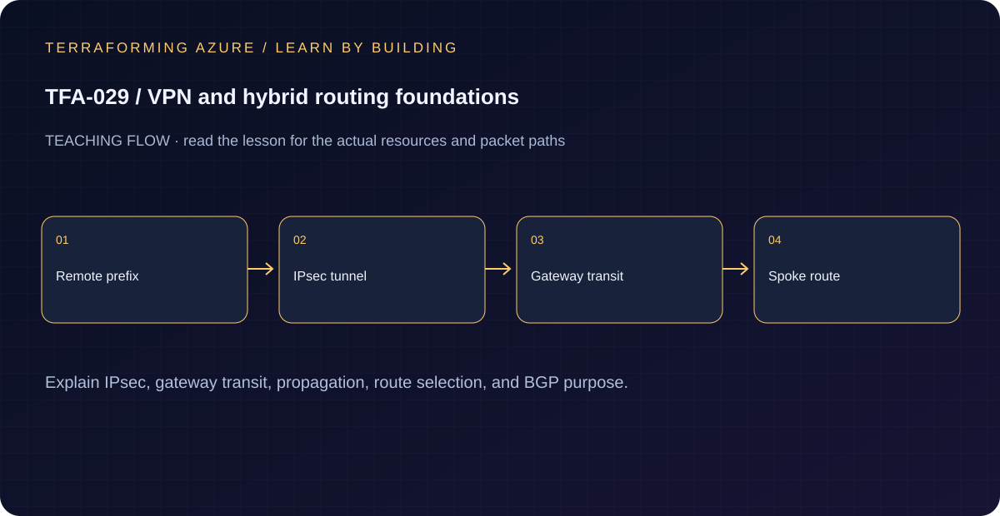

# TFA-029 - VPN and hybrid routing foundations

<!-- lab-metadata:start -->
**Phase 5:** Hybrid operations

**Learning target:** 75 minutes · **Cost tier:** None · **Run mode:** `local`

**Prerequisites:** [TFA-028 — Monitoring and diagnostic evidence](../TFA-028/README.md)
<!-- lab-metadata:end -->

[Course home](../../README.md) | [Previous lab](../TFA-028/README.md) | [Next lab](../TFA-030/README.md)

## Why this lab exists

Before paying for two gateways, make the address plan and route choice understandable on paper and in a small executable model.

## What you will learn

Explain IPsec, gateway transit, propagation, route selection, and BGP purpose. Your evidence must distinguish configuration intent from the observed result: The model distinguishes a tunnel, a route and peering transit settings.

## Predict the mechanism

Gateway transit exposes an existing hub gateway to a peered spoke when both peering sides are configured appropriately. Route propagation distributes reachable prefixes; it does not encrypt arbitrary traffic by itself. BGP can exchange routes dynamically, while a simpler static exercise still requires non-overlapping addresses.

Before running commands, write the expected result: **The model distinguishes a tunnel, a route and peering transit settings.** Then explain what would change in this controlled failure: Predict the missing return prefix or overlapping range before building gateways. Record your prediction before inspecting the outcome.

## Concepts before commands

This is a local Terraform simulation using `terraform_data`. It assumes the listed routes already match destination `10.130.2.4`, compares their prefix lengths, and selects the most specific. It is not an Azure route engine, CIDR-membership validator, tunnel, or connectivity test. A `/16` match beats `/0`. IPsec peers additionally require compatible tunnel settings and a matching shared key.

## Architecture

<!-- lab-diagram:start -->

<!-- lab-diagram:end -->

A local address/route decision artifact with an explicit GatewaySubnet reservation and a validation guard against an ambiguous best route.

## Runtime and cost checkpoint

PowerShell 7.4 or newer (under 8), Terraform 1.15.8, Git, and the preceding concepts.

Local only: no Azure resources, credentials, gateways, or charges. Read the selected services in the [Azure pricing calculator](https://azure.microsoft.com/en-us/pricing/calculator/) before apply. A stopped VM can retain charged disks; a gateway/firewall is not stopped by leaving the terminal. Each lab owns its own local state; keep that state until cleanup. Do not reuse another lab's backend or import its resources.

## Step 1 - Read the implementation

Open `versions.tf`, `variables.tf`, `main.tf`, and `outputs.tf` in this directory. Trace `prefix_lengths`, `longest_prefix`, the map filter, and the precondition. Explain which Azure concepts this local model covers and which it intentionally cannot validate. If a shared Windows VM pattern is referenced, read its [implementation](../../modules/patterns/windows-vm/main.tf) as part of this lesson.

## Step 2 - Plan and build

Run from `labs/TFA-029` in PowerShell 7. Tests use provider mocks or local resources and do not apply Azure infrastructure. Supply real cloud inputs only for your deliberate plan/apply. The example tfvars file is an alternative to environment variables; a real terraform.tfvars value takes precedence over TF_VAR values.

```powershell
terraform init
terraform fmt -check
terraform validate
terraform test
terraform plan -out=lab.tfplan
terraform show lab.tfplan
# Read the whole plan and confirm the subscription, scope, and charged services.
terraform apply lab.tfplan
```

Record what Terraform creates, which values are unknown until apply, and which resources carry ongoing charges. Keep passwords, VPN keys, PFX files, plans, and state out of Git. `sensitive` hides console values; it does not remove them from state.

## Step 3 - Verify with evidence

```powershell
terraform output route_decision
terraform state show terraform_data.route_decision
terraform console
# In the console: local.longest_prefix
# In the console: local.selected_routes
# Then: exit
```

The selected route is `10.130.0.0/16 -> VirtualNetworkGateway`, not the default Internet route. Only a local terraform_data resource is in state. No VPN status is available because no VPN has been deployed.

Save a short local evidence note with the time, exact probe, observed result, and your explanation. Resource existence, DNS, routing, authorization, and application success are different kinds of evidence.

## Troubleshooting

Two candidate routes with the same longest prefix deliberately fail the precondition. Azure also considers route source and other route rules; those are not simulated here. Do not feed arbitrary nonmatching routes into this small exercise and treat its output as authoritative.

## Challenge

Supply an additional matching `10.130.2.0/24` candidate, re-run the plan, and explain the changed selection. Draw the expected return route from the simulated site before starting TFA-030.

## Knowledge check

Complete the five questions in [quiz.json](quiz.json), or use the course site's interactive quiz. Explain each answer before revealing its explanation. The quiz checks reasoning; it is not a substitute for the evidence above.

## Cleanup

```powershell
terraform plan -destroy -out=cleanup.tfplan
if ($LASTEXITCODE -ne 0) { throw 'Destroy plan failed: do not apply an older cleanup plan.' }
terraform show cleanup.tfplan
if ($LASTEXITCODE -ne 0) { throw 'Destroy plan could not be reviewed: stop before apply.' }
terraform apply cleanup.tfplan
if ($LASTEXITCODE -ne 0) { throw 'Destroy failed: retain state and investigate remaining resources before claiming cleanup.' }
$remaining = @(terraform state list)
if ($LASTEXITCODE -ne 0 -or $remaining.Count) { throw 'Cleanup left managed objects or state could not be read.' }
```

A successful destroy and an empty state are the expected result. Do not remove files or state from another lab. Do not commit generated plans or state as evidence.

## Completion criteria

- You can explain why this design produces the observed behavior.
- You captured the required success evidence and investigated the controlled limitation or failure.
- You completed the challenge and five questions.
- You reviewed and completed cleanup, or recorded an explicit owner and deadline for intentionally retained resources.

## Continue learning

[Official documentation](https://learn.microsoft.com/en-us/azure/virtual-network/virtual-networks-udr-overview) | [Continue to TFA-030](../TFA-030/README.md)

## Evidence contract

Read the local VPN/routing model and explain gateway ownership, propagation and learned prefixes. The model distinguishes a tunnel, a route and peering transit settings.

See the [40-lab evidence map](../../docs/curriculum-evidence.md) for source paths, validation level and cleanup dependencies. Authored Azure commands are learner exercises; passing local checks does not establish a live deployment.
