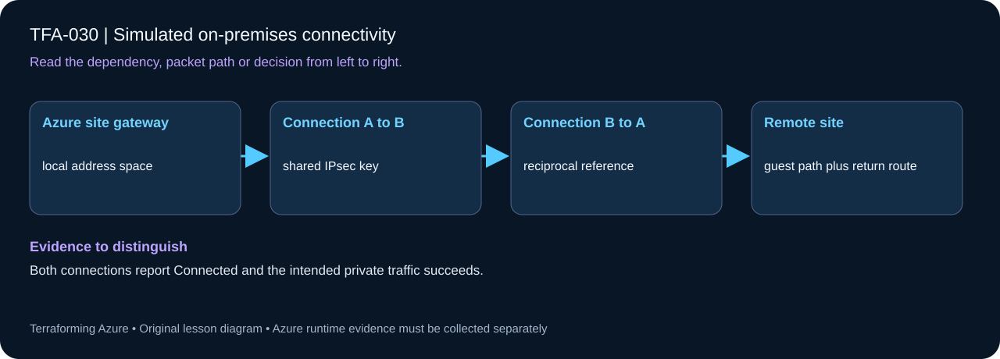

# TFA-030 - Simulated on-premises connectivity

<!-- lab-metadata:start -->
**Phase 5:** Hybrid operations

**Learning target:** 120 minutes · **Cost tier:** High · **Run mode:** `azure`

**Prerequisites:** [TFA-029 — VPN and hybrid routing foundations](../TFA-029/README.md)
<!-- lab-metadata:end -->

[Course home](../../README.md) | [Previous lab](../TFA-029/README.md) | [Next lab](../TFA-031/README.md)

## Why this lab exists

Hybrid connectivity becomes easier to reason about when both ends of a tunnel are visible and independently testable.

## What you will learn

Prove an encrypted connection to an Azure-hosted simulated on-premises network. Your evidence must distinguish configuration intent from the observed result: Both connections report Connected and the intended private traffic succeeds.

## Predict the mechanism

Two Azure VPN gateways can form a repeatable VNet-to-VNet IPsec exercise. Both reciprocal connections must refer to the other gateway and share the intended key. Connected control-plane status is necessary, but a guest traffic probe and a return route are still required to prove the tunnel is useful.

Before running commands, write the expected result: **Both connections report Connected and the intended private traffic succeeds.** Then explain what would change in this controlled failure: Use a mismatched shared key, diagnose the tunnel failure, restore matching keys. Record your prediction before inspecting the outcome.

## Concepts before commands

Two Azure VNets represent an Azure site and a simulated remote site. Each has its own route-based VPN gateway and a VNet-to-VNet connection to its peer using the same shared key. There is no VNet peering between sites. This is an Azure-hosted simulation, not validation of a physical on-premises VPN device, a Local Network Gateway, or a real WAN.

## Architecture

<!-- lab-diagram:start -->

<!-- lab-diagram:end -->

Two non-overlapping VNets, two dedicated GatewaySubnets, two zone-redundant gateway public IPs, two VPN gateways, two directional VNet2VNet connections, and a private Windows test VM at each site.

## Runtime and cost checkpoint

PowerShell 7.4 or newer (under 8), Terraform 1.15.8, Git, and the preceding concepts. Azure CLI, an explicitly selected sandbox subscription, approved permissions and regional quota. AzureRM is pinned to 4.77.0; do not silently upgrade it during the lesson.

Charged resources include two VpnGw1AZ gateways, public IPs, and two Windows VMs. Charges continue while gateways exist. Read the selected services in the [Azure pricing calculator](https://azure.microsoft.com/en-us/pricing/calculator/) before apply. A stopped VM can retain charged disks; a gateway/firewall is not stopped by leaving the terminal. Each lab owns its own local state; keep that state until cleanup. Do not reuse another lab's backend or import its resources.

## Step 1 - Read the implementation

Open `versions.tf`, `variables.tf`, `main.tf`, and `outputs.tf` in this directory. Compare the two connection resources and their peer gateway IDs. Inspect address spaces `10.30.0.0/16` and `10.130.0.0/16`; explain why overlap would break the design. The shared key is sensitive but remains in state. If a shared Windows VM pattern is referenced, read its [implementation](../../modules/patterns/windows-vm/main.tf) as part of this lesson.

## Step 2 - Plan and build

Run from `labs/TFA-030` in PowerShell 7. Tests use provider mocks or local resources and do not apply Azure infrastructure. Supply real cloud inputs only for your deliberate plan/apply. The example tfvars file is an alternative to environment variables; a real terraform.tfvars value takes precedence over TF_VAR values.

```powershell
$env:TF_VAR_subscription_id = Read-Host 'Explicit Azure subscription ID'
az login
az account set --subscription $env:TF_VAR_subscription_id
$env:TF_VAR_location = 'westeurope'
terraform init
terraform fmt -check
terraform validate
terraform test
$env:TF_VAR_admin_password = Read-Host 'Unique Windows lab password (14+ characters)' -MaskInput
$env:TF_VAR_vpn_shared_key = Read-Host 'Unique shared tunnel key (24+ characters)' -MaskInput
terraform plan -out=lab.tfplan
terraform show lab.tfplan
# Read the whole plan and confirm the subscription, scope, and charged services.
terraform apply lab.tfplan
```

Record what Terraform creates, which values are unknown until apply, and which resources carry ongoing charges. Keep passwords, VPN keys, PFX files, plans, and state out of Git. `sensitive` hides console values; it does not remove them from state.

## Step 3 - Verify with evidence

```powershell
$rg = terraform output -raw resource_group_name
az network vpn-connection list -g $rg --query "[].{name:name,status:connectionStatus,ingress:ingressBytesTransferred,egress:egressBytesTransferred}" -o table
$azureVm = terraform output -raw azure_vm_name
$onpremVm = terraform output -raw onprem_vm_name
$azureIp = terraform output -raw azure_private_ip
$onpremIp = terraform output -raw onprem_private_ip
az vm run-command invoke -g $rg -n $onpremVm --command-id RunPowerShellScript --scripts "New-NetFirewallRule -DisplayName 'TFA ICMPv4' -Protocol ICMPv4 -IcmpType 8 -Direction Inbound -Action Allow"
az vm run-command invoke -g $rg -n $azureVm --command-id RunPowerShellScript --scripts "Test-Connection -ComputerName $onpremIp -Count 3"
```

Both connections reach Connected and traffic counters increase when the test VM reaches the other private address. Azure provisioning success alone does not establish a tunnel or prove guest reachability.

Save a short local evidence note with the time, exact probe, observed result, and your explanation. Resource existence, DNS, routing, authorization, and application success are different kinds of evidence.

## Troubleshooting

Check that both gateway deployments completed, both peer connections exist, the shared keys match, address spaces do not overlap, and guest firewall allows the probe. Do not add peering to make the connectivity test pass.

## Challenge

Add a TCP listener on one test VM and a narrowly scoped guest rule, then test that service rather than relying only on ping. Remove the listener and restore the baseline before destroying.

## Knowledge check

Complete the five questions in [quiz.json](quiz.json), or use the course site's interactive quiz. Explain each answer before revealing its explanation. The quiz checks reasoning; it is not a substitute for the evidence above.

## Cleanup

```powershell
$cleanupGroup = terraform output -raw resource_group_name
if ($LASTEXITCODE -ne 0 -or -not $cleanupGroup) { throw 'Capture the actual lab group before planning destruction.' }
terraform plan -destroy -out=cleanup.tfplan
if ($LASTEXITCODE -ne 0) { throw 'Destroy plan failed: do not apply an older cleanup plan.' }
terraform show cleanup.tfplan
if ($LASTEXITCODE -ne 0) { throw 'Destroy plan could not be reviewed: stop before apply.' }
terraform apply cleanup.tfplan
if ($LASTEXITCODE -ne 0) { throw 'Destroy failed: retain state and investigate remaining resources before claiming cleanup.' }
$remaining = @(terraform state list)
if ($LASTEXITCODE -ne 0 -or $remaining.Count) { throw 'Cleanup left managed objects or state could not be read.' }
# Check the Azure resource group no longer exists after successful destroy.
$groupExists = az group exists --subscription $env:TF_VAR_subscription_id --name $cleanupGroup
if ($LASTEXITCODE -ne 0 -or $groupExists -ne 'false') { throw 'The owned group is not confirmed deleted. Keep state and investigate.' }
Remove-Item Env:TF_VAR_admin_password -ErrorAction SilentlyContinue
Remove-Item Env:TF_VAR_vpn_shared_key -ErrorAction SilentlyContinue
```

A successful destroy and an empty state are the expected result. The cleanup command uses the captured group, including a changed prefix. Soft-deleted vaults and retained logs can outlive their active resource; review the relevant Azure lifecycle and cost settings. Do not commit generated plans or state as evidence.

## Completion criteria

- You can explain why this design produces the observed behavior.
- You captured the required success evidence and investigated the controlled limitation or failure.
- You completed the challenge and five questions.
- You reviewed and completed cleanup, or recorded an explicit owner and deadline for intentionally retained resources.

## Continue learning

[Official documentation](https://learn.microsoft.com/en-us/azure/vpn-gateway/vpn-gateway-howto-vnet-vnet-resource-manager-portal) | [Continue to TFA-031](../TFA-031/README.md)

## Evidence contract

Inspect both VPN connection states and execute the authored cross-network private probe. Both connections report Connected and the intended private traffic succeeds.

See the [40-lab evidence map](../../docs/curriculum-evidence.md) for source paths, validation level and cleanup dependencies. Authored Azure commands are learner exercises; passing local checks does not establish a live deployment.
