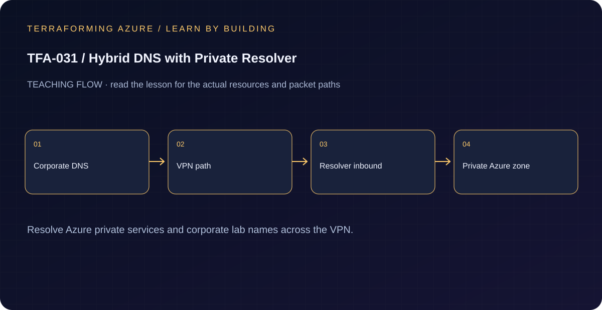

# TFA-031 - Hybrid DNS with Private Resolver

[Course home](../../README.md) | [Previous lab](../TFA-030/README.md) | [Next lab](../TFA-032/README.md)

> **Mode:** Azure deployment | **Time:** 100-140 minutes hands-on plus two gateway deployments | **Cost:** High: two VPN gateways, DNS Private Resolver inbound endpoint, private endpoint, DNS zones, and a Windows DNS VM.

## Why this lab exists

A connected remote host can still resolve a storage name to its public address. Hybrid DNS must carry the query to a resolver that sees the private zone.

## What you will learn

By the end, explain the mechanism below, follow its dependencies in Terraform, reproduce its evidence, diagnose the named failure, and clean up the resources you created. The final challenge checks whether you can apply the concept without copying another resource block.

## Concepts before commands

The simulated-site Windows DNS server conditionally forwards the Blob public service zone and its privatelink zone to an Azure DNS Private Resolver inbound IP across the VPN. The private zone is linked to the Azure VNet. That is query forwarding into Azure; an outbound endpoint/ruleset for Azure-to-on-premises names is a different direction and is not deployed here. The DNS VM uses explicit `-Server` queries in the exercise; it is not silently installed as every VNet client's default DNS server.

## Architecture



A standalone two-gateway hybrid network, private-only Blob endpoint and DNS zone, a delegated resolver subnet with static inbound IP `10.31.1.4`, and Windows DNS with conditional forwarders at `10.131.2.4`.

## Prerequisites and cost checkpoint

PowerShell 7, Terraform 1.9 or later (under 2.0; course tested with 1.15.8), Git, and the preceding concepts. Azure CLI, an explicitly selected sandbox subscription, approved permissions and regional quota. AzureRM is pinned to 4.77.0; do not silently upgrade it during the lesson.

High: two VPN gateways, DNS Private Resolver inbound endpoint, private endpoint, DNS zones, and a Windows DNS VM. Read the selected services in the [Azure pricing calculator](https://azure.microsoft.com/en-us/pricing/calculator/) before apply. A stopped VM can retain charged disks; a gateway/firewall is not stopped by leaving the terminal. Each lab owns its own local state; keep that state until cleanup. Do not reuse another lab's backend or import its resources.

## Step 1 - Read the implementation

Open `versions.tf`, `variables.tf`, `main.tf`, and `outputs.tf` in this directory. Follow the hostname query: simulated Windows DNS -> VPN -> resolver inbound endpoint -> linked private zone -> private endpoint A record. The resolver subnet must be dedicated and delegated. Storage creation uses ARM-only provider behavior because your laptop has no private data-plane path. If a shared Windows VM pattern is referenced, read its [implementation](../../modules/patterns/windows-vm/main.tf) as part of this lesson.

## Step 2 - Plan and build

Run from `labs/TFA-031` in PowerShell 7. Tests use provider mocks or local resources and do not apply Azure infrastructure. Supply real cloud inputs only for your deliberate plan/apply. The example tfvars file is an alternative to environment variables; a real terraform.tfvars value takes precedence over TF_VAR values.

```powershell
$env:TF_VAR_subscription_id = Read-Host 'Explicit Azure subscription ID'
az login
az account set --subscription $env:TF_VAR_subscription_id
$env:TF_VAR_location = 'westeurope'
terraform init
terraform fmt -check
terraform validate
terraform test
$env:TF_VAR_admin_password = Read-Host 'Unique Windows lab password (14+ characters)' -MaskInput
$env:TF_VAR_vpn_shared_key = Read-Host 'Unique shared tunnel key (24+ characters)' -MaskInput
terraform plan -out=lab.tfplan
terraform show lab.tfplan
# Read the whole plan and confirm the subscription, scope, and charged services.
terraform apply lab.tfplan
```

Record what Terraform creates, which values are unknown until apply, and which resources carry ongoing charges. Keep passwords, VPN keys, PFX files, plans, and state out of Git. `sensitive` hides console values; it does not remove them from state.

## Step 3 - Verify with evidence

```powershell
$rg = terraform output -raw resource_group_name
$dnsVm = terraform output -raw dns_vm_name
$blob = terraform output -raw blob_hostname
$expected = terraform output -raw blob_private_ip
az network vpn-connection list -g $rg --query "[].{name:name,status:connectionStatus}" -o table
az vm run-command invoke -g $rg -n $dnsVm --command-id RunPowerShellScript --scripts "Resolve-DnsName $blob -Server 127.0.0.1; Test-NetConnection $expected -Port 443"
terraform output resolver_inbound_ip
terraform output blob_private_ip
```

The explicit query to the local DNS service ultimately returns the Blob private endpoint IP. The TCP test uses the expected private IP explicitly, avoiding the VM's ordinary configured resolver. Compare DNS output with that expected IP; both must describe the same endpoint. DNS success grants no storage data-plane permission.

Save a short local evidence note with the time, exact probe, observed result, and your explanation. Resource existence, DNS, routing, authorization, and application success are different kinds of evidence.

## Troubleshooting

Test the tunnel first, then UDP/TCP 53 reachability, the conditional forwarder, Azure zone link, and DNS record. Forwarding only the privatelink suffix can miss the initial public-service name lookup. Do not point an on-premises DNS forwarder directly to Azure's VNet-local `168.63.129.16` address.

## Challenge

From the DNS VM, test TCP 443 directly to the private IP returned by Resolve-DnsName and record both DNS and TCP evidence. Draw how an outbound resolver endpoint/ruleset would extend the design in the reverse direction.

## Knowledge check

Complete the five questions in [quiz.json](quiz.json), or use the course site's interactive quiz. Explain each answer before revealing its explanation. The quiz checks reasoning; it is not a substitute for the evidence above.

## Cleanup

```powershell
terraform plan -destroy -out=cleanup.tfplan
terraform show cleanup.tfplan
terraform apply cleanup.tfplan
terraform state list
# Check the Azure resource group no longer exists after successful destroy.
az group exists --subscription $env:TF_VAR_subscription_id --name rg-tfa031
Remove-Item Env:TF_VAR_admin_password -ErrorAction SilentlyContinue
Remove-Item Env:TF_VAR_vpn_shared_key -ErrorAction SilentlyContinue
```

A successful destroy and an empty state are the expected result. Verify the actual lab group name from the earlier output if you changed name_prefix. Soft-deleted vaults and retained logs can outlive their active resource; review the relevant Azure lifecycle and cost settings. Do not commit generated plans or state as evidence.

## Completion criteria

- You can explain why this design produces the observed behavior.
- You captured the required success evidence and investigated the controlled limitation or failure.
- You completed the challenge and five questions.
- You reviewed and completed cleanup, or recorded an explicit owner and deadline for intentionally retained resources.

## Continue learning

[Official documentation](https://learn.microsoft.com/en-us/azure/dns/private-resolver-hybrid-dns) | [Continue to TFA-032](../TFA-032/README.md)
