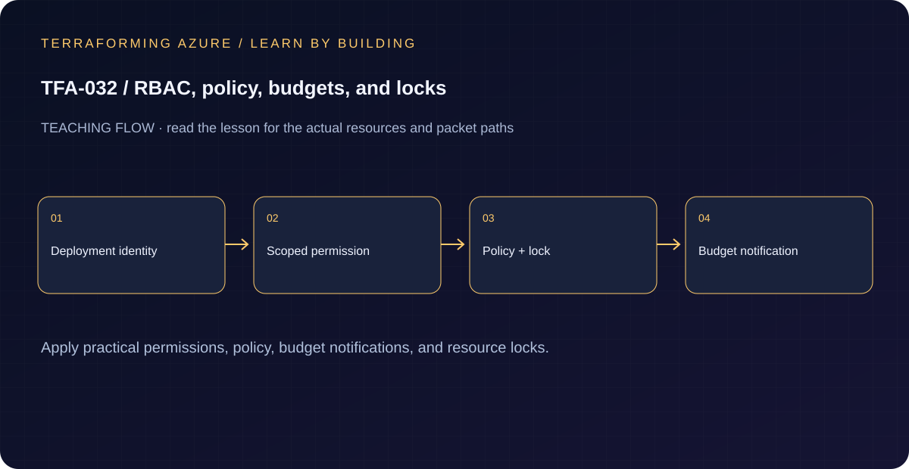

# TFA-032 - RBAC, policy, budgets, and locks

<!-- lab-metadata:start -->
**Phase 5:** Hybrid operations

**Learning target:** 75 minutes · **Cost tier:** Low · **Run mode:** `azure`

**Prerequisites:** [TFA-031 — Hybrid DNS with Private Resolver](../TFA-031/README.md)
<!-- lab-metadata:end -->

[Course home](../../README.md) | [Previous lab](../TFA-031/README.md) | [Next lab](../TFA-033/README.md)

## Why this lab exists

A usable lab needs permissions, guardrails, cost visibility, and a deliberate cleanup path. These controls solve different problems.

## What you will learn

Apply practical permissions, policy, budget notifications, and resource locks. Your evidence must distinguish configuration intent from the observed result: Each control addresses a distinct question and cleanup removes the lock deliberately.

## Predict the mechanism

RBAC assigns actions to principals at a scope; Azure Policy evaluates resource properties against governance rules. A deletion lock blocks accidental removal but is not a backup or a defense against an authorized lock remover. A budget alert reports a threshold and does not suspend billable resources.

Before running commands, write the expected result: **Each control addresses a distinct question and cleanup removes the lock deliberately.** Then explain what would change in this controlled failure: Attempt the documented policy violation or deletion with a lock, then repair the exact control. Record your prediction before inspecting the outcome.

## Concepts before commands

RBAC determines who may act. Azure Policy checks whether a resource configuration is permitted. A budget sends notifications after cost processing; it is not a hard cap. A CanNotDelete lock protects against management-plane deletes and can also block Terraform destroy. The policy definition is subscription-scoped metadata, while the assignment is limited to this lab resource group.

## Architecture

<!-- lab-diagram:start -->

<!-- lab-diagram:end -->

A resource-group Reader assignment to an existing principal, a custom required-tag policy and RG assignment, an RG budget, and an optional delete lock that is off by default.

## Runtime and cost checkpoint

PowerShell 7.4 or newer (under 8), Terraform 1.15.8, Git, and the preceding concepts. Azure CLI, an explicitly selected sandbox subscription, approved permissions and regional quota. AzureRM is pinned to 4.77.0; do not silently upgrade it during the lesson.

Low deployment cost; the budget is an alert mechanism and does not stop resource spending. Read the selected services in the [Azure pricing calculator](https://azure.microsoft.com/en-us/pricing/calculator/) before apply. A stopped VM can retain charged disks; a gateway/firewall is not stopped by leaving the terminal. Each lab owns its own local state; keep that state until cleanup. Do not reuse another lab's backend or import its resources.

## Step 1 - Read the implementation

Open `versions.tf`, `variables.tf`, `main.tf`, and `outputs.tf` in this directory. Inspect the principal and scope, policy effect and indexed mode, budget time period and notification threshold, and lock count. Creating role assignments requires Microsoft.Authorization/roleAssignments/write; Contributor alone does not provide it. Policy definition and billing permissions may require additional approved roles. If a shared Windows VM pattern is referenced, read its [implementation](../../modules/patterns/windows-vm/main.tf) as part of this lesson.

## Step 2 - Plan and build

Run from `labs/TFA-032` in PowerShell 7. Tests use provider mocks or local resources and do not apply Azure infrastructure. Supply real cloud inputs only for your deliberate plan/apply. The example tfvars file is an alternative to environment variables; a real terraform.tfvars value takes precedence over TF_VAR values.

```powershell
$env:TF_VAR_subscription_id = Read-Host 'Explicit Azure subscription ID'
az login
az account set --subscription $env:TF_VAR_subscription_id
$env:TF_VAR_location = 'westeurope'
terraform init
terraform fmt -check
terraform validate
terraform test
$env:TF_VAR_reader_principal_id = Read-Host 'Existing principal object ID for lab Reader'
$env:TF_VAR_notification_email = Read-Host 'Your budget notification email'
$env:TF_VAR_budget_start_date = (Get-Date).ToUniversalTime().ToString('yyyy-MM-01T00:00:00Z')
# Review the date: supply the first day of the current month in UTC explicitly.
terraform plan -out=lab.tfplan
terraform show lab.tfplan
# Read the whole plan and confirm the subscription, scope, and charged services.
terraform apply lab.tfplan
```

Record what Terraform creates, which values are unknown until apply, and which resources carry ongoing charges. Keep passwords, VPN keys, PFX files, plans, and state out of Git. `sensitive` hides console values; it does not remove them from state.

## Step 3 - Verify with evidence

```powershell
$rg = terraform output -raw resource_group_name
az role assignment list --resource-group $rg --all -o table
az policy assignment list --scope (az group show -n $rg --query id -o tsv) -o table
az lock list -g $rg -o table
terraform output budget_id
# Deliberate lab-only denial test; an error is expected after policy propagation.
az network nsg create -g $rg -n nsg-policy-negative-test --location $env:TF_VAR_location
```

Reader and policy are scoped to the lab RG, the budget exists with your explicit current-month start date, and no lock exists until enabled. The untagged NSG should be denied once policy propagates; if it was created before enforcement, record that timing, verify its exact ID with `az network nsg show -g $rg -n nsg-policy-negative-test --query id -o tsv`, then remove only that synthetic NSG with `az network nsg delete -g $rg -n nsg-policy-negative-test` before cleanup. The Terraform group destroy is blocked by unexpected nested resources under the provider safety setting, so do not leave this manual probe behind.

Save a short local evidence note with the time, exact probe, observed result, and your explanation. Resource existence, DNS, routing, authorization, and application success are different kinds of evidence.

## Troubleshooting

Do not escalate to subscription Owner just to bypass a missing permission. Confirm billing support and permissions for RG budgets. If deletion fails, set `enable_delete_lock=false`, apply that change, and retry destroy. Existing tagless resources are not automatically repaired by a deny policy.

## Challenge

Enable the delete lock, inspect it, and review a destroy plan without applying it. Disable the lock through the configuration and apply, then prove cleanup can proceed.

## Knowledge check

Complete the five questions in [quiz.json](quiz.json), or use the course site's interactive quiz. Explain each answer before revealing its explanation. The quiz checks reasoning; it is not a substitute for the evidence above.

## Cleanup

```powershell
$cleanupGroup = terraform output -raw resource_group_name
if ($LASTEXITCODE -ne 0 -or -not $cleanupGroup) { throw 'Capture the actual lab group before planning destruction.' }
# If you enabled the lock, remove it through code first.
terraform apply -var='enable_delete_lock=false'
if ($LASTEXITCODE -ne 0) { throw 'Lock removal failed: resolve it before planning destruction.' }
terraform plan -destroy -out=cleanup.tfplan
if ($LASTEXITCODE -ne 0) { throw 'Destroy plan failed: do not apply an older cleanup plan.' }
terraform show cleanup.tfplan
if ($LASTEXITCODE -ne 0) { throw 'Destroy plan could not be reviewed: stop before apply.' }
terraform apply cleanup.tfplan
if ($LASTEXITCODE -ne 0) { throw 'Destroy failed: retain state and investigate remaining resources before claiming cleanup.' }
$remaining = @(terraform state list)
if ($LASTEXITCODE -ne 0 -or $remaining.Count) { throw 'Cleanup left managed objects or state could not be read.' }
# Check the Azure resource group no longer exists after successful destroy.
$groupExists = az group exists --subscription $env:TF_VAR_subscription_id --name $cleanupGroup
if ($LASTEXITCODE -ne 0 -or $groupExists -ne 'false') { throw 'The owned group is not confirmed deleted. Keep state and investigate.' }
```

A successful destroy and an empty state are the expected result. The cleanup command uses the captured group, including a changed prefix. The subscription-scoped custom policy definition is also managed by this root and must be removed by its destroy; an RG-only delete is insufficient cleanup. Do not commit generated plans or state as evidence.

## Completion criteria

- You can explain why this design produces the observed behavior.
- You captured the required success evidence and investigated the controlled limitation or failure.
- You completed the challenge and five questions.
- You reviewed and completed cleanup, or recorded an explicit owner and deadline for intentionally retained resources.

## Continue learning

[Official documentation](https://learn.microsoft.com/en-us/azure/cost-management-billing/costs/tutorial-acm-create-budgets) | [Continue to TFA-033](../TFA-033/README.md)

## Evidence contract

Inspect the scoped assignment, policy, budget and lock; follow the explicit unlock-before-destroy sequence. Each control addresses a distinct question and cleanup removes the lock deliberately.

See the [40-lab evidence map](../../docs/curriculum-evidence.md) for source paths, validation level and cleanup dependencies. Authored Azure commands are learner exercises; passing local checks does not establish a live deployment.

## Rehearse governance evidence without Azure

[Test-GovernanceEvidence.ps1](Test-GovernanceEvidence.ps1) reads a normalized evidence package: the policy denial response, exact resource/assignment IDs, budget configuration and spend, a separately observed notification event, and lock lists before/after a successful unlock. It requires `RequestDisallowedByPolicy` from the intended assignment; an unrelated authorization error does not count. It calculates the spend percentage and checks both the threshold and notification observation. It also verifies the owned `CanNotDelete` lock disappears after a successful apply. The resource remains present after a notification, demonstrating that a budget is not a shutdown mechanism.

Run `pwsh -NoProfile -File tests/Test-RouteGovernanceFixtures.ps1` from the repository root. The synthetic positive case models 85% spend against an 80% threshold; six negative cases reject the wrong error, wrong assignment, spend below threshold, absent notification, a remaining lock, and failed unlock. A fixture does not prove mail delivery, policy enforcement or Azure lock behavior. For a later live exercise, combine your captured CLI/API responses and notification observation into the same documented fields, without including tokens, recipient secrets or unrelated resource data.
