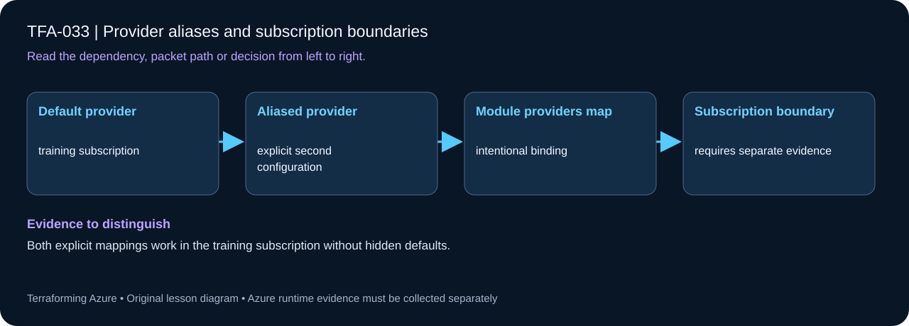

# TFA-033 - Provider aliases and subscription boundaries

<!-- lab-metadata:start -->
**Phase 5:** Hybrid operations

**Learning target:** 75 minutes · **Cost tier:** Low · **Run mode:** `azure`

**Prerequisites:** [TFA-032 — RBAC, policy, budgets, and locks](../TFA-032/README.md)
<!-- lab-metadata:end -->

[Course home](../../README.md) | [Previous lab](../TFA-032/README.md) | [Next lab](../TFA-034/README.md)

## Why this lab exists

A provider alias is an explicit deployment boundary. A resource can be created in the wrong subscription if its provider selection is left to assumption.

## What you will learn

Map provider aliases explicitly and understand cross-subscription prerequisites. Your evidence must distinguish configuration intent from the observed result: Both explicit mappings work in the training subscription without hidden defaults.

## Predict the mechanism

An aliased provider is a distinct configuration passed explicitly into a child module. Using two aliases in one subscription practices mapping without pretending to establish a cross-subscription boundary. A real second subscription additionally needs credentials, permissions, registration and state separation appropriate to that scope.

Before running commands, write the expected result: **Both explicit mappings work in the training subscription without hidden defaults.** Then explain what would change in this controlled failure: Omit the required provider mapping and restore the declared interface. Record your prediction before inspecting the outcome.

## Concepts before commands

The default AzureRM provider uses `subscription_id`; the `secondary` alias uses `secondary_subscription_id`. Each resource group is bound to one provider configuration. You may supply the same subscription to both for an inexpensive single-subscription exercise, but that does not demonstrate real cross-subscription permissions.

## Architecture

<!-- lab-diagram:start -->

<!-- lab-diagram:end -->

One resource group through the default provider and another through an aliased provider, with both fully qualified ARM IDs shown as outputs.

## Runtime and cost checkpoint

PowerShell 7.4 or newer (under 8), Terraform 1.15.8, Git, and the preceding concepts. Azure CLI, an explicitly selected sandbox subscription, approved permissions and regional quota. AzureRM is pinned to 4.77.0; do not silently upgrade it during the lesson.

Resource groups alone have no usage charge. Read the selected services in the [Azure pricing calculator](https://azure.microsoft.com/en-us/pricing/calculator/) before apply. A stopped VM can retain charged disks; a gateway/firewall is not stopped by leaving the terminal. Each lab owns its own local state; keep that state until cleanup. Do not reuse another lab's backend or import its resources.

## Step 1 - Read the implementation

Open `versions.tf`, `variables.tf`, `main.tf`, and `outputs.tf` in this directory. Find `provider = azurerm.secondary` on the secondary resource. Changing a provider assignment is not a safe shortcut for moving an existing Azure resource between subscriptions. Inspect provider mappings explicitly when passing aliases into child modules. If a shared Windows VM pattern is referenced, read its [implementation](../../modules/patterns/windows-vm/main.tf) as part of this lesson.

## Step 2 - Plan and build

Run from `labs/TFA-033` in PowerShell 7. Tests use provider mocks or local resources and do not apply Azure infrastructure. Supply real cloud inputs only for your deliberate plan/apply. The example tfvars file is an alternative to environment variables; a real terraform.tfvars value takes precedence over TF_VAR values.

```powershell
$env:TF_VAR_subscription_id = Read-Host 'Explicit Azure subscription ID'
az login
az account set --subscription $env:TF_VAR_subscription_id
$env:TF_VAR_location = 'westeurope'
terraform init
terraform fmt -check
terraform validate
terraform test
$env:TF_VAR_secondary_subscription_id = Read-Host 'Secondary subscription ID (or repeat primary for this exercise)'
terraform plan -out=lab.tfplan
terraform show lab.tfplan
# Read the whole plan and confirm the subscription, scope, and charged services.
terraform apply lab.tfplan
```

Record what Terraform creates, which values are unknown until apply, and which resources carry ongoing charges. Keep passwords, VPN keys, PFX files, plans, and state out of Git. `sensitive` hides console values; it does not remove them from state.

## Step 3 - Verify with evidence

```powershell
terraform providers
terraform output subscription_boundaries
az group show --subscription $env:TF_VAR_subscription_id -n rg-tfa033 --query id -o tsv
az group show --subscription $env:TF_VAR_secondary_subscription_id -n rg-tfa033-secondary --query id -o tsv
```

Each output ARM ID includes the intended subscription ID. With two real subscriptions, your authenticated principal must have the required permissions and provider registrations in both.

Save a short local evidence note with the time, exact probe, observed result, and your explanation. Resource existence, DNS, routing, authorization, and application success are different kinds of evidence.

## Troubleshooting

An authorization failure on the secondary resource is not fixed by changing the CLI active subscription: the provider subscription is explicit. Inspect the alias and its input, tenant context, permissions, and resource-provider registration.

## Challenge

Pass the secondary provider to a tiny child module through an explicit provider map and explain the boundary. Do not introduce cross-subscription peering until you can explain which identity owns each side.

## Knowledge check

Complete the five questions in [quiz.json](quiz.json), or use the course site's interactive quiz. Explain each answer before revealing its explanation. The quiz checks reasoning; it is not a substitute for the evidence above.

## Cleanup

```powershell
$cleanupGroup = terraform output -raw resource_group_name
if ($LASTEXITCODE -ne 0 -or -not $cleanupGroup) { throw 'Capture the actual lab group before planning destruction.' }
terraform plan -destroy -out=cleanup.tfplan
if ($LASTEXITCODE -ne 0) { throw 'Destroy plan failed: do not apply an older cleanup plan.' }
terraform show cleanup.tfplan
if ($LASTEXITCODE -ne 0) { throw 'Destroy plan could not be reviewed: stop before apply.' }
terraform apply cleanup.tfplan
if ($LASTEXITCODE -ne 0) { throw 'Destroy failed: retain state and investigate remaining resources before claiming cleanup.' }
$remaining = @(terraform state list)
if ($LASTEXITCODE -ne 0 -or $remaining.Count) { throw 'Cleanup left managed objects or state could not be read.' }
# Check the Azure resource group no longer exists after successful destroy.
$groupExists = az group exists --subscription $env:TF_VAR_subscription_id --name $cleanupGroup
if ($LASTEXITCODE -ne 0 -or $groupExists -ne 'false') { throw 'The owned group is not confirmed deleted. Keep state and investigate.' }
```

A successful destroy and an empty state are the expected result. The cleanup command uses the captured group, including a changed prefix. Soft-deleted vaults and retained logs can outlive their active resource; review the relevant Azure lifecycle and cost settings. Do not commit generated plans or state as evidence.

## Completion criteria

- You can explain why this design produces the observed behavior.
- You captured the required success evidence and investigated the controlled limitation or failure.
- You completed the challenge and five questions.
- You reviewed and completed cleanup, or recorded an explicit owner and deadline for intentionally retained resources.

## Continue learning

[Official documentation](https://developer.hashicorp.com/terraform/language/providers/configuration#alias-multiple-provider-configurations) | [Continue to TFA-034](../TFA-034/README.md)

## Evidence contract

Run the alias mapping tests and inspect which provider configuration each module receives. Both explicit mappings work in the training subscription without hidden defaults.

See the [40-lab evidence map](../../docs/curriculum-evidence.md) for source paths, validation level and cleanup dependencies. Authored Azure commands are learner exercises; passing local checks does not establish a live deployment.
