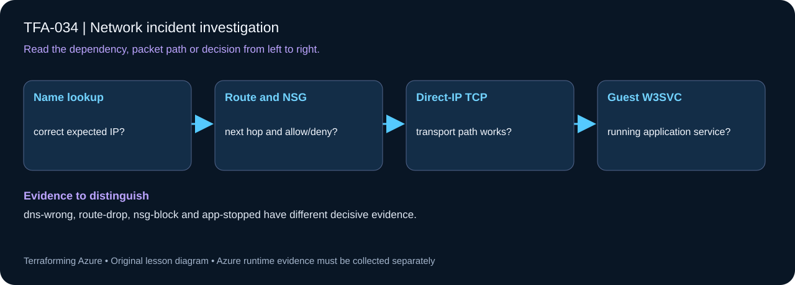

# TFA-034 - Network incident investigation

<!-- lab-metadata:start -->
**Phase 5:** Hybrid operations

**Learning target:** 75 minutes · **Cost tier:** Moderate · **Run mode:** `azure`

**Prerequisites:** [TFA-033 — Provider aliases and subscription boundaries](../TFA-033/README.md)
<!-- lab-metadata:end -->

[Course home](../../README.md) | [Previous lab](../TFA-033/README.md) | [Next lab](../TFA-035/README.md)

## Why this lab exists

Troubleshooting should produce a falsifiable explanation supported by evidence, then a small reviewed fix.

## What you will learn

Diagnose a broken service by following DNS, routes, enforcement, and application health. Your evidence must distinguish configuration intent from the observed result: dns-wrong, route-drop, nsg-block and app-stopped have different decisive evidence.

## Predict the mechanism

An HTTP failure can originate in name resolution, route selection, policy or the guest service. Probe the expected private IP separately from the hostname and inspect the chosen route before editing security rules. The selected incident changes one layer so the evidence can isolate cause instead of encouraging broad permission changes.

Before running commands, write the expected result: **dns-wrong, route-drop, nsg-block and app-stopped have different decisive evidence.** Then explain what would change in this controlled failure: Select each fault once; restore healthy between cases and re-probe HTTP. Record your prediction before inspecting the outcome.

## Concepts before commands

The controlled `incident` switch selects exactly one layer: dns-wrong, route-drop, nsg-block or app-stopped. The healthy baseline uses web.tfa034.internal → 10.34.2.4, a permitted client/server NSG path and running IIS. Each case has a distinct piece of decisive evidence. Start with healthy evidence, inject the fault in Terraform, collect the failing TCP result and effective NSG evidence, and restore the healthy configuration. Keep control-plane reachability, packet transport, and HTTP behavior separate.

## Architecture

<!-- lab-diagram:start -->

<!-- lab-diagram:end -->

Client/server subnets, two private VMs, IIS on the server, and a subnet NSG with one controlled HTTP rule.

## Runtime and cost checkpoint

PowerShell 7.4 or newer (under 8), Terraform 1.15.8, Git, and the preceding concepts. Azure CLI, an explicitly selected sandbox subscription, approved permissions and regional quota. AzureRM is pinned to 4.77.0; do not silently upgrade it during the lesson.

Charged resources include two private Windows VMs, private DNS and one NAT Gateway/public NAT IP. No Azure Firewall or VPN gateway is deployed in this focused incident lab. Read the selected services in the [Azure pricing calculator](https://azure.microsoft.com/en-us/pricing/calculator/) before apply. A stopped VM can retain charged disks; a gateway/firewall is not stopped by leaving the terminal. Each lab owns its own local state; keep that state until cleanup. Do not reuse another lab's backend or import its resources.

## Step 1 - Read the implementation

Open `versions.tf`, `variables.tf`, `main.tf`, and `outputs.tf` in this directory. Follow `var.incident` into the NSG access property. Read the Windows VM module and the server bootstrap command. There is no public RDP ingress and no architecture change needed to repair the intended fault. If a shared Windows VM pattern is referenced, read its [implementation](../../modules/patterns/windows-vm/main.tf) as part of this lesson.

## Step 2 - Plan and build

Run from `labs/TFA-034` in PowerShell 7. Tests use provider mocks or local resources and do not apply Azure infrastructure. Supply real cloud inputs only for your deliberate plan/apply. The example tfvars file is an alternative to environment variables; a real terraform.tfvars value takes precedence over TF_VAR values.

```powershell
$env:TF_VAR_subscription_id = Read-Host 'Explicit Azure subscription ID'
az login
az account set --subscription $env:TF_VAR_subscription_id
$env:TF_VAR_location = 'westeurope'
terraform init
terraform fmt -check
terraform validate
terraform test
$env:TF_VAR_admin_password = Read-Host 'Unique Windows lab password (14+ characters)' -MaskInput
terraform plan -out=lab.tfplan
terraform show lab.tfplan
# Read the whole plan and confirm the subscription, scope, and charged services.
terraform apply lab.tfplan
```

Record what Terraform creates, which values are unknown until apply, and which resources carry ongoing charges. Keep passwords, VPN keys, PFX files, plans, and state out of Git. `sensitive` hides console values; it does not remove them from state.

## Step 3 - Verify with evidence

```powershell
$rg = terraform output -raw resource_group_name
$client = terraform output -raw client_vm_name
$serverIp = terraform output -raw server_private_ip
az vm run-command invoke -g $rg -n $client --command-id RunPowerShellScript --scripts "Test-NetConnection $serverIp -Port 80; (Invoke-WebRequest http://$serverIp -UseBasicParsing).StatusCode"
$nic = Split-Path (terraform output -raw server_nic_id) -Leaf
az network nic list-effective-nsg -g $rg -n $nic -o json
terraform plan -var='incident=nsg-block' -out=incident.tfplan
terraform apply incident.tfplan
az vm run-command invoke -g $rg -n $client --command-id RunPowerShellScript --scripts "Test-NetConnection $serverIp -Port 80"
```

The healthy baseline returns TcpTestSucceeded true and HTTP 200. The controlled incident makes TCP fail while the VM still exists and Run Command remains available. The effective rule identifies the deny. Restore `incident=healthy` through a reviewed plan before cleanup.

Save a short local evidence note with the time, exact probe, observed result, and your explanation. Resource existence, DNS, routing, authorization, and application success are different kinds of evidence.

## Four incidents, four different diagnoses

Use only one `incident` value at a time and restore healthy between cases. The server's address stays 10.34.2.4. Record a fresh name lookup, a direct-IP TCP probe, effective routes/NSG and guest service state before deciding the cause.

| Mode | Controlled change | Expected distinguishing evidence | Repair |
|---|---|---|---|
| healthy | baseline | DNS 10.34.2.4, TCP 80 succeeds, IIS Running | none |
| dns-wrong | A record becomes 10.34.2.99 | name points to wrong host; direct-IP probe still succeeds | restore A record via healthy |
| route-drop | client UDR 10.34.2.4/32 → None | DNS correct; effective route discards; NSG allows; IIS Running | remove discard route via healthy |
| nsg-block | server NSG rule denies TCP 80 | DNS and route correct; effective NSG denies; IIS Running | restore allow via healthy |
| app-stopped | extension stops W3SVC | DNS/route/NSG correct; guest service Stopped | extension starts W3SVC via healthy |

```powershell
$server = terraform output -raw server_vm_name
$hostName = terraform output -raw application_hostname
$clientNic = Split-Path (terraform output -raw client_nic_id) -Leaf
$case = 'dns-wrong' # Then separately route-drop, nsg-block, app-stopped.
terraform plan -var="incident=$case" -out=incident.tfplan
terraform show incident.tfplan
terraform apply incident.tfplan
if ($LASTEXITCODE -ne 0) { throw 'Fault injection did not complete; diagnose apply before network behavior.' }
az vm run-command invoke -g $rg -n $client --command-id RunPowerShellScript --scripts "Clear-DnsClientCache; Resolve-DnsName $hostName; Test-NetConnection $serverIp -Port 80"
az network nic show-effective-route-table -g $rg -n $clientNic -o json
az network nic list-effective-nsg -g $rg -n $nic -o json
az vm run-command invoke -g $rg -n $server --command-id RunPowerShellScript --scripts 'Get-Service W3SVC'
terraform plan -var='incident=healthy' -out=repair.tfplan
terraform show repair.tfplan
terraform apply repair.tfplan
az vm run-command invoke -g $rg -n $client --command-id RunPowerShellScript --scripts "Clear-DnsClientCache; Resolve-DnsName $hostName; Test-NetConnection $serverIp -Port 80; (Invoke-WebRequest http://$hostName -UseBasicParsing).StatusCode"
```

The custom-script settings change when app-stopped changes; the same extension reruns to stop/start the service without replacing the VM. Use the 30-second record TTL and a new client process when comparing DNS. No additional infrastructure is needed to repair a fault. The normal whole-root destroy includes zone, records, route table and NAT; do not delete state or open every port. Five fixture cases and mocked plans validate the diagnostic distinctions locally, with actual Azure observations explicitly unverified.

## Troubleshooting

If the healthy baseline already fails, do not inject the next fault. Check IIS service, guest firewall, effective NSG, IP, and routes in that order. Preserve timestamps and outputs in a local incident record; redact subscription identifiers before sharing publicly.

## Challenge

Write a five-line incident report: symptom, impact, hypothesis, decisive evidence, and code fix. Restore healthy, rerun the same probe, and include the before/after difference.

## Knowledge check

Complete the five questions in [quiz.json](quiz.json), or use the course site's interactive quiz. Explain each answer before revealing its explanation. The quiz checks reasoning; it is not a substitute for the evidence above.

## Cleanup

```powershell
$cleanupGroup = terraform output -raw resource_group_name
if ($LASTEXITCODE -ne 0 -or -not $cleanupGroup) { throw 'Capture the actual lab group before planning destruction.' }
terraform plan -destroy -out=cleanup.tfplan
if ($LASTEXITCODE -ne 0) { throw 'Destroy plan failed: do not apply an older cleanup plan.' }
terraform show cleanup.tfplan
if ($LASTEXITCODE -ne 0) { throw 'Destroy plan could not be reviewed: stop before apply.' }
terraform apply cleanup.tfplan
if ($LASTEXITCODE -ne 0) { throw 'Destroy failed: retain state and investigate remaining resources before claiming cleanup.' }
$remaining = @(terraform state list)
if ($LASTEXITCODE -ne 0 -or $remaining.Count) { throw 'Cleanup left managed objects or state could not be read.' }
# Check the Azure resource group no longer exists after successful destroy.
$groupExists = az group exists --subscription $env:TF_VAR_subscription_id --name $cleanupGroup
if ($LASTEXITCODE -ne 0 -or $groupExists -ne 'false') { throw 'The owned group is not confirmed deleted. Keep state and investigate.' }
Remove-Item Env:TF_VAR_admin_password -ErrorAction SilentlyContinue
```

A successful destroy and an empty state are the expected result. The cleanup command uses the captured group, including a changed prefix. Soft-deleted vaults and retained logs can outlive their active resource; review the relevant Azure lifecycle and cost settings. Do not commit generated plans or state as evidence.

## Completion criteria

- You can explain why this design produces the observed behavior.
- You captured the required success evidence and investigated the controlled limitation or failure.
- You completed the challenge and five questions.
- You reviewed and completed cleanup, or recorded an explicit owner and deadline for intentionally retained resources.

## Continue learning

[Official documentation](https://learn.microsoft.com/en-us/azure/virtual-network/diagnose-network-traffic-filter-problem) | [Continue to TFA-035](../TFA-035/README.md)

## Evidence contract

Compare hostname, direct-IP TCP, effective route/NSG and W3SVC across four selectable incidents. dns-wrong, route-drop, nsg-block and app-stopped have different decisive evidence.

See the [40-lab evidence map](../../docs/curriculum-evidence.md) for source paths, validation level and cleanup dependencies. Authored Azure commands are learner exercises; passing local checks does not establish a live deployment.

The local evidence parser is [Test-IncidentEvidence.ps1](Test-IncidentEvidence.ps1). Run the shared regression from the repository root: `pwsh -NoProfile -File tests/Test-LessonEvidence.ps1`. Its [synthetic fixtures](../../tests/fixtures/lesson-evidence/README.md) validate response interpretation without Azure access.
