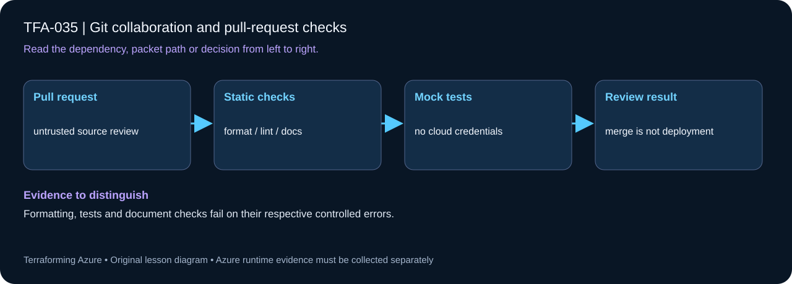

# TFA-035 - Git collaboration and pull-request checks

<!-- lab-metadata:start -->
**Phase 6:** Delivery & capstone

**Learning target:** 75 minutes · **Cost tier:** None · **Run mode:** `local`

**Prerequisites:** [TFA-034 — Network incident investigation](../TFA-034/README.md)
<!-- lab-metadata:end -->

[Course home](../../README.md) | [Previous lab](../TFA-034/README.md) | [Next lab](../TFA-036/README.md)

## Why this lab exists

Infrastructure changes should be easy for someone else to understand, verify, and review before they reach Azure.

## What you will learn

Review infrastructure changes through credential-free pull-request quality checks. Your evidence must distinguish configuration intent from the observed result: Formatting, tests and document checks fail on their respective controlled errors.

## Predict the mechanism

A pull-request check should validate source without acquiring deployment credentials. Formatting, schema validation, mocked contracts and static security checks examine different failure classes. Documentation and catalog checks are part of the interface because a syntactically valid root can still have unusable instructions.

Before running commands, write the expected result: **Formatting, tests and document checks fail on their respective controlled errors.** Then explain what would change in this controlled failure: Introduce one formatting or broken-link defect, observe the exact check, restore. Record your prediction before inspecting the outcome.

## Concepts before commands

The local Terraform resource is a review-contract exercise, not a GitHub API integration. The actual repository quality workflow is `.github/workflows/quality.yml`. A branch and pull request carry the code change, while CI runs formatting, validation, offline mocked tests, and course-integrity checks. Repository rules/required checks must be configured separately by a repository administrator.

## Architecture

<!-- lab-diagram:start -->

<!-- lab-diagram:end -->

A local terraform_data review contract and a real small branch change that you review against the repository quality workflow. No Terraform GitHub provider is used and no PR is opened automatically.

## Runtime and cost checkpoint

PowerShell 7.4 or newer (under 8), Terraform 1.15.8, Git, and the preceding concepts.

Local Terraform exercise; optional GitHub CI uses your account's Actions allowance. Read the selected services in the [Azure pricing calculator](https://azure.microsoft.com/en-us/pricing/calculator/) before apply. A stopped VM can retain charged disks; a gateway/firewall is not stopped by leaving the terminal. Each lab owns its own local state; keep that state until cleanup. Do not reuse another lab's backend or import its resources.

## Step 1 - Read the implementation

Open `versions.tf`, `variables.tf`, `main.tf`, and `outputs.tf` in this directory. Read the quality workflow and `scripts/Test-Course.ps1` before making your branch. Compare the named jobs/checks with branch-protection settings if you own the repository. If a shared Windows VM pattern is referenced, read its [implementation](../../modules/patterns/windows-vm/main.tf) as part of this lesson.

## Step 2 - Plan and build

Run from `labs/TFA-035` in PowerShell 7. Tests use provider mocks or local resources and do not apply Azure infrastructure. Supply real cloud inputs only for your deliberate plan/apply. The example tfvars file is an alternative to environment variables; a real terraform.tfvars value takes precedence over TF_VAR values.

```powershell
terraform init
terraform fmt -check
terraform validate
terraform test
terraform plan -out=lab.tfplan
terraform show lab.tfplan
# Read the whole plan and confirm the subscription, scope, and charged services.
terraform apply lab.tfplan
```

Record what Terraform creates, which values are unknown until apply, and which resources carry ongoing charges. Keep passwords, VPN keys, PFX files, plans, and state out of Git. `sensitive` hides console values; it does not remove them from state.

## Step 3 - Verify with evidence

```powershell
terraform output review_contract
git switch -c feature/tfa-035-learning-change
# Edit one sentence in your personal fork: explain its purpose, then save.
git diff --check
git diff
../../scripts/Test-Course.ps1
# Commit and open a PR in your own repository after reviewing the diff.
```

The diff is small and understandable; local checks pass before a PR is opened. A real PR run of quality.yml should report its actual checks. Terraform output alone does not create or enforce GitHub protection.

Save a short local evidence note with the time, exact probe, observed result, and your explanation. Resource existence, DNS, routing, authorization, and application success are different kinds of evidence.

## Troubleshooting

A green formatting job does not prove networking behavior. Fix a failed check locally and push a coherent update; do not disable the workflow to get a green badge. External fork PRs must not obtain Azure credentials.

## Challenge

Make one intentional formatting error on your own branch, observe the failing local/CI check, then repair it. Write a PR description that explains behavior and validation in three sentences.

## Knowledge check

Complete the five questions in [quiz.json](quiz.json), or use the course site's interactive quiz. Explain each answer before revealing its explanation. The quiz checks reasoning; it is not a substitute for the evidence above.

## Cleanup

```powershell
terraform plan -destroy -out=cleanup.tfplan
if ($LASTEXITCODE -ne 0) { throw 'Destroy plan failed: do not apply an older cleanup plan.' }
terraform show cleanup.tfplan
if ($LASTEXITCODE -ne 0) { throw 'Destroy plan could not be reviewed: stop before apply.' }
terraform apply cleanup.tfplan
if ($LASTEXITCODE -ne 0) { throw 'Destroy failed: retain state and investigate remaining resources before claiming cleanup.' }
$remaining = @(terraform state list)
if ($LASTEXITCODE -ne 0 -or $remaining.Count) { throw 'Cleanup left managed objects or state could not be read.' }
```

A successful destroy and an empty state are the expected result. Do not remove files or state from another lab. Do not commit generated plans or state as evidence.

## Completion criteria

- You can explain why this design produces the observed behavior.
- You captured the required success evidence and investigated the controlled limitation or failure.
- You completed the challenge and five questions.
- You reviewed and completed cleanup, or recorded an explicit owner and deadline for intentionally retained resources.

## Continue learning

[Official documentation](https://docs.github.com/en/actions/reference/workflows-and-actions/events-that-trigger-workflows#pull_request) | [Continue to TFA-036](../TFA-036/README.md)

## Evidence contract

Run the credential-free check commands and inspect .github/workflows/ci.yml. Formatting, tests and document checks fail on their respective controlled errors.

See the [40-lab evidence map](../../docs/curriculum-evidence.md) for source paths, validation level and cleanup dependencies. Authored Azure commands are learner exercises; passing local checks does not establish a live deployment.
