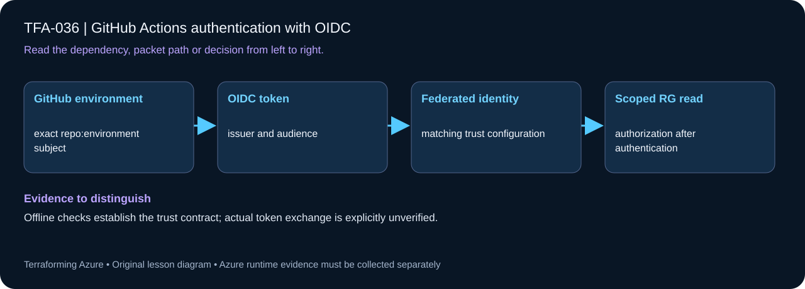

# TFA-036 - GitHub Actions authentication with OIDC

[Course home](../../README.md) | [Previous lab](../TFA-035/README.md) | [Next lab](../TFA-037/README.md)

> **Mode:** Azure deployment | **Time:** 60-90 minutes | **Cost:** Low: managed identity and its containing resource group. No client secret is created.

## Why this lab exists

A deployment workflow should exchange a short-lived GitHub identity token for Azure access instead of storing a long-lived Azure password.

## What you will learn

By the end, explain the mechanism below, follow its dependencies in Terraform, reproduce its evidence, diagnose the named failure, and clean up the resources you created. The final challenge checks whether you can apply the concept without copying another resource block.

## Concepts before commands

GitHub is the token issuer, Azure is the audience, and the federated subject identifies exactly one repository environment. This lab creates a user-assigned managed identity and federated credential through Azure Resource Manager, avoiding Entra application-registration privileges. Identity creation and permission assignment are separate actions.

## Architecture



A user-assigned identity, two exact environment-subject federated credentials, and Contributor scoped only to this lab RG. The role is intentionally insufficient for deploying arbitrary new RGs or the full capstone.

## Prerequisites and cost checkpoint

PowerShell 7, Terraform 1.9 or later (under 2.0; course tested with 1.15.8), Git, and the preceding concepts. Azure CLI, an explicitly selected sandbox subscription, approved permissions and regional quota. AzureRM is pinned to 4.77.0; do not silently upgrade it during the lesson.

Low: managed identity and its containing resource group. No client secret is created. Read the selected services in the [Azure pricing calculator](https://azure.microsoft.com/en-us/pricing/calculator/) before apply. A stopped VM can retain charged disks; a gateway/firewall is not stopped by leaving the terminal. Each lab owns its own local state; keep that state until cleanup. Do not reuse another lab's backend or import its resources.

## Step 1 - Read the implementation

Open `versions.tf`, `variables.tf`, `main.tf`, and `outputs.tf` in this directory. Compare owner, repository, and protected environment spelling with the credential subject. A workflow job must set `environment` to that exact value and request `id-token: write`. The public client/tenant/subscription IDs are identifiers, not secrets. If a shared Windows VM pattern is referenced, read its [implementation](../../modules/patterns/windows-vm/main.tf) as part of this lesson.

## Step 2 - Plan and build

Run from `labs/TFA-036` in PowerShell 7. Tests use provider mocks or local resources and do not apply Azure infrastructure. Supply real cloud inputs only for your deliberate plan/apply. The example tfvars file is an alternative to environment variables; a real terraform.tfvars value takes precedence over TF_VAR values.

```powershell
$env:TF_VAR_subscription_id = Read-Host 'Explicit Azure subscription ID'
az login
az account set --subscription $env:TF_VAR_subscription_id
$env:TF_VAR_location = 'westeurope'
terraform init
terraform fmt -check
terraform validate
terraform test
$env:TF_VAR_github_owner = Read-Host 'Exact GitHub owner'
$env:TF_VAR_github_repository = Read-Host 'Exact GitHub repository name'
$env:TF_VAR_github_environment = 'azure-course'
$env:TF_VAR_github_plan_environment = 'azure-plan'
terraform plan -out=lab.tfplan
terraform show lab.tfplan
# Read the whole plan and confirm the subscription, scope, and charged services.
terraform apply lab.tfplan
```

Record what Terraform creates, which values are unknown until apply, and which resources carry ongoing charges. Keep passwords, VPN keys, PFX files, plans, and state out of Git. `sensitive` hides console values; it does not remove them from state.

## Step 3 - Verify with evidence

```powershell
terraform output federated_subject
terraform output AZURE_CLIENT_ID
terraform output AZURE_TENANT_ID
terraform output AZURE_SUBSCRIPTION_ID
$rg = terraform output -raw resource_group_name
az identity federated-credential list -g $rg --identity-name id-tfa036-github -o json
az role assignment list --resource-group $rg --all -o table
```

The credential subject matches `repo:OWNER/REPOSITORY:environment:azure-course` and `repo:OWNER/REPOSITORY:environment:azure-plan`, audience is api://AzureADTokenExchange, and Contributor is limited to the lab RG. The Azure workflow consumes the IDs through the protected environments described in [delivery.md](../../docs/delivery.md). Its deployment roles and backend access must be deliberately granted at the documented scopes; the lab RG role does not authorize the capstone. A token from another repo/environment must not match.

Save a short local evidence note with the time, exact probe, observed result, and your explanation. Resource existence, DNS, routing, authorization, and application success are different kinds of evidence.

## Troubleshooting

Check issuer, audience, exact subject, job environment, token permission, and tenant. Configure allowed branches/reviewers on the GitHub environment where supported. Do not replace a subject mismatch with a broad wildcard or add a client secret.

## Challenge

Explain two extra permissions needed by the capstone: Storage Blob Data Contributor on the state container/account for Entra backend access, and approved role-assignment permissions where the infrastructure creates RBAC. Grant only the deliberately approved scopes; Contributor does not include roleAssignments/write.

## Knowledge check

Complete the five questions in [quiz.json](quiz.json), or use the course site's interactive quiz. Explain each answer before revealing its explanation. The quiz checks reasoning; it is not a substitute for the evidence above.

## Cleanup

```powershell
terraform plan -destroy -out=cleanup.tfplan
terraform show cleanup.tfplan
terraform apply cleanup.tfplan
terraform state list
# Check the Azure resource group no longer exists after successful destroy.
az group exists --subscription $env:TF_VAR_subscription_id --name rg-tfa036
```

A successful destroy and an empty state are the expected result. Verify the actual lab group name from the earlier output if you changed name_prefix. Soft-deleted vaults and retained logs can outlive their active resource; review the relevant Azure lifecycle and cost settings. Do not commit generated plans or state as evidence.

## Completion criteria

- You can explain why this design produces the observed behavior.
- You captured the required success evidence and investigated the controlled limitation or failure.
- You completed the challenge and five questions.
- You reviewed and completed cleanup, or recorded an explicit owner and deadline for intentionally retained resources.

## Continue learning

[Official documentation](https://learn.microsoft.com/en-us/azure/developer/github/connect-from-azure-openid-connect) | [Continue to TFA-037](../TFA-037/README.md)
