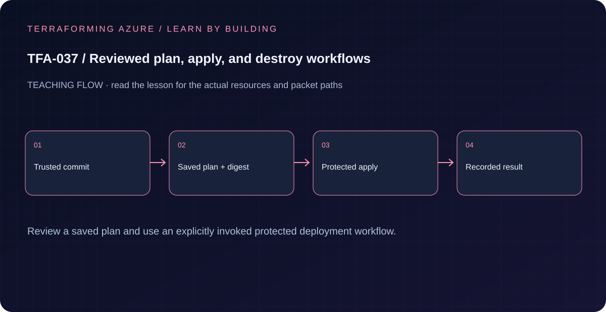

# TFA-037 - Reviewed plan, apply, and destroy workflows

<!-- lab-metadata:start -->
**Phase 6:** Delivery & capstone

**Learning target:** 75 minutes · **Cost tier:** None · **Run mode:** `local`

**Prerequisites:** [TFA-036 — GitHub Actions authentication with OIDC](../TFA-036/README.md)
<!-- lab-metadata:end -->

[Course home](../../README.md) | [Previous lab](../TFA-036/README.md) | [Next lab](../TFA-038/README.md)

## Why this lab exists

A review is useful only if the operation executed is the one the reviewer inspected.

## What you will learn

Review a saved plan and use an explicitly invoked protected deployment workflow. Your evidence must distinguish configuration intent from the observed result: The exact reviewed artifact applies; tampered and wrong-operation artifacts fail before Terraform apply.

## Predict the mechanism

A saved plan is the artifact reviewed for a particular operation and state snapshot. Replanning at apply time can invalidate that review. The local rehearsal binds root, operation, source hashes, plan hash and age, while a protected real workflow adds authentication, backend locking and controlled artifact access.

Before running commands, write the expected result: **The exact reviewed artifact applies; tampered and wrong-operation artifacts fail before Terraform apply.** Then explain what would change in this controlled failure: Alter a disposable plan byte or manifest operation and observe a rejected apply. Record your prediction before inspecting the outcome.

## Concepts before commands

The actual deployment workflow lives at `.github/workflows/azure.yml`; the Terraform here models its contract locally. Plan is the default operation. Deployments require an explicit manual workflow operation, scoped Azure OIDC access, and the `azure-course` protected environment. A plan-only job uses `azure-plan`. Saved plans can contain sensitive data and should have short retention and restricted access. This repository creates a fresh saved plan in each manual run, encrypts its artifact using PLAN_ENCRYPTION_KEY, and checks its SHA-256 hash, commit, stage, and maximum 24-hour age before applying the same run's plan. Configure required environment reviewers in repository settings before using apply or destroy.

## Architecture

<!-- lab-diagram:start -->

<!-- lab-diagram:end -->

A local workflow contract plus inspection and a guided manual run of the repository Azure workflow against a selected capstone stage. No cloud operation is triggered by this lab's local apply.

## Runtime and cost checkpoint

PowerShell 7.4 or newer (under 8), Terraform 1.15.8, Git, and the preceding concepts.

Local contract exercise is free; actual workflow cloud operations incur the selected lab's charges. Read the selected services in the [Azure pricing calculator](https://azure.microsoft.com/en-us/pricing/calculator/) before apply. A stopped VM can retain charged disks; a gateway/firewall is not stopped by leaving the terminal. Each lab owns its own local state; keep that state until cleanup. Do not reuse another lab's backend or import its resources.

## Step 1 - Read the implementation

Open `versions.tf`, `variables.tf`, `main.tf`, and `outputs.tf` in this directory. Read the workflow operation choices, stage choices, concurrency group, environment, permissions, plan artifact handling, and cleanup paths. The stage choices are foundation, secure, applications, and hybrid; the workflow targets TFA-040. Follow [delivery.md](../../docs/delivery.md) for exact variables, secrets, backend setup, and scopes. If a shared Windows VM pattern is referenced, read its [implementation](../../modules/patterns/windows-vm/main.tf) as part of this lesson.

## Step 2 - Plan and build

Run from `labs/TFA-037` in PowerShell 7. Tests use provider mocks or local resources and do not apply Azure infrastructure. Supply real cloud inputs only for your deliberate plan/apply. The example tfvars file is an alternative to environment variables; a real terraform.tfvars value takes precedence over TF_VAR values.

```powershell
terraform init
terraform fmt -check
terraform validate
terraform test
terraform plan -out=lab.tfplan
terraform show lab.tfplan
# Read the whole plan and confirm the subscription, scope, and charged services.
terraform apply lab.tfplan
```

Record what Terraform creates, which values are unknown until apply, and which resources carry ongoing charges. Keep passwords, VPN keys, PFX files, plans, and state out of Git. `sensitive` hides console values; it does not remove them from state.

## Step 3 - Verify with evidence

```powershell
terraform output workflow_contract
Get-Content ../../.github/workflows/azure.yml
terraform plan -var='operation=destroy'
# In your GitHub repository, open Actions -> Azure workflow.
# Select operation=plan and a capstone stage; inspect its summary before an apply run.
```

The local contract reports a plan operation by default. A manually dispatched real workflow authenticates through OIDC and publishes a reviewable plan for TFA-040. Apply/destroy create a fresh same-run plan and require azure-course environment review; do not approve without inspecting that run's plan summary. A local terraform_data output is not evidence of Azure execution.

Save a short local evidence note with the time, exact probe, observed result, and your explanation. Resource existence, DNS, routing, authorization, and application success are different kinds of evidence.

## Run a minimal saved-plan rehearsal locally

The four Terraform files in this lesson use only built-in `terraform_data`. [Demo-SavedPlan.ps1](Demo-SavedPlan.ps1) runs the actual local plan/apply cycle and rejects changed artifacts, changed sources, a mismatched root/operation and plans older than 24 hours. It does not read Azure credentials or request a GitHub token.

```powershell
./Demo-SavedPlan.ps1 -Operation Plan
terraform show ./rehearsal.tfplan
./Demo-SavedPlan.ps1 -Operation Apply -AcknowledgeReviewedPlan
terraform plan -detailed-exitcode
# Expected exit 0 after applying exactly the saved local plan.
./Demo-SavedPlan.ps1 -Operation PlanDestroy
terraform show ./rehearsal.tfplan
./Demo-SavedPlan.ps1 -Operation Destroy -AcknowledgeReviewedPlan
terraform state list
# Expected empty state after successful destruction.
```

For the controlled failure, copy the saved plan before applying, alter one byte in the disposable copy and try the corresponding rehearsal apply: its SHA-256 must fail. Restore the unchanged original only to complete cleanup. The repository regression runs this in an isolated temporary directory and additionally checks an operation mismatch. A hash stored beside a file is an accidental-change check; somebody who can alter both can forge it. The production workflow therefore also binds protected review, source commit, state/backend identity, encryption and same-run artifact ownership.

Read the full capstone workflow after completing this local exercise. Its Azure effects remain explicitly separate from the local rehearsal. Remove `rehearsal.manifest.json` and saved plans only after cleanup; no secrets belong in the local contract.

## Troubleshooting

A saved plan from another commit, state snapshot, Terraform/provider version, or variable set is stale and must not be applied. Check target/backend identity before approving destruction. A budget does not shut down a forgotten deployment.

## Challenge

Trace one real plan from workflow input through backend, plan artifact, review, and apply. List which checks prevent concurrent state writers and which permissions allow backend blob locking.

## Knowledge check

Complete the five questions in [quiz.json](quiz.json), or use the course site's interactive quiz. Explain each answer before revealing its explanation. The quiz checks reasoning; it is not a substitute for the evidence above.

## Cleanup

```powershell
terraform plan -destroy -out=cleanup.tfplan
if ($LASTEXITCODE -ne 0) { throw 'Destroy plan failed: do not apply an older cleanup plan.' }
terraform show cleanup.tfplan
if ($LASTEXITCODE -ne 0) { throw 'Destroy plan could not be reviewed: stop before apply.' }
terraform apply cleanup.tfplan
if ($LASTEXITCODE -ne 0) { throw 'Destroy failed: retain state and investigate remaining resources before claiming cleanup.' }
$remaining = @(terraform state list)
if ($LASTEXITCODE -ne 0 -or $remaining.Count) { throw 'Cleanup left managed objects or state could not be read.' }
```

A successful destroy and an empty state are the expected result. Do not remove files or state from another lab. Do not commit generated plans or state as evidence.

## Completion criteria

- You can explain why this design produces the observed behavior.
- You captured the required success evidence and investigated the controlled limitation or failure.
- You completed the challenge and five questions.
- You reviewed and completed cleanup, or recorded an explicit owner and deadline for intentionally retained resources.

## Continue learning

[Official documentation](https://developer.hashicorp.com/terraform/cli/commands/plan#out-filename) | [Continue to TFA-038](../TFA-038/README.md)

## Evidence contract

Run Demo-SavedPlan.ps1 plan/apply/plan-destroy/destroy on the local contract and reject altered plans. The exact reviewed artifact applies; tampered and wrong-operation artifacts fail before Terraform apply.

See the [40-lab evidence map](../../docs/curriculum-evidence.md) for source paths, validation level and cleanup dependencies. Authored Azure commands are learner exercises; passing local checks does not establish a live deployment.
