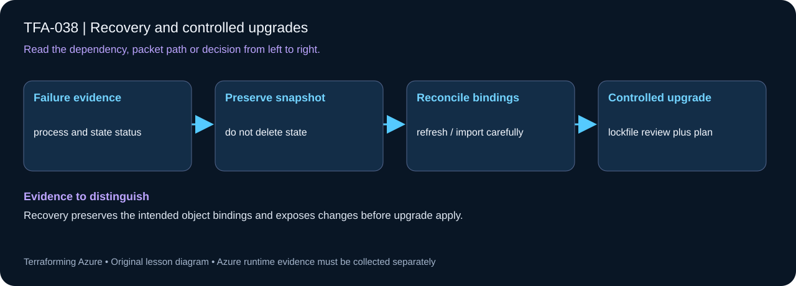

# TFA-038 - Recovery and controlled upgrades

[Course home](../../README.md) | [Previous lab](../TFA-037/README.md) | [Next lab](../TFA-039/README.md)

> **Mode:** Local Terraform / workflow learning | **Time:** 50-75 minutes | **Cost:** Local state only. No Azure resources or credentials.

## Why this lab exists

State is operational data. Recovery should be rehearsed on a disposable local resource before a real cloud incident.

## What you will learn

By the end, explain the mechanism below, follow its dependencies in Terraform, reproduce its evidence, diagnose the named failure, and clean up the resources you created. The final challenge checks whether you can apply the concept without copying another resource block.

## Concepts before commands

This lab uses only terraform_data so you can safely inspect a state backup, remove a local state file, restore that exact backup, and observe a clean plan. It does not simulate Azure resource import, remote backend disaster recovery, or provider API behavior. Keep the original lineage/serial and prefer documented backend version recovery over hand-editing JSON.

## Architecture



One local resource with stable recovery metadata. You will create an ignored state backup and restore it after a deliberate local-state loss.

## Prerequisites and cost checkpoint

PowerShell 7, Terraform 1.9 or later (under 2.0; course tested with 1.15.8), Git, and the preceding concepts.

Local state only. No Azure resources or credentials. Read the selected services in the [Azure pricing calculator](https://azure.microsoft.com/en-us/pricing/calculator/) before apply. A stopped VM can retain charged disks; a gateway/firewall is not stopped by leaving the terminal. Each lab owns its own local state; keep that state until cleanup. Do not reuse another lab's backend or import its resources.

## Step 1 - Read the implementation

Open `versions.tf`, `variables.tf`, `main.tf`, and `outputs.tf` in this directory. Read `main.tf`, the Terraform version constraint, and the state metadata after the first apply. Understand that a state backup may contain secrets in real deployments, even when console output hides them. If a shared Windows VM pattern is referenced, read its [implementation](../../modules/patterns/windows-vm/main.tf) as part of this lesson.

## Step 2 - Plan and build

Run from `labs/TFA-038` in PowerShell 7. Tests use provider mocks or local resources and do not apply Azure infrastructure. Supply real cloud inputs only for your deliberate plan/apply. The example tfvars file is an alternative to environment variables; a real terraform.tfvars value takes precedence over TF_VAR values.

```powershell
terraform init
terraform fmt -check
terraform validate
terraform test
terraform plan -out=lab.tfplan
terraform show lab.tfplan
# Read the whole plan and confirm the subscription, scope, and charged services.
terraform apply lab.tfplan
```

Record what Terraform creates, which values are unknown until apply, and which resources carry ongoing charges. Keep passwords, VPN keys, PFX files, plans, and state out of Git. `sensitive` hides console values; it does not remove them from state.

## Step 3 - Verify with evidence

```powershell
terraform output record
terraform state pull | Set-Content -Encoding utf8NoBOM terraform.tfstate.recovery-backup.json
terraform state list
# Confirm this directory contains only terraform_data.record before proceeding.
Move-Item -LiteralPath terraform.tfstate -Destination terraform.tfstate.exercise-lost
terraform plan
# Expected: one create, because Terraform cannot see the original state.
Move-Item -LiteralPath terraform.tfstate.recovery-backup.json -Destination terraform.tfstate
terraform plan -detailed-exitcode
```

After state loss, Terraform proposes creating the local resource again. Restoring the exact pulled state produces exit code 0 and no changes. Do not apply the recreation plan between loss and restore. This exercise never deletes or recreates an Azure object.

Save a short local evidence note with the time, exact probe, observed result, and your explanation. Resource existence, DNS, routing, authorization, and application success are different kinds of evidence.

## Troubleshooting

Run the exercise only in TFA-038 with local state. If the final plan proposes a change, check input values, working directory, and whether the backup matches this state lineage. Never push a state file into an unrelated backend to make an error disappear.

## Challenge

On a branch, tighten the tested Terraform version constraint, initialize and run the local tests, inspect the diff, then restore the course constraint. For AzureRM upgrades elsewhere, change the exact provider pin in a dedicated PR and review lockfile/schema/plan changes before applying.

## Knowledge check

Complete the five questions in [quiz.json](quiz.json), or use the course site's interactive quiz. Explain each answer before revealing its explanation. The quiz checks reasoning; it is not a substitute for the evidence above.

## Cleanup

```powershell
terraform plan -destroy -out=cleanup.tfplan
terraform show cleanup.tfplan
terraform apply cleanup.tfplan
terraform state list
```

A successful destroy and an empty state are the expected result. Do not remove files or state from another lab. Do not commit generated plans or state as evidence.

## Completion criteria

- You can explain why this design produces the observed behavior.
- You captured the required success evidence and investigated the controlled limitation or failure.
- You completed the challenge and five questions.
- You reviewed and completed cleanup, or recorded an explicit owner and deadline for intentionally retained resources.

## Continue learning

[Official documentation](https://developer.hashicorp.com/terraform/cli/commands/state/pull) | [Continue to TFA-039](../TFA-039/README.md)
