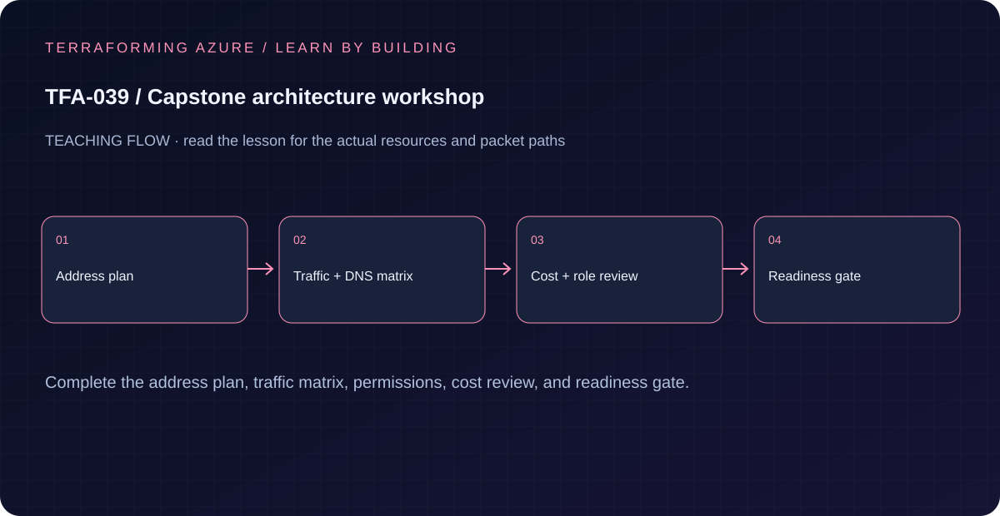

# TFA-039 - Capstone architecture workshop

[Course home](../../README.md) | [Previous lab](../TFA-038/README.md) | [Next lab](../TFA-040/README.md)

> **Mode:** Local Terraform / workflow learning | **Time:** 60-100 minutes | **Cost:** Local workbook only. Its readiness flags do not deploy Azure or approve spending.

## Why this lab exists

The final build should start with agreed interfaces, routes, names, costs, and evidence criteria instead of a large unreviewed apply.

## What you will learn

By the end, explain the mechanism below, follow its dependencies in Terraform, reproduce its evidence, diagnose the named failure, and clean up the resources you created. The final challenge checks whether you can apply the concept without copying another resource block.

## Concepts before commands

This workbook turns the capstone's decisions into an inspectable local output. The readiness booleans record your own review; they do not call Azure APIs. Distinct CIDR strings catch only exact duplication, not partial overlap. Read the actual TFA-040 defaults before deployment; the workshop default address plan matches TFA-040 defaults and remains a planning artifact, not a deployment.

## Architecture



A five-network address plan and explicit readiness flags for cost, quota, and cleanup ownership, plus a capstone traffic/evidence worksheet.

## Prerequisites and cost checkpoint

PowerShell 7, Terraform 1.9 or later (under 2.0; course tested with 1.15.8), Git, and the preceding concepts.

Local workbook only. Its readiness flags do not deploy Azure or approve spending. Read the selected services in the [Azure pricing calculator](https://azure.microsoft.com/en-us/pricing/calculator/) before apply. A stopped VM can retain charged disks; a gateway/firewall is not stopped by leaving the terminal. Each lab owns its own local state; keep that state until cleanup. Do not reuse another lab's backend or import its resources.

## Step 1 - Read the implementation

Open `versions.tf`, `variables.tf`, `main.tf`, and `outputs.tf` in this directory. Read `workbook.md` and the TFA-040 architecture and stages. Reconcile its exact input names, state/backend, address blocks, regions, SKU availability, and required permissions before signing off. If a shared Windows VM pattern is referenced, read its [implementation](../../modules/patterns/windows-vm/main.tf) as part of this lesson.

## Step 2 - Plan and build

Run from `labs/TFA-039` in PowerShell 7. Tests use provider mocks or local resources and do not apply Azure infrastructure. Supply real cloud inputs only for your deliberate plan/apply. The example tfvars file is an alternative to environment variables; a real terraform.tfvars value takes precedence over TF_VAR values.

```powershell
terraform init
terraform fmt -check
terraform validate
terraform test
terraform plan -out=lab.tfplan
terraform show lab.tfplan
# Read the whole plan and confirm the subscription, scope, and charged services.
terraform apply lab.tfplan
```

Record what Terraform creates, which values are unknown until apply, and which resources carry ongoing charges. Keep passwords, VPN keys, PFX files, plans, and state out of Git. `sensitive` hides console values; it does not remove them from state.

## Step 3 - Verify with evidence

```powershell
terraform output workshop_decisions
../../scripts/Test-AzureReadiness.ps1 -LocalOnly
# Optional read-only Azure preflight; requires a deliberate sandbox subscription.
../../scripts/Test-AzureReadiness.ps1 -SubscriptionId (Read-Host 'Capstone subscription ID') -Location westeurope
terraform plan -var='cost_reviewed=true' -var='quota_reviewed=true' -var='cleanup_owner_confirmed=true' -out=readiness.tfplan
terraform apply readiness.tfplan
terraform output workshop_decisions
```

Readiness is false initially and true only after you explicitly set all three flags. Independently capture the preflight script results and complete the workbook. Passing this local check does not certify Azure quota, DNS, traffic, WAF behavior, or cleanup.

Save a short local evidence note with the time, exact probe, observed result, and your explanation. Resource existence, DNS, routing, authorization, and application success are different kinds of evidence.

## Troubleshooting

If a required decision is unresolved, leave the relevant flag false and finish the worksheet. Do not copy a CIDR map into TFA-040 until you have checked all ranges for overlap and matched the capstone implementation's actual inputs.

## Challenge

Have a second reader trace a normal web request, a blocked request, spoke-to-spoke traffic, private service DNS, and a simulated-site query using only your worksheet. Fix every unexplained route, permission, and return path before building.

## Knowledge check

Complete the five questions in [quiz.json](quiz.json), or use the course site's interactive quiz. Explain each answer before revealing its explanation. The quiz checks reasoning; it is not a substitute for the evidence above.

## Cleanup

```powershell
terraform plan -destroy -out=cleanup.tfplan
terraform show cleanup.tfplan
terraform apply cleanup.tfplan
terraform state list
```

A successful destroy and an empty state are the expected result. Do not remove files or state from another lab. Do not commit generated plans or state as evidence.

## Completion criteria

- You can explain why this design produces the observed behavior.
- You captured the required success evidence and investigated the controlled limitation or failure.
- You completed the challenge and five questions.
- You reviewed and completed cleanup, or recorded an explicit owner and deadline for intentionally retained resources.

## Continue learning

[Official documentation](https://learn.microsoft.com/en-us/azure/architecture/networking/architecture/hub-spoke) | [Continue to TFA-040](../TFA-040/README.md)
