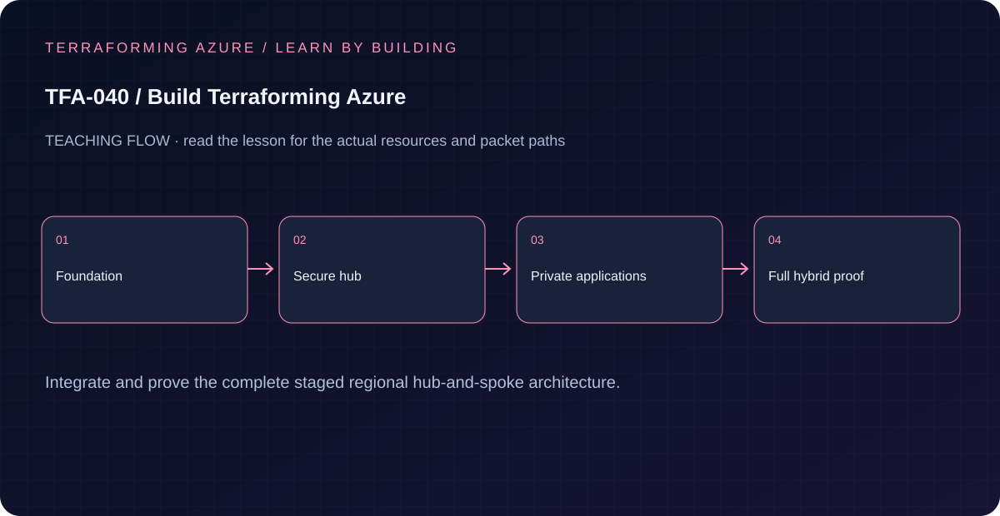

# TFA-040 · Build the complete hub-and-spoke platform

<!-- lab-metadata:start -->
**Phase 6:** Delivery & capstone

**Learning target:** 480 minutes · **Cost tier:** High · **Run mode:** `azure`

**Prerequisites:** [TFA-039 — Capstone architecture workshop](../TFA-039/README.md)
<!-- lab-metadata:end -->

<!-- lab-diagram:start -->

<!-- lab-diagram:end -->

[← TFA-039](../TFA-039/README.md) · [Course home](../../README.md) · [Architecture](../../docs/architecture.md)


**The mission:** turn everything you have learned into one working platform, then
prove its traffic paths. A successful `terraform apply` is the beginning of the
verification, not the finish line.

Allow several focused sessions plus Azure provisioning waits. This capstone uses
one root, one remote state and four cumulative stages. Complete all four to graduate.

## Before you start

Complete TFA-001–039. You must be able to explain a Terraform plan, state ownership,
CIDR selection, peering non-transitivity, route specificity, NSGs, private DNS,
managed identity, WAF, and VPN gateway transit without copying a command.

Use Windows with PowerShell 7, Azure CLI, and the course's pinned Terraform/provider
versions. Complete [backend bootstrap](../../bootstrap/README.md) first. Your Azure
identity needs resource deployment and role-assignment permissions in the training
subscription. Review [cost and cleanup](../../docs/cost-and-cleanup.md).

From the repository root:

```powershell
./scripts/Test-AzureReadiness.ps1 -Mode Local
# The commands below explicitly enter your own Azure lab session.
az login
az account set --subscription '<your-training-subscription-id>'
$env:TF_VAR_subscription_id = az account show --query id --output tsv
./scripts/Test-AzureReadiness.ps1 -Mode AzureReadOnly -Stage hybrid -SubscriptionId $env:TF_VAR_subscription_id
Set-Location labs/TFA-040
Copy-Item ./lab.auto.tfvars.example ./lab.auto.tfvars
Copy-Item ./backend.hcl.example ./backend.hcl
```

Local readiness enforces PowerShell 7.4+, Terraform 1.15.8, Azure CLI 2.60+, Git
2.40+, and VS Code 1.90+ within their supported major versions. It performs no
Azure account query. The explicit `AzureReadOnly` mode checks the selected account,
provider registration, regional service declarations, VM SKU restrictions and fresh
deployment vCPU headroom. Permissions, policy effects and service capacity remain
`SKIP` until established in a separately authorized deployment; no readiness report
certifies that an apply will succeed.

Edit the two local copies. Replace the subscription, state-account settings, and
documentation-only `203.0.113.10/32` with your actual public IPv4 `/32`. That address
is allowed to reach Bastion and public HTTPS; another source should be denied.
Use backend key **`capstone.terraform.tfstate`**, separate from bootstrap and every
earlier exercise. Keep `name_prefix`, `environment`, location and address plan
unchanged while advancing stages.

Set the administrator password without writing it into shell history:

```powershell
$password = Read-Host 'Windows lab administrator password' -AsSecureString
$env:TF_VAR_admin_password = [System.Net.NetworkCredential]::new('', $password).Password
terraform init -backend-config=backend.hcl -lockfile=readonly
terraform validate
```

Use 16–123 characters with uppercase, lowercase, number, and symbol. `sensitive`
hides normal CLI output; credentials, IPsec keys and PFX material still enter the
protected state and saved plan. Keep those files and environment variables private.

## Understand what you are building

| Network | Default address space | Responsibility |
|---|---|---|
| Hub | `10.0.0.0/16` | Standard Firewall and policy, Standard Bastion, resolver, VPN gateway |
| Application spoke | `10.10.0.0/16` | Dedicated WAF_v2 subnet and two private Windows/IIS VMs |
| Data spoke | `10.20.0.0/16` | Blob and Key Vault private endpoints; public access disabled |
| Operations spoke | `10.30.0.0/16` | Private Windows operations and verification VM |
| Simulated on-premises | `192.168.0.0/16` | Windows DNS/client VM, second VPN gateway, explicit NAT egress |

Only hub-spoke VNets are peered. Simulated on-premises is **Azure-hosted** and uses
a VNet-to-VNet IPsec/IKE tunnel, not peering. This teaches hybrid routing without
requiring a home VPN appliance. A physical deployment would use an actual VPN
device, an explicit local network gateway and real WAN conditions.

The two IIS NIC addresses are the Application Gateway backend pool; no extra load
balancer is necessary. HTTPS terminates at WAF and HTTP continues privately to IIS.
The demonstration uses a self-signed certificate for `app.terraforming-azure.test`;
it does not require domain ownership and is not a production certificate workflow.

The network module creates dedicated Firewall `/26`, Bastion `/26`, gateway `/27`,
DNS inbound/outbound `/28`, and Application Gateway `/24` subnets. Workload NICs
have **no public IPs** and implicit default outbound access is disabled.

## Stage 1 · Foundation

Inspect the root, then follow `module.capstone` into [the reusable implementation](../../modules/capstone/README.md).
Find the stage conditions before deploying. This stage creates the five VNets,
subnets, NSGs, six directional hub-spoke peerings, private DNS zones, workspace and
action group. No Firewall, Bastion, gateway, WAF, or VM is created yet. The workspace
can still incur ingestion charges if data is sent to it.

```powershell
terraform plan -var-file=stages/foundation.tfvars -out=tfplan.foundation
terraform show tfplan.foundation
terraform apply tfplan.foundation
terraform output
```

**Checkpoint:** five VNets, three private zones linked to the hub, no direct
spoke-spoke or on-premises peering. `traffic_contract.windows_vm_count` and
`vpn_gateway_count` are both zero. Draw the intended packet path before continuing.

## Stage 2 · Secure shared services

**Cost gate:** Firewall Standard, Bastion Standard and a DNS resolver inbound
endpoint start hourly meters. Read the estimate before applying. Stopping a VM
later does not stop these managed-service charges.

```powershell
terraform plan -var-file=stages/secure.tfvars -out=tfplan.secure
terraform show tfplan.secure
terraform apply tfplan.secure
terraform output firewall_private_ip
terraform output resolver_inbound_ip
```

**Checkpoint:** resolver inbound is `10.0.1.4` under the default address plan.
Spoke DNS points to Firewall DNS proxy, which forwards to that inbound address.
The zones remain linked to the hub. Workload route tables contain `0.0.0.0/0`,
other-spoke and on-premises prefixes via Firewall with gateway propagation
disabled. A more-specific route beats a default route; read the actual prefixes.

Find the data subnet's `private_endpoint_network_policies = "Enabled"`. Without
route-policy support, private endpoint `/32` routes could bypass the intended
inspection. **No workload route table is associated with the WAF subnet.** Ordinary
Application Gateway v2 public response/control-plane traffic needs its supported
direct path. IIS return traffic to WAF stays inside the application VNet.

## Stage 3 · Private applications and data

Create the ignored local certificate using the repository helper:

```powershell
../../scripts/New-LabCertificate.ps1 -OutputDirectory ./.secrets `
  -DnsName app.terraforming-azure.test -SetTerraformEnvironment
terraform plan -var-file=stages/applications.tfvars -out=tfplan.applications
terraform show tfplan.applications
terraform apply tfplan.applications
./scripts/Test-Capstone.ps1 -Mode AzureReadOnly
```

**Cost gate:** this adds WAF_v2, three Windows B2s VMs/disks, private endpoints and
telemetry. Both IIS extensions install and verify `/health.txt`. AMA collects
Windows events, performance and IIS logs through a Data Collection Rule and its
Data Collection Endpoint. Approved HTTPS monitoring egress is public; this is
separate from the private workload data services. IIS uses W3C logs with hourly
rollover; log-file collection is not instantaneous.

The explicit Azure collector gathers control-plane observations and public ingress
responses. Guest DNS, managed-identity data reads, effective traffic inspection,
log arrival and alert recovery remain `SKIP` unless separately collected; a zero
exit code with skipped checks is incomplete acceptance. The script checks public HTTPS `200`, a custom `X-Lab-Block: true`
request returning WAF `403`, two healthy IIS backends, and no NIC public IPs. It
uses `curl.exe --resolve` to supply the training hostname without modifying your
hosts file. `--insecure` is deliberate only for this self-signed demonstration.

Storage shared keys and anonymous access are disabled. Terraform provisions only
ARM resources; its provider uses `storage.data_plane_available = false` so the
public workstation does not need access to the private Storage data plane. The
operations VM's managed identity has Blob Data Contributor and Key Vault Secrets
Officer. The application and corp identities have read-only data roles.

Seed synthetic data **from ops01** using Run Command. Allow several minutes for
RBAC/private DNS propagation. The helper polls each original service FQDN until
its only IPv4 answer matches the exact private endpoint IP from Terraform. Missing,
public, mixed and wrong-private answers are retried before any token or data
request. Each loop is bounded by `MaxAttempts` (default 20) and
`RetryDelaySeconds` (default 15); HTTP calls have a 30-second timeout. Transient
403/429/503 responses retry, while fatal errors are sanitized and stop.

Pass both expected addresses explicitly:

```powershell
$rg = terraform output -raw resource_group_name
$vms = terraform output -json vm_names | ConvertFrom-Json
$storage = terraform output -raw storage_account_name
$vault = terraform output -raw key_vault_name
$pe = terraform output -json private_endpoint_ips | ConvertFrom-Json
az vm run-command invoke --resource-group $rg --name $vms.ops01 `
  --command-id RunPowerShellScript --scripts '@scripts/Initialize-PrivateData.ps1' `
  --parameters "StorageAccountName=$storage" "KeyVaultName=$vault" `
    "ExpectedBlobIp=$($pe.blob)" "ExpectedVaultIp=$($pe.vault)" 'Mode=Seed'
az vm run-command invoke --resource-group $rg --name $vms.iis01 `
  --command-id RunPowerShellScript --scripts '@scripts/Initialize-PrivateData.ps1' `
  --parameters "StorageAccountName=$storage" "KeyVaultName=$vault" `
    "ExpectedBlobIp=$($pe.blob)" "ExpectedVaultIp=$($pe.vault)" 'Mode=Probe'
```

**Checkpoint:** original Blob and Key Vault FQDNs resolve to `10.20.*` addresses;
managed identity reads the sample blob and secret through HTTPS. The helper prints
no tokens or secret values. HTTPS application rules SNAT the inspected private
endpoint traffic, preserving the return path. An unauthorized identity must fail
even if its network path is allowed: networking and authorization are separate.

## Stage 4 · Full hybrid connectivity

**Cost/time gate:** two `VpnGw1AZ` gateways, outbound resolver endpoint, another
Windows VM, and simulated on-premises NAT are added. Gateway creation can take
45 minutes or longer. This is the required full capstone; regional stages alone
do not demonstrate hybrid completion.

```powershell
$vpnSecret = Read-Host 'Unique IPsec pre-shared key (16+ characters)' -AsSecureString
$env:TF_VAR_vpn_shared_key = [System.Net.NetworkCredential]::new('', $vpnSecret).Password
terraform plan -var-file=stages/hybrid.tfvars -out=tfplan.hybrid
terraform show tfplan.hybrid
terraform apply tfplan.hybrid
./scripts/Test-Capstone.ps1 -Mode AzureReadOnly
```

There are two reciprocal VNet-to-VNet connections using the same secret. Hub
peerings allow gateway transit; spoke peerings use that gateway. GatewaySubnet has
three **specific spoke-prefix** UDRs to Firewall, with no `0.0.0.0/0` UDR and no
NSG. The Firewall subnet retains learned gateway routes to the remote VNet.

The simulated on-premises NAT only gives corp01 explicit Internet egress for VM
extensions, public recursion and monitoring. More-specific Azure private routes
still use the VPN. It does not give the VM a public IP or replace the tunnel.

Windows DNS is installed as a standalone role, without an Active Directory forest.
It is authoritative for `corp.terraforming-azure.test`. It conditionally forwards
`azure.terraforming-azure.test`, `blob.core.windows.net` and `vault.azure.net` to
the hub resolver. Forward the original Azure service namespaces, not only their
`privatelink` aliases. The hub outbound ruleset forwards only the corp namespace
to `192.168.1.4`; forwarding Azure zones back to its own inbound endpoint would
create a loop. corp01 initially boots on Azure DNS, installs its DNS role, and only
then becomes its own DNS client and the on-premises VNet DNS server.

```powershell
$vms = terraform output -json vm_names | ConvertFrom-Json
az vm run-command invoke --resource-group $rg --name $vms.ops01 `
  --command-id RunPowerShellScript --scripts 'Resolve-DnsName corp01.corp.terraforming-azure.test -DnsOnly'
az vm run-command invoke --resource-group $rg --name $vms.corp01 `
  --command-id RunPowerShellScript --scripts 'Resolve-DnsName iis01.azure.terraforming-azure.test -DnsOnly; (Invoke-WebRequest http://iis01.azure.terraforming-azure.test/ -UseBasicParsing).StatusCode'
az vm run-command invoke --resource-group $rg --name $vms.corp01 `
  --command-id RunPowerShellScript --scripts '@scripts/Initialize-PrivateData.ps1' `
  --parameters "StorageAccountName=$storage" "KeyVaultName=$vault" `
    "ExpectedBlobIp=$($pe.blob)" "ExpectedVaultIp=$($pe.vault)" 'Mode=Probe'
az network vpn-connection list --resource-group $rg --output table
```

**Checkpoint:** both VPN connections are `Connected`, tunnel counters increase,
corp names resolve from Azure, Azure private names resolve from corp01, private
IIS returns `200` across the tunnel, and private data reads succeed.

The resolver outbound subnet reaches corporate DNS directly over the VPN. Its
return path is the learned hub route; no Firewall UDR is attached to that subnet.
The corporate NSG allows TCP/UDP 53 from the outbound resolver subnet. This path
has no Firewall rule or Firewall-log requirement. Workload HTTPS and IIS flows use
the inspected paths described below.

For corp01 administration, use **Bastion IP-based connection** to `192.168.1.4`
(or the custom address in `vm_private_ips`). Standard Bastion enables this feature
and native-client tunneling. A VM resource selection used for peered spokes is not
the corporate VPN connection path. The Bastion subnet and corporate VM exchange
RDP over the VPN directly, enforced by the corporate NSG and guest firewall.
Record a successful RDP session separately; configuration and connected gateways
alone cannot establish administration success.

## Prove the traffic contract

| Source → destination | Expected | Enforcement and return path |
|---|---|---|
| Operator `/32` → public HTTPS | `200` | WAF → private IIS; IIS returns to same-VNet WAF |
| Same request plus `X-Lab-Block: true` | `403` | Deterministic WAF block; backend not reached |
| Other public source → HTTPS | Denied | Ingress NSG source allowlist |
| Bastion → private VM RDP | Allowed | Bastion subnet → VM NSG; no VM public IP |
| ops01/corp01 → IIS HTTP | Allowed | Specific UDR/VPN gateway → Firewall → app NSG |
| IIS → ops01 RDP | Denied | Firewall default deny plus operations NSG |
| IIS/ops01 → `www.microsoft.com:443` | Allowed | Application rule; Firewall public egress |
| IIS/ops01 → `example.com:443` | Denied | Firewall default deny; DNS success alone is not HTTPS success |
| IIS/ops01/corp01 → Blob/Key Vault HTTPS | Allowed with identity role | Explicit data prefix → Firewall application rule/SNAT → PE |
| Public client → workload data services | Denied | Public service access disabled; data-plane auth still required |
| Azure → corp DNS; corp → Azure private DNS | Resolved | Resolver endpoints/ruleset and Windows conditional forwarders |

Inspect effective routes from the operator machine:

```powershell
$nics = terraform output -json nic_names | ConvertFrom-Json
az network nic show-effective-route-table --resource-group $rg --name $nics.iis01 --output table
az network nic list-effective-nsg --resource-group $rg --name $nics.iis01 --output json
az vm run-command invoke --resource-group $rg --name $vms.iis01 `
  --command-id RunPowerShellScript --scripts '(Invoke-WebRequest https://www.microsoft.com -UseBasicParsing).StatusCode; $allowed=$false; try { Invoke-WebRequest https://example.com -UseBasicParsing -TimeoutSec 20; $allowed=$true } catch { Write-Output "Expected deny: $($_.Exception.Message)" }; if ($allowed) { throw "example.com unexpectedly allowed" }'
```

Use the route's **prefix and next hop**, backend health, actual HTTP result and
logs as evidence. A ping, DNS response, or connected tunnel alone cannot prove
inspection or application access. Save redacted screenshots/text into your own
learning notes; keep subscription IDs, keys, state and credentials out of commits.

In the workspace Logs view, run these after generating traffic. Allow initial
ingestion time; some resource diagnostics use `AzureDiagnostics` and others use
dedicated tables:

```kusto
union isfuzzy=true AZFWApplicationRule, AZFWNetworkRule, AGWAccessLogs, AGWFirewallLogs, AzureDiagnostics
| where TimeGenerated > ago(30m)
| take 100
```

```kusto
Heartbeat | summarize LastSeen=max(TimeGenerated) by Computer
```

```kusto
union isfuzzy=true Event, Perf, W3CIISLog, StorageBlobLogs, AZKVAuditLogs
| where TimeGenerated > ago(30m)
| summarize Records=count() by Type
```

The backend-health metric alert is configured with an action group. An optional
`alert_email` adds a receiver; the default records alerts in Azure without emails.
The workspace's 1 GB/day quota is an ingestion control, not a subscription budget
or guaranteed spending stop.

## Break, investigate, repair

1. Stop `W3SVC` on iis01 through Bastion/Run Command. Observe one unhealthy backend,
   continued service through iis02 and the metric alert after its five-minute
   evaluation window. Start `W3SVC` and verify both backends recover.
2. Temporarily disable the corp forwarding rule in the portal. Azure-to-corp
   lookup fails while public lookup still works. Run a full hybrid plan, explain
   the detected drift, apply the repair and repeat the DNS probe.
3. Temporarily remove an approved Firewall rule. Prove the denied request in
   Firewall logs, restore using the normal full-root plan, and repeat the request.

Change one thing at a time. Never bypass the exercise with a VM public IP, broad
allow-any rule or direct on-premises peering. Do not publish your deliberately
broken configuration. If apply fails partway, keep the same stage and state,
inspect the error, then re-plan the whole root. Routine `-target` is not a recovery
strategy. Selecting an earlier stage later **destroys** later-stage resources.

## Finish and clean up

You graduate when every traffic-matrix assertion has evidence, both backends and
both tunnels are healthy, both DNS directions work, telemetry arrives, a broken
flow has been repaired, and a repeat full hybrid plan reports no changes.

```powershell
terraform plan -var-file=stages/hybrid.tfvars -detailed-exitcode
# Exit 0 = no changes; 2 = differences; 1 = error.
terraform plan -destroy -var-file=stages/hybrid.tfvars -out=tfplan.destroy
terraform show tfplan.destroy
terraform apply tfplan.destroy
az group exists --name $rg
terraform state list
```

Expected: `false` for the capstone resource group; no capstone managed resources
remain in state. Gateway teardown may take time. Confirm the group's resources,
especially Firewall, WAF, Bastion, VPN gateways, NAT, public IPs and disks, are gone.
The Key Vault has a seven-day soft-delete retention; it is not automatically
purged, and a later deployment can recover the course-owned vault. Sample data is
disposable. The backend remains intentionally separate.

If the entire course is finished, follow the bootstrap cleanup order: destroy
all consumers first, back up and migrate bootstrap state back locally, then
destroy the backend. Never delete the account holding the only usable state.

```powershell
'TF_VAR_admin_password','TF_VAR_certificate_path','TF_VAR_certificate_password','TF_VAR_vpn_shared_key' |
  ForEach-Object { Remove-Item -LiteralPath "Env:$_" -ErrorAction SilentlyContinue }
```

Remove ignored local plans/certificates when no longer needed. Do not run broad
recursive deletion commands against your working directory.

## Knowledge check

Answer the five questions in [quiz.json](quiz.json), then explain each wrong
option. Compare a default-route bypass, a DNS loop, an unauthorized identity and
an unhealthy application backend: they are different failures with different
evidence.

## Offline verification and practical limits

```powershell
terraform init -backend=false -lockfile=readonly
terraform validate
terraform test
terraform -chdir=../../modules/capstone init -backend=false -lockfile=readonly
terraform -chdir=../../modules/capstone test
```

Mock-provider tests execute four cumulative **mock applies**, then inspect resource
relationships. These applies run entirely inside mocked providers; they do not
contact Azure. Distinct fabricated IDs make wrong subnet, gateway and identity
relationships visible. The suite checks actual resource counts, routing
boundaries, private-only data/VMs and invalid inputs without deploying Azure.
They do **not** prove service quotas, regional SKU availability, permission
propagation, Azure API acceptance, gateway connectivity or live traffic. Complete
the live acceptance checklist in your own subscription. The test fixture is text,
not a real certificate, and cannot be used for an Azure apply.

### Exercise the evidence runner without Azure

From this lab directory, generate a fabricated hybrid response and evaluate it:

```powershell
$fixture = Join-Path ([IO.Path]::GetTempPath()) 'terraforming-azure-synthetic.json'
./tests/New-SyntheticSnapshot.ps1 -Stage hybrid |
  ConvertTo-Json -Depth 30 | Set-Content -LiteralPath $fixture
./scripts/Test-Capstone.ps1 -Mode Fixture -FixturePath $fixture
./tests/Test-InfrastructureBehavior.ps1
# Use the pinned contributor Python 3.12+:
python ../../tools/test_capstone_mutations.py
Remove-Item -LiteralPath $fixture
```

Every evidence row includes `PASS`, `FAIL` or `SKIP`, a target, stage, source and
collection time. `synthetic` identifies fixtures; it never means Azure passed.
A contradictory or malformed observation fails. Missing observations skip. The
report always keeps `azure_runtime_certified = false`: a human must still review
the full traffic, recovery, no-change-plan and cleanup evidence. Fixture mode is
the default and requires an explicit fixture file; it has no Azure fallback.

See [the offline test contract](tests/README.md) for mutation cases, probe bounds,
and the distinction between authored runtime adapters and measured runtime results.

## Primary references

- [Microsoft hub-spoke reference](https://learn.microsoft.com/en-us/azure/architecture/networking/architecture/hub-spoke)
- [Hybrid Firewall routing](https://learn.microsoft.com/en-us/azure/firewall/tutorial-hybrid-portal)
- [Application Gateway subnet/routing requirements](https://learn.microsoft.com/en-us/azure/application-gateway/configuration-infrastructure)
- [Private endpoint inspection and return symmetry](https://learn.microsoft.com/en-us/azure/private-link/inspect-traffic-with-azure-firewall)
- [DNS resolver endpoint and ruleset design](https://learn.microsoft.com/en-us/azure/dns/private-resolver-endpoints-rulesets)
- [VNet-to-VNet versus actual S2S](https://learn.microsoft.com/en-us/azure/vpn-gateway/vpn-gateway-howto-vnet-vnet-resource-manager-portal)
- [Terraform Azure backend](https://developer.hashicorp.com/terraform/language/backend/azurerm)
- [Azure Monitor agent egress endpoints](https://learn.microsoft.com/en-us/azure/azure-monitor/agents/azure-monitor-agent-network-configuration)

- [Bastion IP-based connections over VPN](https://learn.microsoft.com/en-us/azure/bastion/connect-ip-address)
